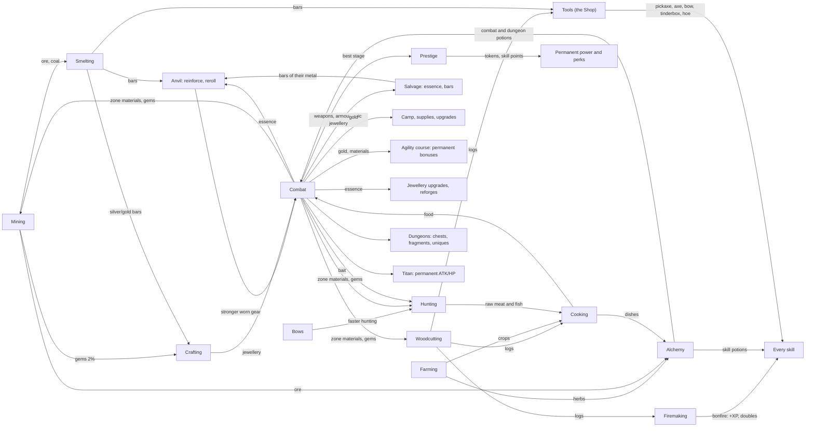

# Fantasy Idle — Game Design (v2)

This is the design the code in `src/` implements. Every number here comes from the code or from the
tools in `tools/`; if they disagree, the code is right and this file is stale. The evidence behind
each decision is in [`docs/reports/Fantasy Idle game design research.md`](reports/Fantasy%20Idle%20game%20design%20research.md)
and the six note files under `docs/research_notes/`. Nothing here is final — it is a tuned starting
point that the simulator can move.

**Contents:** [1 Vision](#1-vision-and-pillars) · [2 Core loop](#2-the-core-loop) · [3 Systems](#3-systems) ·
[4 Modifier pipeline](#4-the-modifier-pipeline) · [5 Balance](#5-balance-targets-measurements-and-knobs) ·
[6 Divergences from the research report](#6-where-this-differs-from-the-research-report) ·
[7 What was cut](#7-what-was-cut-from-the-concept) · [8 Code map](#8-code-map)

---

## 1. Vision and pillars

A browser idle RPG in the Melvor Idle / RuneScape tradition: you train gathering and production
skills, turn what you gather into gear, and use that gear to push through combat zones — then
prestige for permanent power and push further.

1. **Everything feeds something.** Every resource has at least one consumer, and combat hands
   materials back to the skills. No dead-end items (the prototype had five unused woods).
2. **Gear tiers are the spine.** Each metal tier roughly doubles power; a new tier is the big
   milestone of each stretch of play. Rarity adds flavour and affixes, never a bigger jump than a tier.
   Combat drops and dungeons are a second route to the same tiers, tuned to run beside crafting
   rather than past it.
3. **Idle is first-class, active is a bonus.** Leaving the game running (or closed, up to the
   offline cap) is the main way to progress, and leaving it alone for a minute earns the Focus bonus.
   Clicking and mini-games help — at most ~1.5× — but are never required.
4. **No permanent walls.** Every stall has at least two ways out: better gear (skills or drops), more
   combat levels (fighting), camp upgrades (gold), dungeons and the Titan, or prestige tokens.
5. **Honest numbers.** Every bonus shown in the UI goes through one modifier pipeline, so what the
   UI says is what the game does (the prototype's achievement rewards were text only).

## 2. The core loop



**Minute to minute:** one action runs at a time — a skill node, a workshop recipe, or combat
(starting one stops the other, like Melvor). **Hour to hour:** push a zone for the next tier's drops →
gather and smelt bars of the metal you wear → reinforce it at the anvil → when a boss stops you, farm
a dungeon, train a skill, or prestige. **Day to day:** prestige when a run stalls (the first one, which
teaches it, a few minutes in, after the stage-20 boss, with the guide's hand on it: §3.24), spend skill
points on perks, challenge the Titan when it wakes, claim banked daily crates,
let offline progress run overnight.

## 3. Systems

### 3.1 Skills and the XP curve

- **Curve:** the Old School RuneScape / Melvor table, `XP(L) = floor(¼ · Σ_{l=1}^{L-1} floor(l + 300·2^(l/7)))`,
  cap 99 (`src/core/xp.js`). Level 92 is the halfway point to 99 (13,034,431 XP). The prototype's
  `nextXp × 1.5` put mining 50 at 322 years of play; this puts it at ~2.5 hours.
- **Skills (11):** Mining, Woodcutting, Hunting (gathering; its river took Fishing in October 2026); Cooking, Firemaking, Alchemy
  (production); Farming (parallel, on the clock); Agility (a course you build); Smithing, Crafting
  (workshop); Combat (earned by fighting). Every skill's level matters — workshop levels gate recipes,
  farming levels open plots, agility levels open course slots, combat level gates wearing gear.
- **Nodes** (`src/data/skills.js`): base XP per action grows ~15× across a skill while intervals
  grow only 1.4–2×, so base XP/hour roughly doubles every 15 levels. At Melvor pace an action opening
  past level 20 gives less than its base (runite 62 instead of 130; `src/data/pace.js`, §5.1).
  Example (mining, base XP):

| Node | Level | Interval | XP | | Node | Level | Interval | XP |
|---|---|---|---|---|---|---|---|---|
| Copper | 1 | 3.0 s | 8 | | Mithril | 40 | 3.4 s | 48 |
| Iron | 10 | 3.0 s | 14 | | Gold | 50 | 3.6 s | 65 |
| Coal | 15 | 3.0 s | 18 | | Adamantite | 60 | 3.8 s | 88 |
| Silver | 30 | 3.2 s | 32 | | Runite | 75 | 4.2 s | 130 |

- **Interval model:** `interval = max(250 ms, base / (1 + Σ speed bonuses))` (`actionInterval`
  in `src/core/modifiers.js`). Speed bonuses add within the skill: tools, the Forager perk,
  achievements, pets, agility obstacles, weekend events, mini-game boosts and Focus, plus the
  action's own mastery (§3.20).
- **Gems:** every mining action has a 2% chance to also yield a gem of roughly the rock's tier.
- **Skill capes** (`src/data/capes.js`, Melvor's skillcapes): level 99 in a skill earns its cape
  for good. Each gives a small bonus to its own skill, counted whichever cape is worn: a second ore,
  log, catch, dish, bar, herb or potion 10% more often (a log burning twice, for firemaking),
  +10% crops a harvest, +10% quality on everything made (crafting), +3% speed in every skill
  (agility), +5% attack and defence (combat). The hero puts the new cape on as it is earned (a DCSS
  cloak in the cape's own cloth with a gold hem, `hero/capes/<skill>`); in Settings, once one is
  earned, any earned cape or the rank's cloak can be worn, with the next cape (the skill nearest 99)
  as a silhouette. Capes are worked out from the levels; the save keeps only the one worn
  (`hero.cape`). The 99 card shows the hero in it, and the chronicle's line wears it too.

### 3.2 Resources and dependencies

`src/data/resources.js` defines 74 resources, and a test checks that every one has a consumer. Who
consumes what:

| Resource | Made by | Consumed by |
|---|---|---|
| Ores, coal | Mining, zone drops | Smelting (coal: 0 / 1 / 2 / 2 / 3 per bar for copper / iron / mithril / adamant / runite); combat potions (copper, iron, mithril, adamant ore) |
| Bars | Smelting, salvaging weapons and armour | The anvil (reinforcing and rerolling worn gear), tools and bows (the Shop), jewellery (silver/gold only) |
| Gems | Mining (2%), zone drops, chests | Jewellery |
| Logs | Woodcutting, zone drops | **Cooking: one a dish, of the dish's tier** (normal up to magic), Firemaking, tool handles, bows, agility obstacles, skill potions (normal, oak, willow, maple) |
| Raw meat | Hunting (the forest), zone drops | Cooking |
| Raw fish | Hunting (the river), zone drops | Cooking |
| Crops | Farming | Cooking (one potato, or two of the others, per dish) |
| Food | Cooking (meat, fish, farm dishes) | Combat auto-eat (smallest dish that fills the gap); dungeon potions (roast rabbit, fox, boar, deer) |
| Herbs | Alchemy foraging, Farming, zone drops | Potions |
| Fishing bait | Zone drops (Marsh, Ruins, Frozen Wastes), the Shop | Hunting's river spots: one per catch, 50% chance of a second fish |
| Potions | Alchemy | Combat, dungeon and skill potions, six tiers each, a minute of their work a bottle (§3.6) |
| Essence | Combat, salvaging drops, dungeon chests, the Titan, daily crates | The anvil, jewellery upgrades and reforges |

Sell prices: `base[category] × 1.6^(tier−1)` with bases ore 3, bar 8, gem 25, log 2, raw 3, food 6,
herb 4, crop 3, potion 30. Selling is a bootstrap; combat gold is the real economy (§3.8).

### 3.3 Tools

Bought in the Shop (`src/systems/tools.js`, `src/data/workshop.js`; October 2026, the owner: tools are purchases,
not skill work, as Melvor sells its axes and rods): pickaxes, axes, tinderboxes, hoes and bows (the bow serves Hunting's
river too: the fishing rod went with Fishing), each tier for the bars and logs it always took, once the skill it serves
reaches its level (they were made in Smithing, and the bow in Crafting, at those levels of the maker's skill, for a
sliver of its XP: about 3,500 in all). The Shop's button shows ▲ when a better one can be bought. Each tier gives
**+5% speed and +5% "double" chance** to its skill (tier 5 pickaxe: +25% speed, 25% doubles). For the tinderbox the
double is a log that burns twice (XP and bonfire time); for the hoe, speed is crop growth and the double is a double
harvest. Their bars and logs are still why a gatherer visits the smithy and a smith the woods.

### 3.4 Workshop

- **Smelting:** 2.0–2.6 s per bar; smithing level 1 / 10 / 20 / 35 / 45 / 55 / 75 for copper / iron /
  silver / mithril / gold / adamant / runite; 10–90 XP per bar.
- **No forging** (§3.25): every weapon and piece of armour drops in the fight. Until early October 2026 each metal
  forged its own set; then copper alone made a first set (3 s a piece, 19 bars for all seven, 18 XP a bar), which
  measured at stage 100 in 2.5 h against 4.4 h without it (12 seeds, 150 h); the owner had it go too (21 October
  2026). Smithing is smelting and the anvil; an old order to forge is dropped when the save loads.
- **The anvil** (`src/systems/anvil.js`, from Smithing 5): reinforces a worn weapon or piece of armour
  (+5% base stats a step, to +10) and rerolls its bonuses, with bars of its metal — copper, iron,
  mithril, adamant, runite for tiers 1–5; Dragonbone takes twice the runite, Abyssal three times — and
  essence; no gold. Step n takes `ceil(bars per piece × 1.5^(n−1))` bars (a body: 5, 8, 12 … 193;
  about 113 pieces' worth for +10) and `2 × n × tier` essence, needs Smithing `5n`, and pays the bars'
  XP (as forging did: 18 / 30 / 57 / 90 / 135 a bar, paced; past +10, the +10 level's: §3.31). A reroll takes a piece's worth of bars
  and the old reforge's essence. The metal's mastery grows a second a bar and takes up to 19.6% of
  the bars off. Smelting a metal needs its level, so the bars are the real gate (runite at 75), or they
  come from salvaging gear of that metal. A piece put on in place of a reinforced one of its kind is
  refitted: it takes the levels but one, and their bars (§3.25).
- **Jewellery:** 1 silver or gold bar + 1 gem → Ring, Earring or Amulet. The gem sets the base level
  (1 / 10 / 25 / 40 / 55 / 70), the tier and the power (0.8 × the tier's power, like dropped
  jewellery); a gold setting adds 20%. Earrings add +2 and Amulets +4 levels; gold bars need crafting
  30. Silver and gold are jewellery-only metals. (Power used to average the bar and the gem, which
  made a gold-and-amethyst ring a tier-1 item stronger than mithril.)
- **Plain pieces** (the owner, 21 October 2026: "levelling up crafting feels too hard"): with no gem, a Ring,
  Earring or Amulet is the setting alone, one silver or gold bar (`PLAIN` in `src/data/workshop.js`), at the
  setting's level (+2 and +4 as above). It is as weak as an amethyst piece and teaches 70% of what a piece of the
  best gem the jeweller can set teaches (`PLAIN_XP_SHARE`, `plainXp`; a gold setting a fifth more, as it adds a
  fifth to power; the Voidstone sets no pace): 14 XP at level 1, 35 from 25, 55 from 55, 74 from 70 (gold 88).
  The Gem row starts with it, picked for a player who holds none of the gems they can set; it has its own mastery
  ("Plain jewellery"). Crafting's gems were its bottleneck: a piece takes one, from a 2% find in the mine, the
  Shop's pouches or the deep fight's diamonds (which need level 70). By estimate, a crafter who mines and smelts
  their own bars, with the pouches at 25–40 kills, reached 50 in 27–60 h, 75 in 270–510 h and 99 in about 2,000 h;
  with the pouches at 4–18 kills (§3.8) 8–12 / 90–150 / 970–1,600 h; with plain pieces and the pace below
  (§5.1) about 6 / 48 / 414 h. In the simulator (12 seeds, 150 h) the climb is unchanged (best stage 140 / 270 /
  770 at 10 / 50 / 150 h against 140 / 275 / 770) and its player's Crafting ends at 50 instead of 46.
- **The jeweller's bench** (the owner, 21 October 2026: "do jewellery bench"; `src/systems/bench.js`, from
  Crafting 5): what the anvil is to weapons and armour, for the jewellery the hero wears, on the Crafting tab's
  second step (`benchCard` in render.js; a worn piece's detail has a Bench button). Upgrading and rerolling
  bonuses take gems (`benchGem`: amethyst for tier 1 up to diamond for tier 6, twice the diamonds for tier 7, the
  Voidstone being too rare to be a price) and essence, and no gold. **Upgrading works the slot, as the anvil does**
  (§3.31; the owner, 22 October 2026: "anvil upgrades are for the item slot, bench upgrades are for the items, is this
  difference intentional" — it wasn't, and the slot won): `state.bench` holds `{ level, tier }` for Neck, Ring1,
  Ring2, Ear1 and Ear2, every ring, earring or amulet worn there has the levels, and they have no top: +5% of a
  piece's base stats a level to +10, then ×1.05 a level (`forgeMult`). Step n takes `ceil(gems × 1.5^(n−1))` gems
  of the best tier the slot has held (a ring or an earring 1, an amulet 2: 119 and 231 to +10), ×1.15 a level past
  it (a tier-7 ring: 840 diamonds to +15, 2,044 to +20, 9,316 to +30), `2 × n × tier` essence and Crafting `5n`, one
  level a step past +10 up to 99. A reroll stays the piece's: a piece's worth of gems and the anvil's rising
  essence. The work pays half the gems' Crafting XP (`BENCH_XP_SHARE`; past +10 the +10 level's; a piece made with
  them pays it all, and takes a bar and its time: at the full XP the deep fight's diamonds took the simulated hero
  to Crafting 92 in 150 hours, against 80 at half, its Smithing 77) and practice in their jewellery's mastery, whose
  levels take gems off the price. Salvage gives back nothing of it, as the work stays in the slot. Saves from the
  bench's first day (and the Inventory's gold upgrades before it): on every load a worn piece's own levels go to its
  slot and the bag's, best first, to the lowest slot of their kind, and all come off plain (`sanitizeBench`, copied
  into `meta.bench` like the forge's). In the simulator (12 seeds, 150 h) the bench by the piece left the climb as
  before (best stage 280 / 540 / 770 at 50 / 100 / 150 h against 270 / 540 / 770), and a new player's first hour too
  (stage 70 for one who watches, 60 before; 78 for one who taps, 79); by the slot, 291 / 590 / 830 against 283 / 550 /
  790 with the same seeds, a little quicker late as a better piece no longer starts from +0 (its Crafting ends lower:
  the bot no longer pays for the same levels twice).
  It is the sink the deep heroes' diamonds lacked (thousands, unusable below Crafting 70), and jewellery
  drops at every rarity with it (§3.25).
- **Crafted gear rolls Common to Rare**, forged and below Crafting 75 alike. Jewellery's best rises with
  Crafting (October 2026, §5.7): Epic possible from level 75, Legendary at 99, at the roll's own odds
  (about 3% and under 1% a piece, more with the quality bonuses; `CRAFT_RARITY_LEVELS` in `src/data/items.js`).
- **The Voidstone** (tier 7, Crafting 85): no rock holds it. The Abyss's bosses leave one at a quarter of
  their first falls from depth 5 (stage 141) on (`VOIDSTONE_DEPTH`, `VOIDSTONE_CHANCE` in
  `src/data/workshop.js`), and a Voidstone piece is cut to the deepest depth the hero has reached: its
  power grows ×1.45 a depth past 5, like the fight's drops there (`abyssDropMult`), so a crafted piece
  can stand beside what drops late, and the essence that upgrades jewellery has a piece worth it.

### 3.5 Equipment

`src/data/items.js`, generator in `src/core/formulas.js`, bag and actions in `src/systems/inventory.js`.

- **Base stats** = `5 × material power × slot multiplier × quality × variance(0.95–1.05)`.
  Material power: copper 1, iron 2.2, mithril 4.8, adamant 10.6, runite 23.4, and the two
  **drop-only tiers** Dragonbone 51 and Abyssal 112 (×2.2 per tier). Slot multipliers (ATK / DEF):
  Weapon 4/0, Shield 0/3, Body 0/3, Legs 0/2, Head 0/1.5, Gloves 0.7/0.7, Boots 0.3/1, Ring 0.8/0.8,
  Neck 1.2/1, Ear 0.6/0.6. Twelve slots (two rings, two earrings).

| Tier | Weapon ATK | Weapon + armour ATK / DEF (common) | Same, legendary | Wear at combat |
|---|---|---|---|---|
| Copper | 20 | 25 / 56 | 70 / 157 | 1 |
| Iron | 44 | 55 / 123 | 154 / 345 | 10 |
| Mithril | 96 | 120 / 269 | 336 / 753 | 25 |
| Adamant | 212 | 265 / 594 | 742 / 1,662 | 40 |
| Runite | 468 | 585 / 1,310 | 1,638 / 3,669 | 60 |
| Dragonbone (drop only) | 1,020 | 1,275 / 2,856 | 3,570 / 7,997 | 70 |
| Abyssal (drop only) | 2,240 | 2,800 / 6,272 | 7,840 / 17,562 | 80 |

- **Rarity = quality + affixes**: Common ×1.00 / 0 affixes, Uncommon ×1.20 / 1, Rare ×1.50 / 2,
  Epic ×2.00 / 3, Legendary ×2.80 / 4 (×1.08 / 1.16 / 1.25 / 1.40 until October 2026, §3.29). A
  legendary is worth about a tier (×2.2): it beats a common piece of the tier above and about matches an
  uncommon one, a rare one beats it, and **nothing reaches two tiers up** (a test enforces this); in the Abyss it
  is worth nearly three depths of the drops' ×1.45. The prototype multiplied stats by up to 64× and let
  legendary copper beat runite.
- **Affixes** (8 kinds): crit chance, crit damage, attack speed, dodge, lifesteal, gold find, combat
  XP, max HP. Values roll once and scale +8% per tier. Totals are capped in the pipeline (§4).
- **Upgrades:** +5% base stats per level to +10, then ×1.05 a level with no top (§3.31). Weapons and armour are
  reinforced at the anvil with bars and essence (§3.4), jewellery at the jeweller's bench with gems and essence
  (§3.4); neither takes gold, and both levels belong to the slot. (Jewellery was upgraded in the Inventory with
  `2 × level × tier` essence plus 4 kills' gold a level until 21 October 2026; the levels it got there went to its slot.)
- **Reroll** (reforge): an item's affixes rolled again (not its rarity or base stats) for `3 × tier × min(10,
  1 + rerolls so far)` essence and a piece's worth of its material: bars at the anvil, gems at the bench.
- **Salvage:** dropped gear → essence (`ceil(0.8 × tier × (rarity rank + 1))`), crafted gear → ~40% of
  its bars back (whole bars, fair on average). Either way, half of the essence spent upgrading the
  item comes back. A dropped weapon or piece of armour also gives bars of its metal (1 common … 5
  legendary, ×2 / ×3 past runite), and any of them three quarters of the bars reinforcing it took; a piece
  of jewellery three quarters of the gems the bench put into it (`gemsIn`).
- **Bag and lock:** 40 rolled items, and 5 more for each bag upgrade (up to 12, a bag of 100), bought with gold,
  priced like the gold shop at 150 kills' worth of gold at the best stage, ×1.5 each time (`BAG_UPGRADE`; October
  2026, the owner's ask: the bag sat at 40/40, and gold piles up), or with essence, 2,000 ×1.5 each time
  (`bagUpgradeEssence`; the owner's go, 27 October 2026: from the fourth on the gold came to more than a late run's
  whole gold, which goes at prestige, while essence piles up deep). Overflow
  auto-salvages the weakest unlocked item, but never the
  best upgrade for a slot — if nothing else can go, the bag overflows instead (a bag full of locked
  items once made every new drop, however good, salvage on arrival). An auto-salvage filter (off /
  common / uncommon / rare / weaker) salvages low drops on arrival unless they are upgrades; Weaker
  takes any drop that wouldn't improve what is worn, whatever its rarity (never a dungeon's unique: it
  is a record), and the bag's "Salvage weaker" button does the same for what it holds. Locked items are
  never sold or salvaged. Nothing is ever silently deleted.

### 3.6 Combat

`src/systems/combat.js`, formulas in `src/core/formulas.js`, stats in `src/core/modifiers.js`.

- **Timers:** player and enemy attack on independent timers (player 1.5 s base, at least 0.75 s with attack speed's +100% cap; enemy
  2.2 s at stage 1, −8 ms per stage, min 1.3 s). Large time steps resolve attacks in time order.
- **Player stats:** `ATK = (5 + gear ATK) × (1 + Σ ATK%) × token layer × camp layer`; DEF likewise
  without the unarmed 5; `max HP = (100 + 12 × (combat level − 1)) × (1 + Σ HP%) × token layer × camp layer`.
  Combat level gives +1.2% ATK and DEF per level (×2.18 at 99).
- **Damage taken:** `dmg = max(ATK_e² / (ATK_e + DEF), 10% of ATK_e, 1)`. DEF equal to the enemy's ATK
  halves damage, and no amount of DEF blocks more than 90%. The prototype subtracted DEF flat, which
  made the player immune until a boss's ×2 ATK suddenly killed them — every wall was a boss.
- **Crits:** 5% × 1.5 base; affixes add. **Dodge**, **lifesteal** from affixes/potions.
- **Lifesteal's ceiling** (`BASE.lifestealPerSecond`, 3%; the owner, October 2026: "HP regen is too
  strong, preventing the need for potions"): lifesteal heals a share of the damage a monster really took
  (a killing blow's excess heals nothing), and all of it together at most 3% of max HP a second, out of a
  room (`combat.lifestealRoom`) that fills at that pace while the hero fights and holds a swing's worth at
  most. Monsters have about twenty times the hero's health, so uncapped, 5% of lifesteal healed 1.4 times
  what a stage-140 hero took and he ate one dish in twenty minutes (700 without it); in the simulator food
  changed nothing past stage 100. Under the ceiling, easy fights still heal themselves, and at the
  frontier, where monsters take 10-17% of max HP a second, food and potions carry the hero.
- **HP:** no refill between enemies. Regen 0.1% of max HP per second in combat, 2% per second out of
  combat. **Food heals a share of max HP** (12% for a roast rabbit to 46% for a leviathan feast, Gourmet
  and Chef on top), so it never goes stale: a fixed 40-1,100 HP healed 2% of a stage-160 hero (the
  owner's report, October 2026). **Auto-eat** below 25% HP (Gourmet raises it), and just before a blow
  that would fell the hero while the run climbs (§3.28); "Auto" picks the smallest food that fills the gap.
  The line was half: with a dish healing a share, a hero at the line ate through a stock in minutes for
  little; at a quarter only, he fell at the wall from above the line with food in the bag (§3.28).
- **Potions** (`src/data/potions.js`, `src/systems/potions.js`): **three kinds, six tiers each** (the
  owner, October 2026: fewer potions, each growing, simply named; tiers V and VI on 22 October, as nothing
  opened past Alchemy 68), the tier the herb's (Guam I, Marrentill II, Tarromin III, Harralander IV, Ranarr V
  at 70, Torstol VI at 85) with a second ingredient from another skill: ore for a
  **Combat Potion** (×1.8 / 2.4 / 3 / 3.6 / 4.2 / 4.8 attack, defence and max HP on the stages, against the Titan
  and the clan boss; ×1.4-2 until the supplies, §3.28; runite ore for V, a diamond for VI), a cooked dish for a
  **Dungeon Potion** (×2 / 2.75 / 3.5 / 4.5 / 5.25 / 6 in a run only, ×1.5-2.5 before, and a
  10-60% chance of a second fragment from each chest; roast bear for V, drake for VI), logs for a **Skill Potion**
  (×1.15-1.7 the speed of every skill but Farming, +10-60% its XP; yew for V, magic logs for VI). They open at
  Alchemy 5-68, then Combat V 75, Skill V 78, Dungeon V 81, Combat VI 88, Skill VI 91, Dungeon VI 94.
  **Making against using** (the owner, 22 October 2026: "a player makes 1k combat potion in 30 minutes and that's
  pretty much enough for him for the entire game"): a bottle lasted five minutes, so an hour of brewing lasted
  135-250 hours of fighting. Now a bottle lasts **a minute**, and from tier IV a brew takes **two herbs and about
  five seconds** (3 before; the XP grew with the time). Measured with the game's code (ingredients in the bank),
  an hour of brewing is 15-17 hours of use plain, 24-28 with the tier's skill potion, 28-32 with the bonfire and
  mastery 99 too, and 5-6 when the herbs are foraged as well. The pick, the fight's dock and a skill's potion
  chip show how long the bottles carried will last, not the dose at work. Their icons are DCSS potion tiles of
  the same colour families, deeper (`LATE_TIER_POTIONS` in `tools/atlas.py`); the two herbs are a nettle and a
  starflower, and their cards are Gemini's (sheet `cards12`: a teal Ranarr by a mountain stream, a glowing Torstol on a
  ledge under the stars; for a day they showed the Guam and Harralander paintings in new hues). Sized with the simulator over 20 seeds: a bot that brews reaches
  stage 100 in 3.25 h, 120 in 5.2 h and 150 in 12.7 h, against 3.7, 6.8 and 16.7 h for one that brews none
  (the game before them: 3.1, 6.2 and 15.5 h); a weaker first tier (×1.15) left the first hours 10% slower. They multiply after every other bonus. **Each place has its
  pick** (`combat.potion`, `combat.dungeonPotion`, `workPotion`; `potionPicker` in render.js): the Combat
  and Clan tabs and the fight's dock take a combat potion, the Dungeons tab and a run's dock a dungeon
  potion or a combat potion at half its strength (`OUT_OF_PLACE`, the owner: "it should, just worse"),
  every skill tab a skill potion. A bottle lasts **a minute of its work** (five until 22 October 2026; the
  Alchemist medal: 25% longer), its clock running only while that work does, and the next is drunk at once. The clan fight
  takes the combat potion, and the server's reckoning counts it (`stableState(…, { clan: true })` in
  `src/core/power.js`: a dose running or a bottle left, which the fight drinks at its start); the boards
  and the boss's sizing stay potion-free. Old saves turn their bottles into these by the tier of their herb
  (`OLD_POTIONS` in `src/core/state.js`). The seven before them (October 2026: a bottle lasting minutes,
  multiplying, growing with Alchemy; before that +20% for 15 attacks, about 17 seconds, that nobody could
  see) raised one thing each. The three cards are Gemini's (sheet `cards11` in `tools/cards.py`: a red
  flask by a sword and shield, a purple one by a chest and its key, a green one by a pickaxe and an axe).
  **The skill potion is a chip** in a skill's header (the owner: the row took too much room, and its Brew
  tile went): the bottle at work with its tier and time left, a tap opening a small tray of the bottles
  carried (`skillPotionChip` in render.js). Like a slot it is there once Alchemy is open, an empty flask
  when none is picked and "None carried" in its tray when there are none (the owner looked for it by the
  mastery while his hero carried none).
- **Clicks and combo** (cut in October 2026, the owner: fast clicking took his hero to stage 100 with no
  prestige, food or potion, and cleared dungeons in seconds that the Dungeons tab called out of reach):
  a strike lands a tenth of an attack (`BALANCE.combat.manualHitMult`), at most one every 250 ms
  (`strikeGapMs`, four a second), and adds a combo stack (diminishing, max 10, decays after 1.5 s
  without one). Each stack is +1% damage on every hit. It was half, then a fifth, of an attack, up to
  eight a second, with +3% a stack to 30 and, at 10, 20 and 30 stacks, +10% crit, +15% lifesteal and
  echo strikes. The game has no anti-cheat, so an auto-clicker is assumed: a minute's damage at every
  interval between clicks from 1 ms to 2 s (each click also ends Focus) against an idle hero's was
  ×6.7 at best before, ×1.54 now (×1.5 for anything faster than four a second, ×1.2 at two a second,
  ×1.08 at one), and no healing. A player who taps through the first hour stands at stage 70 (110
  before) against 50 for one who only watches (`node tools/opening.mjs 60 3`).
  **A new monster drops in** (October 2026, the owner's question whether an auto-clicker's farming was fair;
  `BALANCE.combat.dropInMs`, `droppingIn` in `src/systems/combat.js`): for 0.42 s after it comes, the length of its
  entrance on screen, no strike reaches it (the click does nothing and spends no quarter second); the hero's own swings,
  750 ms apart at the quickest, never wait for it, so idle play, the offline replay, the Titan and the clan boss are
  as they were. The damage cap above held in real fights, but where a strike fells a monster the next stood ready at
  once, so the clicks set the pace: on an easy stage or dungeon an auto-clicker felled 3.7–4.8 times an idle hero's
  monsters (dungeon clears 3.9–4.4 times, so fragments), a hand at two clicks a second half that. The genre waits
  between monsters (Melvor Idle three seconds after a kill, upgrades taking it to a quarter; Clicker Heroes about half
  one). Measured on simulated heroes at best stages 60–500, farming and in two dungeons each, five rules: the drop-in
  leaves an auto-clicker 1.9–2.4 times an idle hero there (a new hero's slower swing, 2.9), the same as a hand at two
  clicks a second; real fights, gold, pushing and the first hour unchanged. A whole swing's wait after a strike's kill
  (1.5–1.6 times) and longer drop-ins (0.6 s and up) left hands behind the macro, and in a hard dungeon a hand at two
  clicks a second below an idle hero (6.5 clears against 9); 0.42 s is the longest a hand at two a second keeps up with.
- **The chain** (21 October 2026, gone the same day): five numbered points over the fight every 20–30 s, struck in
  order within 4 s for two kills' gold and, within 2 s, a 15-s rally of +20% attack speed, the owner's answer to
  macros clicking the monster. It got in the strikes' way (its points covered the monster) and was moved off it;
  then the owner's auto-clicker froze the game in Chrome while it ran, and the owner decided that a mouse macro is
  fair play ("there is nothing wrong with using mouse macro"), which left the chain no purpose. In tests in real
  Chrome with a stage-450 hero under ~2,000 clicks a second, the builds with the chain stalled now and then as a
  chain came (once for over 5 s, once with no frames drawn for seconds), the one before it never. It was removed, and
  a save's leftovers of it (`combat.chain`, `chainAt`, `rallyUntil`) go as it loads. Since then a click inside the
  strike's quarter second costs nothing at all (`strike` in main.js runs no tick of the game for it), the touch-screen
  tip handlers ask `matchMedia` once instead of on every click, and the sound's unlock asks a suspended context to
  resume once at a time instead of on every press.
- **Boss timer:** a boss must fall within **30 seconds of fighting** (the clock only runs while you
  fight, so it works the same offline). If it holds out you step back one stage and farm there for
  60 seconds before it is retried automatically; beating it sooner (by stepping forward) ends the
  wait. Bosses are the DPS checks; regular stages test survival.
- **Death** retreats to the start of the zone (from a zone's first stage, one stage back, never onto
  the previous zone's boss) with half HP. The hero then rests at the campfire until his health is full
  (about 25 s) and goes back into the fight by himself (`combat.recovering`); "Stay at camp", starting
  work or entering the fight at once call that off. Offline replay does the same, so a fall early in a
  long absence costs a rest, not the absence.
- **Retreat lets the monster catch its breath** (the owner's call, 16 October 2026: resting at camp healed the
  hero but not the boss, so retreating, resting and coming back beat bosses he couldn't beat in one go and pushed
  him past where he belonged). Leaving a fight at the stages (Retreat, work, a prestige) makes the monster whole
  again, a boss's clock starts over and a pack starts whole, as after a fall (`catchBreath`,
  `src/systems/combat.js`); entering the fight checks it too, for a save stored mid-retreat. The same monster, so
  leaving and coming back doesn't roll a gilded one again.
- **Death:** retreat to the start of the zone (a boss death sends you back 9 stages), HP set to 50%,
  a rest to full health, then the fight goes on from there. **Farm mode** ("Stay on this stage") keeps you on the current stage; the map, and the stones on
  the scene's stage path, take you back to any stage reached this run.
- **Boss payouts:** a boss pays its bonus (gold ×3, XP ×5, its loot table) only on its **first fall
  in a run** — the kill that moves you on — and the Titan always does. A boss you farm after beating
  it, and every dungeon boss, pays like the regular monsters its health is worth (a ×3-health boss
  rolls regular loot three times). Parking on a boss is never the best farm.
- **Modes:** the same loop runs the stage ladder, a dungeon run or a Titan fight
  (`state.combat.mode` = `stages` / `dungeon` / `titan`).

### 3.7 Zones, enemies and loot

`src/data/zones.js`. Ten authored zones of ten stages; stage 10 of each is a boss. After stage 100
the Abyss goes on with a depth counter and steeper growth, in named strata.

- **The Abyss's strata** (`src/data/strata.js`; `robust-and-fun/B_longterm_motivation.md` §8.2 item 1):
  past stage 100 the Abyss was one place, the same four monsters and boss for hundreds of stages. It is
  now a stack of sixteen layers of 25 stages from stage 101: The Abyss (its own monsters), the Weeping
  Dark, the Bone Reaches, the Ember Pits, the Frozen Void, the Writhing Maze, the Shadow Court, the Storm
  Wastes, the Starless Sea, the Iron Halls, the Hollow Throne, the Burning Choir, the Glass Garden, the
  Rotting Deep, the Spatial Rift and Pandemonium (476 on, without end). Each has four monsters and a boss
  of its own from the DCSS tiles (75 new bestiary pages, 183 kinds in all), a card the first time it is
  reached (its line, its boss as a silhouette), its name over the fight and on the world map's Abyss
  pin, and its own painting behind its fight and on its card (`assets/paint/<stratum id>.webp`, painted
  with Gemini in October 2026; until then each wore a colour grade over the Abyss's). The zone keeps the
  id `abyss` and everything else the Abyss had: its scaling, loot, depth and gear tiers.

- **Enemy HP** = `25 × 1.075^(s−1)` to stage 100 (×2.06 per zone), then ×1.085 per stage, and past
  stage 400 ×1.065 (`deepFrom`, `deepHpGrowth`: the deep Abyss eased, §5.6).
  **Enemy ATK** = `5 × 1.065^(s−1)`, then ×1.075, past 400 ×1.057. **Bosses** ×3 HP, ×1.6 ATK; from
  stage 60 the ladder's bosses move evenly to ×7 HP and ×1 ATK by stage 150 (`stageBoss`, §3.29), and
  pay for ×3 HP as before. The dungeons' bosses and the Titan keep ×3 and ×1.6 under their own multiples.
- **Two tiers per zone.** `tier` is the zone's richness (material quantities, gems, boss essence);
  `gearTier` is the tier of gear that drops there. Prestige carries players through the early zones
  far faster than they can smith (stage 60 in ~1.5 h, mithril in ~2–4 h), so the gear tier follows
  the crafting timeline instead of the zone number: each zone drops about the tier a typical player
  crafts when they first get there, and a drop one tier up is the lucky case. The drop-only tiers
  live in the Abyss: Dragonbone from depth 3 (stage 121), Abyssal from depth 5 (stage 141).
- **Deeper Abyss drops keep pace.** Past depth 5 there is no new tier, so every further depth makes
  dropped gear **×1.45** stronger (`BALANCE.abyss.dropGrowth`; an item level, the card shows
  "depth N"). Monsters grow ×2.26 per depth (×1.085 per stage), so gear alone never quite keeps up
  and the climb slows as it goes, but it never stops: without this, every simulated player stalled
  for good at the stage 200 boss.

| Stage | Zone | Enemy | HP | ATK | Gold (first fall) | Combat XP | Loot tier | Tokens if best |
|---|---|---|---|---|---|---|---|---|
| 1 | Sunlit Meadow | Slime | 25 | 5 | 6 | 3 | 1 | 0 |
| 10 | Sunlit Meadow | Goblin Chieftain (boss) | 143 | 14 | 107 | 168 | 1 | 1 |
| 30 | Glimmering Caves | Crystal Golem (boss) | 610 | 49 | 458 | 533 | 2 | 11 |
| 50 | Stormy Highlands | Orc Warlord (boss) | 2,594 | 175 | 1,946 | 912 | 2 | 27 |
| 70 | Ember Volcano | Ember Drake (boss) | 11,021 | 616 | 8,266 | 1,299 | 3 | 46 |
| 90 | Skyreach Spire | Thunder Roc (boss) | 46,818 | 2,173 | 35,114 | 1,691 | 4 | 70 |
| 100 | The Abyss | Abyss Warlord (boss) | 96,493 | 4,080 | 72,370 | 1,888 | 4 | 82 |
| 120 | The Abyss, depth 2 | Abyss Warlord (boss) | 493,280 | 17,332 | 369,960 | 2,287 | 5 | 110 |
| 130 | The Weeping Dark, depth 3 | Dread Lich (boss) | 1,115,299 | 35,723 | 836,474 | 2,487 | 6 | 125 |
| 150 | The Weeping Dark, depth 5 | Dread Lich (boss) | 5,701,460 | 151,748 | 4,276,095 | 2,891 | 7 | 156 |

- **Rewards per kill:** gold `0.25 × enemy max HP` (a boss's first fall ×3 on top of its ×3 HP);
  combat XP `3 × stage^1.05` (first fall ×5); a zone material with 35% chance (first-fall bosses
  always), quantity `1 + floor(zone tier / 3)`; a gem 3% (first-fall bosses 30%); essence 10% for 1–2
  (first-fall bosses 3–6 × zone tier / 2).
- **Gear drops:** 0.2% of regular kills, 50% of a boss's first fall. Tier = the zone's gear tier −1
  (25%) / same (65%) / +1 (10%) (`DROP_TIER_OFFSETS`, §3.25). Rarity weights common → legendary:
  regular 50 / 35 / 12 / 2.5 / 0.5, boss 20 / 40 / 28 / 9 / 3, with epic and legendary
  ×(1 + 0.15 × (tier − 1)). An AFK fighter sees a few drops an hour and salvages most of them.
- **Zone loot tables** feed the skills at the zone's tier — e.g. the Forest drops iron ore, coal,
  oak logs and raw fox; the Volcano drops runite ore, yew logs and raw bear. Combat is never a dead end.
- **Gilded monsters:** one regular monster of the stage ladder in 150 comes gilded (never a boss, a
  dungeon elite or the Titan): the same fight for 5× gold, 2× XP, a gem and 3–6 × zone tier / 2
  essence for certain. The scene turns it gold with a banner and a chime as it arrives; it counts
  toward its kind in the bestiary and in `stats.gildedKills`, and the Gold Rush medal (25 of them)
  makes them come 50% more often (`gildedMult`). About +3% gold over a run: in the simulator the
  runs with and without them land within each other's spread (DESIGN §5.2 is chaotic past 50 h).

### 3.8 Economy: gold, camp and supplies

- **Sources:** combat kills (dominant), the Titan, selling materials and items, daily crates.
- **Sinks:** camp upgrades, jewellery upgrades and reforges (with essence), supplies, farming seeds,
  and agility obstacles and their upgrades. Since the camp's prices follow the best stage, the camp is
  the big one: about half of all gold earned in 150 simulated hours (45–53%; 70–85% for a player with
  Auto on), against about 1% before, when 95–99% of gold was lost at prestige unspent.
- **Camp** (`src/data/camp.js`) — the run-scoped power layer, bought with gold and **reset on
  prestige**: Whetstone +5% ATK, Armour Rack +5% DEF, Hearth +4% HP per level, multiplicative, without end
  (×3.39 / ×3.39 / ×2.67 at level 25; besides those 25, endless levels in plain gold, the cheaper bought first, §3.30).
  The 25 cost `max(base, 0.008 × a kill's gold at the best stage) × 1.36^i` (base 20 / 20 / 15): the base price until
  about best stage 85, so a new player's camp is as it was (§3.24); past that, a whole upgrade costs about 50 kills at the best stage,
  so each run buys its camp again as it nears its best (the owner's choice 3a). At 0.016 the camp took
  80% of gold but each late run took 0.7 h instead of 0.5 h. It turns each new run into a climb and
  gives gold a job.
- **Supplies** (gold shop): coal, logs, herbs, rabbits, bait and the Essence Cache (10 essence for 30
  kills — the open-ended late-game sink) priced in kills at the furthest stage the run has reached (4–6
  kills a pack; a boss stage prices like its regular monsters), never under 1.25 × what they sell back for
  (`supplyPrice`, `SUPPLY_RESALE_MARGIN`), so the price follows income and can never be resold at a profit
  (the prototype's Coal Wagon printed +350 gold per purchase). Until 21 October 2026 they were priced at the
  best stage ever, at 25–40 kills (essence 80): the owner found 25 coal, mined in seconds, cost minutes of
  fighting, and dearer still early in a run, whose kills pay a fraction of the best stage's. Once Crafting is open,
  a **gem pouch** too: ten Amethysts (50 kills) to Crafting 9, ten Topaz (80) from 10 to 24, ten
  Sapphires (120; since October 2026 8, 12 and 18 at the run's stage) from 25 on, one at a time as the level climbs (`craft` on the entry, `goldShopOpen`).
  The fight's and the mine's gems follow their zone's or rock's tier, so a deep hero found only gems a
  new crafter cannot cut; the pouches keep Crafting's first forty levels open at any point of the game,
  as Melvor's shop sells Leather (`docs/research_notes/crafting-gems.md`). The higher gems are never sold.
- **Gold resets on prestige.** It is run currency, like Clicker Heroes' gold.

### 3.9 Prestige, tokens, skill points and perks

`src/systems/prestige.js`, `src/data/perks.js`.

- **Available** from stage 10, once the run has lasted **10 minutes** (otherwise a run that starts
  past stage 10 could be prestiged again at once, forever); the first prestige, which teaches the loop
  and comes once, need not wait (§3.24). Resets: stage (restart at 10% of your all-time best), gold,
  camp.
  Keeps: skills and mastery, gear, tools, materials, essence, achievements, tokens, perks, pets,
  dungeon clears and fragments, Titans defeated, the agility course and farming plots.
- **Tokens** = `floor(((best stage this run − 5) / 5)^1.5)`: 1 at stage 10, 27 at 50, 82 at 100,
  156 at 150. Tokens are **held, never spent**; each is a permanent +0.4% ATK and DEF and +0.2% HP
  (0.5% and 0.25% until the records came), in its own multiplicative layer, so the layer is
  `1 + 0.004 × tokens × records`. The Eternity achievement adds +10% tokens.
- **Records** (`recordsOf` in `src/core/modifiers.js`; the owner's choice 2, from
  `incremental-math.md` A1.3): every 25 stages of all-time best and each of the eight dungeon uniques found
  (once, whatever its tier; held until 22 October 2026) is a record, a dungeon Seal two (§3.11), and so is each Trial
  tier cleared (§3.26); each multiplies what the tokens give by 1.05 (stage 300 with five uniques: ×2.29). Held
  tokens alone make each late run add less (+0.8% a run after the hundredth); a record lifts the whole
  stock. A new 25-stage record is a card ("Your tokens are ×1.05 stronger"), and a unique's card says
  so too, once the player has tokens; the token chip's tip counts them. **Every 50 levels of the skills
  together** (every skill but Combat, `skillLevelsTotal`, `BASE.recordSkillLevels`) is a record as well,
  with its own card (`skillRecord`), and the Hall's Records shows how far the next is (the owner, October
  2026: players fought and never trained, as no skill level reached the fight; it came with lifesteal's
  ceiling, so the simulator's skilling player keeps his pace and one who never trains falls behind).
- **Auto** (`autoPrestigeIn`, `tickAutoPrestige`): after 5 prestiges, or 48 hours after the first one
  (`prestige.firstAt`), whichever comes first, the dock's Prestige button gets an Auto switch beside it
  (`settings.autoPrestige`, off until turned on). It took 20 prestiges until the check-in research
  found that a player who visits three times a day earned it on day 8, his runs sitting at their wall
  for 86–97% of his time away, and one who visits once a day never
  (`docs/research_notes/robust-and-fun/C_sessions_players.md`). With it on, a run that has spent 10
  minutes climbing without a new best stage (`combat.stallMs`, which runs only while the hero fights or
  rests to fight on), and may be prestiged, is: the hero
  walks straight into the next run's first fight, and a note says what it paid (a new rank still gets
  its card). Only while climbing the stage ladder: never while staying on a stage, in a dungeon or at
  the Titan, resting or working. Offline replay runs the same check, and the welcome-back summary
  counts the prestiges. The switch shows when it will go ("in 7m"). With Auto off, the Prestige button
  glows once a run may be prestiged and has stalled that long (`prestigeReady`); before Auto is earned,
  three minutes without a new best stage (`BALANCE.prestige.readyStallMs`: an early run's stages come in
  seconds, so three minutes is a wall), and the first prestige at once (§3.24).
- **Skill points:** 1 per prestige for a run that reached at least half your all-time best, plus 1
  for every 25 stages of all-time best (each threshold pays once). **A perk level costs more as the
  perk climbs** (`perkLevelCost`; October 2026, the owner: at one point a level, every perk was soon
  full): levels 1-5 cost 1 point, 6-10 cost 2, and so on, never more than 10, and Paragon's price never
  stops rising (`costCap`), so a 50-level perk costs 275, the 212 levels outside Paragon 874, and Paragon's
  200 levels 4,100 (levels bought before kept what they cost). Deeper since 15 October 2026 (the owner:
  with Auto on a player fills the perks too early; the simulator's player with Auto earns 60-80 points a
  day, and filled every perk but Paragon in about five days with the old 25-level perks at most 5 points a
  level; now about two weeks, and Paragon months). Spent on eight perks: Knight (+4% ATK, 50 levels),
  Warlord (+4% HP, 50), Rogue (+3% attack speed, 20), Forager (+3% skill speed, 30), Scholar (+3% XP, 30),
  Endurance (+2 h offline cap, 6), Gourmet (+5% auto-eat threshold and food healing, 6), Fortune (+5% gold
  and drop chance, 20), and Paragon (+1% ATK, DEF and HP, 200 levels) so skill points always have a use
  once the others are full. **The perk reset** (the owner, the same day; `PERK_RESET`, `resetPerks` in
  `core/state.js`): every save from before it lost its perk levels once and got them back as skill points to
  spend at today's prices, the more of two counts (the levels owned plus the points left, a level having cost
  one point until 13 October; or all the prestiges and the best stage have paid, as a level's price was never
  kept). The owner's save: 87 levels and 4 points became 91 points; the tester's 194 levels, 199.
- **Why polynomial tokens:** see §6.1 — an exponential token formula ran away in the simulator.
- **A name** (`state.hero.name`, set in Settings, sanitised by `heroName` in `src/core/text.js`:
  one line of plain text, up to 20 characters; empty is "You") shows over the hero in the fight and
  on his panel in the Inventory.
- **Ranks** (`src/data/ranks.js`): prestiges earn the hero a title worn as his cloak's colour, the
  gear rarities' colours and then past them: Recruit (red), Adventurer (1, green), Veteran (5, blue),
  Champion (15, purple), Hero (40, gold), Legend (100, white), Mythic (250, black), at about 1, 5,
  12, 30, 60 and 150 hours of play in the simulator; then Exalted (500, a dragon-scale cloak), Eternal
  (1,000, cyan) and Immortal (2,000, void purple), added for the late game's long stretches
  (`robust-and-fun/B_longterm_motivation.md` §8.2: with Auto near hours 240, 500 and 930). No bonus: a
  mark of how far he has come. A rank
  badge sits by the hero in the Inventory and on the Prestige panel (with the count to the next), and
  a prestige that earns one is a card of its own with the hero in his new cloak.
- **Looks and name** (`src/data/looks.js`, `state.hero`): the player names the hero and picks one of
  ten looks (DCSS player bases and hairstyles: men and women of three skin tones, an elf pair, a
  dwarf), on the title card (arrows beside the hero) or in Settings (portraits). Six more are earned
  with medals (an orc for Dungeon Delver, a gold djinni for Gold Rush, a gargoyle for Titan Slayer,
  a mummy for Monster Scholar, a demonspawn for Abyss Walker, a ghoul for the secret Unbroken): the
  medal's card shows the hero in it, and Settings shows the next one as a silhouette naming its medal
  (never a secret one's). Cosmetic only; the gear and the rank's cloak go on top. Text addresses
  "your hero", never a pronoun.

### 3.10 Hunting's river, Firemaking, Farming and Agility

- **Hunting's river** (`src/data/skills.js`, nodes with `fish: true`; Fishing until October 2026, when
  the owner made the two one skill: they were mirror images, seven spots each at 1, 15 … 90 and dishes a
  point apart): seven spots from Shrimp Shallows (1) to Leviathan Deep (90), a row of the Hunting tab
  beside the forest's game, opening after five dishes (disclosure `river`). Fish cook into food a little
  better than meat of their level. Each catch there uses one **bait** if you have any, for a 50% chance of
  a second fish; bait drops in the wetter zones and the Shop sells tins. The bow is the whole skill's tool;
  at a river spot the stage shows the river, the rod and Finn, and the mini-game is the angler's
  (`MINIGAME_CONFIG.river`). Old saves keep the higher of the two levels, both masteries and counts, and
  the better of bow and rod (`foldFishingIntoHunting` in `src/core/state.js`); Finn is Hunting's second
  pet, and the Angler medal Hunting 50.
- **Firemaking:** burns logs for XP (the log sink) and feeds the **bonfire**: each log adds 15 s × its
  tier, up to an hour, on the wall clock. While it burns every skill — combat included — earns +5% XP,
  rising to +10% at Firemaking 99, and every gathering and production action may make two: 5% at
  Firemaking 1, 20% at 99 (`bonfireDouble`; the owner, October 2026: XP alone went unnoticed).
  Tinderboxes (Smithing) are its tool.
- **Farming** (`src/data/farming.js`, `src/systems/farming.js`) — the first **parallel** skill: up to
  six plots (opening at levels 1, 1, 15, 30, 50, 70) grow on the wall clock while any other action runs
  and while the game is closed. Planting is a click and buys the seed at a flat price (25 gold for
  potatoes to 4,000 for starfruit); harvesting pays the crop and XP per unit. Eight crops: four herbs
  for Alchemy and potatoes, cabbages, pumpkins and starfruit for four new dishes. Harvest XP per
  plot-hour roughly doubles every ~15 levels. "Harvest ready & replant" replants the same crops.
  Hoes (Smithing) speed growth and can double a harvest.
- **Agility** (`src/data/agility.js`, `src/systems/agility.js`): a course of six slots (opening at
  levels 1, 10, 25, 40, 55, 70), each holding one of three obstacles. Building costs a fixed amount of
  gold — 20k, 200k, 1.5M, 10M, 60M, 300M, about an hour of one run's income where the slot opens — plus
  logs and bars (the last slot also 5 diamonds). Every obstacle is a **permanent bonus that survives
  prestige** (gathering or production speed, ATK/DEF/HP, gold, drops, crit, offline hours, workshop
  speed, farming yield, XP, attack speed, dodge, all-skill speed). Obstacles upgrade to **level 5**:
  each level adds the bonus again, costs the slot's price × 2^level and needs 7 more agility levels.
  Running the course is an action that takes as long as its obstacles together and pays their XP
  (+25% per obstacle level). Replacing an obstacle has no refund.

### 3.11 Dungeons and unique items

`src/data/dungeons.js`, `src/systems/dungeon.js`. A dungeon is an authored gauntlet: elite
monsters (×1.4 HP, ×1.15 ATK) and a boss (×1.5 on top of the boss multipliers) with a **60-second
timer**, fought with the gear you walk in with — gear is locked inside, and the run starts at full
health. Dying, leaving or running out of time loses the run; clearing it (the boss falls) is a win
that opens a chest. **After the first clear of a visit the hero waits at the open chest** (it stands in
the boss's place on the scene) and a dialog offers **Keep going** (the run starts again after every
clear, until the hero leaves; an ∞ marks it) or **End the dungeon** (back to the stage the hero left,
fighting on). A player watching goes back to the Dungeons tab when a visit is over: after End the
dungeon, Leave dungeon, or a lost run (a fall or the boss's timer, once the defeat has shown); map
Travel, the Titan and a prestige keep the fight on screen, and a player on another tab stays there. With no answer in `DUNGEON_CHOICE_MS` (30 s), or with nobody there while away, the hero
keeps going, so idle time is never lost; leaving while waiting is not a failure, as the run is won.
There is no standing repeat switch any more (old saves drop `combat.autoRepeat`). During a run the
fight's dock leads with a panel of its own: the clears, the unique's fragments (Assemble once there are
50), the choice while waiting with its countdown, and the run's orders (Leave dungeon, Map).

| Dungeon | Opens at | Like stages | Boss (HP / ATK) | Chest loot tier | Unique |
|---|---|---|---|---|---|
| Goblin Warren | 20 | 25–31 | 984 / 52 | 2 | Goblin King's Crown (Head, tier 2) |
| Crystal Depths | 50 | 55–62 | 9,269 / 372 | 3 | Crystal Heart (Amulet, tier 3) |
| Orc Stronghold | 80 | 85–93 | 87,243 / 2,625 | 4 | Warlord's Cleaver (Weapon, tier 4) |
| Dragon's Lair | 120 | 125–135 | 2,515,540 / 51,285 | 6 | Dragonheart Plate (Body, tier 6) |
| Void Citadel | 160 | 165–175 | 65,738,659 / 925,413 | 7 | Void King's Aegis (Shield, tier 7) |
| Abyssal Maw | 210 | 215–227 | 4,572,642,334 / 39,771,879 | 7 (at depth 12) | Starless Band (Ring, tier 7) |
| Sunken Necropolis | 240 | 245–257 | 52,851,750,768 / 348,201,024 | 7 (at depth 15) | Drowned King's Greaves (Legs, tier 7) |
| The Hellforge | 275 | 280–292 | 918,544,529,014 / 4,376,493,552 | 7 (at depth 18) | Hellforged Gauntlets (Gloves, tier 7) |

- **Worn, a unique shows on the hero:** the Goblin King's Crown as a gold crown, the Warlord's
  Cleaver as an executioner's axe, the Dragonheart Plate as red dragon armour and the Void King's
  Aegis as a violet tower shield (`hero/<layer>_unique/<id>` in the atlas; the Crystal Heart, an
  amulet, has no layer of its own).
- **Placement:** each dungeon sits about where a typical player reaches its unique's tier by crafting,
  so a unique rewards farming a little early instead of skipping tiers.
- **Monsters pay like ladder monsters of the same health** (the boss too, §3.6), so the chest is the
  whole bonus: one **fragment** (3% chance of three), `0.5 × zone tier` essence, three material
  picks from the zone, a gem 50% of the time, and boss-quality gear of the chest tier 4% of the time,
  as strong as the dungeon's depth in the Abyss makes it (like its monsters' own drops: ×2.1 in the
  Citadel, ×13.5 in the Maw; before, chest gear ignored the depth and was weaker than the drops beside
  it). A strong hero clears a run in well under a minute, so a chest is never a jackpot.
- **Uniques:** 50 fragments assemble the dungeon's unique; a chest holds it outright 0.2% of the time.
  Uniques are Legendary with fixed affixes (the Crown: +15% gold find, +4% crit, +5% HP) and 10% more
  base power than their tier — the best piece of that tier, not a tier skip. The first copy starts
  locked; a spare (assembled or found again) arrives unlocked, to salvage for essence. Uniques cannot
  be reforged.
- **The Sunken Necropolis and the Hellforge** (October 2026; `robust-and-fun/B_longterm_motivation.md`
  §8.2 item 2): two more past the Maw, a drowned city of the dead (twelve undead, the Sunken King) and a
  forge of the damned (twelve constructs, the Obsidian Colossus), from DCSS tiles. Their uniques (Legs
  and Gloves, the slots no unique had) are records too. Each has its painting (`necropolis`, `hellforge`;
  they borrowed the Drowned Ruins' and the Dragon's Lair's under a colour grade until October 2026);
  their map pins sit by the drowned ruins' lake and at the volcano's foot. With Auto they open at about
  56 and 74 hours of play.
- **The Abyssal Maw** is the long game's dungeon: it opens at stage 210, about 83 hours into the
  simulator's play at Melvor pace, and its careful player first clears it at about 177: twelve horrors of the deep Abyss and the Devourer. Its unique, the Starless Band, is
  worth its affixes rather than its power, since gear dropped that deep is dozens of times stronger
  than any tier's base: +8% prestige tokens, +15% combat XP, +10% drop chance, +30% crit damage. Its
  painting (`maw`) is a cavern like an open maw: black stone fangs at the edges, motes of dying light
  and a ring of cold teal light around the chasm, over a ledge of cracked basalt.
- **Clear milestones** per dungeon, permanent: 25 clears +2% ATK and DEF, 100 clears +3% gold and drop
  chance, 250 clears +3% max HP; earned again at each tier (below), a sealed tier's counting in full.
- **A unique is a record once found** (the owner, 22 October 2026: "Dungeon buffs ties to the items from dungeons
  which causes them to occupy space in the inventory permanently"): `state.uniques` notes every unique found
  (`goblin_crown`, `goblin_crown@2` for the second tier's), kept in `meta.uniques` too, and `recordsOf` counts
  them, held or not, each of the eight once whatever its tier; a save from before notes the ones it carries. So a
  unique can be salvaged or handed in.
- **Tiers and the Seal** (the same message: "Dungeons end too early. All 8 of them 250 rounds, a player can do
  around stage 300 while the game goes into thousands"; the owner's idea, made concrete: research in the
  conversation of 22 October, Melvor's Strongholds, Diablo's Greater Rifts, WoW's Mythic+). When every dungeon
  has `DUNGEON_TIER_CLEARS` (250) clears at the open tier and the hero holds that tier's eight uniques, a row at
  the top of the Dungeons tab (`sealRow` in render.js: the tier's numeral and rule, the eight uniques lit while
  held and ringed by their dungeon's clears, from the first dungeon at 250: disclosure `dungeon_seal`) offers
  **Make the Seal** (`sealDungeons` in `src/systems/dungeon.js`): the eight are handed in (a spare in the bag
  before a worn one, whose slot is left empty), the Seal takes no bag slot and is worth `SEAL_RECORDS` (2)
  records, and the next tier opens (`state.dungeonTier`, kept in `meta.dungeonTier` too): the same eight
  `DUNGEON_TIER_STAGES` (300) stages deeper, their gates too (`dungeonAt`), named with a numeral (Goblin Warren
  II), their paintings turned to new hues (`dungeonTierInfo(tier).hue`, on the cards and in the fight), one rule
  for their monsters in turn (`DUNGEON_RULES`: Swift, attacks a quarter faster; Stout, half again the health;
  Savage, a third harder; Relentless, the boss's clock 40 s), chests of Abyssal gear at their depth, uniques of
  their own (Abyssal, ×1.1 a tier's gear grown with the depth of their dungeon's boss, the same bonuses:
  `makeUnique`; gear and the next Seal's price, not second records), and clears and fragments from nothing.
  Fragments carried over made the next tier's eight at once,
  each as strong as gear 200 stages past the hero: the simulated one leapt from stage 330 to 490 in two hours,
  so they start again. A run keeps its tier (`combat.dungeon.tier`). The simulated player farms toward the Seal
  (a dungeon is worth a visit while it owes clears or its unique; it seals when it can) and seals tier I at about
  52 hours. Over 12 seeds, with the bench by the slot and Alchemy's minute-long doses (§3.6), its best stage is 309 /
  460 / 640 / 820 / 890 at 50 / 75 / 100 / 125 / 150 hours, against 291 / 420 / 590 / 720 / 830 with the bench alone
  and 283 / 404 / 550 / 690 / 790 for the game before: dungeons that never end are worth farming all the way (stage
  150 at 9.2 h against 11.1, the milestones and the chests), and each Seal is two records. With each tier's eight
  counting as eight more records it was 940 at 150 hours; with four records a Seal, 920. A new player's first hour
  is unchanged (stage 70 for one who watches, 78 for one who taps).
- **Readiness:** the Dungeons tab estimates the boss fight (time to kill vs the timer, and how long you
  last without food), coloured green / amber / red.

### 3.12 The Titan

Once an hour (from stage 20) you may challenge the Titan: a **60-second damage race** at full health
against a boss with ten times a boss's health. Unused attempts bank, up to three (`TITAN_BANK`), so a
player back after a few hours has them waiting. Titan level L fights like stage `10 × (L + 1)` for the
first 20 (level 1: 2,963 HP; level 10: 2.2 M HP), then 5 stages apart (`titanStage`). A win is
permanent: **+2% ATK and max HP** per Titan defeated (+1% from the 21st: `titanBonusUnits`), plus
`8 × L` essence, 30 kills of gold at your best stage and two gems; the next Titan is stronger. A loss
pays essence for the share of health you took off. The late
line was halved when the long-term research found Titans falling once in 30–220 hours late in the
game: they now fall twice as often for the same power over the same stretch of the road.

**After the fight the hero goes back to what he was doing** when he challenged it (`titan.before`,
`resumeAfterTitan` in `src/systems/dungeon.js`), however it ended (a win, the clock, a fall, Give up):
his work picks up where it stopped, a rest stays a rest (after a fall at the stages, the rest that ends
in the fight), and a fight goes on at the stages; a fall in the Titan's fight rests and fights on only
if he was fighting before it. New work started mid-fight ends it and replaces what he was doing. Until
October 2026 he was left fighting at the stages whatever he had been doing. A Titan fight never survives
a reload: the hero is back at what he was doing (a save from before `titan.before` fights on at the
stages, as it did). A tab put to sleep mid-fight replays the fight, then his work for the rest of the
time. On screen the fight keeps the screen for its last banner (1.5 s, frozen on that moment: the win and what it
left, "Time is up" with the share dealt, or the fall), then goes back to the tab the Titan was challenged from;
Give up goes back at once (`backFromTitan` in `src/main.js`).

### 3.13 Pets and the collection

`src/data/pets.js`. One pet per skill (twelve, combat included), found at random while training and
kept forever. Melvor's formula: the chance per action is `action seconds × skill level / 25,000,000`, so the
expected wait is about `25,000,000 / level` seconds of training (~70 h at level 99) whatever the
action's speed; combat rolls once per kill as a 4-second action and farming once per harvest as an
action as long as the crop's growing time. Each pet gives +3% speed to its skill (Fang, the combat
pet: +3% ATK and DEF; Sprout, the farming pet: +3% growth speed). The Achievements tab lists pets and uniques as a collection.
A pet found also keeps the hero company: Fang (or, until he comes, the first pet found) stands at his
feet in the fight, and each skill's pet beside him on that skill's stage, bobbing gently.

**The bestiary** (`src/data/bestiary.js`). Every kind of monster (183, `BESTIARY_SIZE`: five for each
of the ten zones and the fifteen strata below the Abyss's first, then the dungeons' own, each listed
once where it is first met; the Titans are left out, as each falls
only once) has a portrait in the Achievements tab's Bestiary (beside the Medals, the Collection and the
hero's Records: lifetime numbers as big figures, and the chronicle, the hero's firsts with their
dates, noted from the game's events as they happen, offline too, by `src/systems/chronicle.js`), with how many have fallen and up to three
stars: one at 10 defeats, two at 100, three at 1,000 (549 in all). Defeats are counted per kind in
`stats.killsByMonster` (dungeon elites count too), and the stars total is `stats.bestiaryStars`,
recounted from the table when a save loads; old saves start with an empty table and see the kinds
they have stood beside as met. A star is a toast with the monster's sprite. Two medals ride on it:
Naturalist (25 stars, +5% gold) and Monster Scholar (100 stars, +5% drop chance). The places reached
are shown, the next as silhouettes; a kind not met yet is a black shape and "???".

### 3.14 Achievements, unlocks and the daily crate

- **Achievements** (`src/data/achievements.js`): 45 (42 open, 3 secret), each with a named reward applied through the
  pipeline **plus** +1% ATK, DEF and skill speed per achievement (Antimatter Dimensions / Cookie
  Clicker "milk" pattern). Dungeon clears, Titans, pets, uniques, the new skills, a finished agility
  course and mastery (500 and 2,500 levels, a first 99) have their own. A test checks that every bonus in the data is well-formed (the Forager perk
  once had a malformed bonus and did nothing). Three are **secret** (`secret: true`): not shown nor counted in the Hall
  until earned (pat your pet 25 times, open a great crate, get back up after 100 falls), so finding
  one is a small surprise; the Hall's count is of the medals shown. Medals for systems met late (the
  first Ascension, twenty Trial tiers) wait, like the secret ones, until the player has met them
  (`after`, a disclosure id). Six medals mark the deep game (October 2026): stages 200, 300, 400 and 500
  (the bottoms of the Ember Pits, the Storm Wastes, the Burning Choir and Pandemonium's first 25), a
  first Ascension (+10% tokens) and twenty Trial tiers.
- **The gear codex** (`state.codex`, `CODEX_TYPES` in `src/data/items.js`): a page per kind of gear
  and tier, 70 in all, filled by `addItem` whenever a piece arrives (kept or salvaged on landing);
  shown in the Hall's Collection. The Armourer medal comes at 40 pages.
- **Completion** (`src/systems/completion.js`; `robust-and-fun/B_longterm_motivation.md` §8.2 item 8):
  how much of the game is done, as one figure with a decimal on the Hall's banner ("7.8% done"), and its
  parts as bars at the top of Records. Eleven parts of equal weight, each its share done: skill levels to
  99, mastery to 99 on every action, the bestiary's stars, the codex, the medals, the pets, the uniques,
  the first 20 Titans, the Trials' tiers, the agility course's slots and the festival cloaks. The whole
  counts every part from the start, so it only rises (a unique the player unlocks and sells away is the
  one thing that lowers it); Records names only the parts the player has met. A cape for 100% is still
  to come.
- **Unlocks** (`src/data/unlocks.js`): tabs appear when a predicate on the state becomes true, each
  when it is of use (`docs/research_notes/robust-and-fun/A_onboarding_pacing.md` §5.4) — by work:
  Smithing after mining 5 times (ore that monsters drop no longer opens it for a hero who only
  fights), Woodcutting after the first bar, Cooking after the first hunt (Hunting's river after 5 dishes),
  Firemaking after 20 logs, Farming after 10 Alchemy actions or Cooking 15, Crafting with the first
  silver (or gold) bar once a gem has been found (its first piece can be made at once; it used to
  open hours before anything in it could be made); by climbing (`pace`), in this order when several
  wait: Hunting at stage 5, Prestige once the stage-20 boss falls (the first prestige needs no
  ten-minute run, so it can be used the moment it opens: §3.24), Dungeons at 20, Alchemy at 15, the
  Shop when the first boss falls, the Hall
  with five medals, the Clan after the first prestige, the weekend Events after it when a festival is
  on or due within a day, and Agility at stage 35 with Woodcutting and Smithing open and half of the
  first obstacle's gold in hand. **One at a time, a breather apart** (§3.24): a place reached by
  climbing waits until the attended time since the last place opened reaches `PLACE_GAPS_MS` (1.5,
  3, 4, 5, 7, 10, 15, 20, then 30 minutes); a place earned by work opens within 90 s
  (`WORK_GAP_MS`), never closer than that to another; none opens during a boss fight. Attended time
  (`meta.attendedMs`) runs while the page is in view or the player gave input in the last three
  minutes: a tab left in the background, and time away, do not count. A return after ten minutes or
  more opens the one place that was waiting, and the welcome-back report names it. Each goal
  carries a `task` in a few words and the `tab` where the work happens; the sidebar's Next card
  shows it with its progress, and a place earned but waiting as "On its way", its bar filling with the
  breather. On a local development host `?dev=1` unlocks all (Settings then shows a switch to turn it
  off); on any other host it is ignored and cleaned from the save, and the server flags an upload that
  carries it or a forced event.
- **Daily crates** (`src/systems/daily.js`): one ripens every 20 hours and **up to three wait for
  you**, so a missed day costs nothing; no streaks. A crate holds 40 kills of gold at your best stage,
  12 materials and a gem from that zone, and `3 × zone tier` essence. Every seventh crate opened
  (a count, not consecutive days, so still no streak to lose) is a **great crate**: three times the
  gold, twice the rest, and a gem of the next tier besides (+29% over a week). The crate's dialog
  shows seven little crates for the way there.
- **No suggestions.** There used to be an advisor: notes on what to do next (forge this, plant
  that, the Titan is awake, spend your skill points), first as a quest board and then as a strip
  under the scene. It was taken out to keep the screen simple. What is ready shows where it lives
  instead: the next unlock in the sidebar's Next card, a ▲ on gear that beats what you wear (and
  a one-tap Equip in the fight), a lit camp upgrade you can afford, a glowing Perks button when
  there are skill points, a crate button when one is ripe, and a badge on a place's tab in the
  sidebar when something waits there: the count of ripe plots on Farming, a gold "!" on Dungeons
  when the Titan is awake and the hero can beat him (a badge always on would say nothing) or a
  unique can be assembled, a ▲ on Inventory for better gear. The browser tab's title says what the
  hero is doing ("Ember Volcano stage 64", "Copper Vein"), with a ★ when a crate or crops wait.

### 3.15 Active play: mini-games and Focus

- **Mini-games** (`src/systems/minigame.js`) are **opportunities**, not a job: while you train a
  gathering or production skill, a first chance appears after 45–90 seconds and then one every 3–6
  minutes, each open for **a minute** (it was 20 s, and a player on another tab missed it: Cookie Clicker's
  upgrades take its golden cookie from 13 s to 52 s, RuneScape's Forestry counts anyone who chopped in the last 3
  minutes), with a chime Settings can turn off, on one clock for all the skills (with a clock each, a player who
  switched skills found a chance waiting in each and kept a boost up nearly all the time). A challenge left open
  by a reload counts as missed.
  A win makes the skill **×2 as fast for 45 seconds** (each win of a streak 5 s longer, up to 65 s): the
  ×2 multiplies after every other speed bonus, the working card glows with a ×2 and its bar shines, and
  the boost's end says what it added (half of what the skill made meanwhile: "+14 copper ore, +340 XP").
  Playing a mini-game doesn't end Focus. Until October 2026 a win gave +35% (+5% a streak win, up to +55%)
  for 90 s, added to the other speed bonuses, and the clicks cost Focus's +15% for a minute: at a stage-160
  hero's speeds a win came to about 12% more work over those 90 s, and players didn't feel it (the owner's
  report). A miss costs nothing but the streak.
- **Every game can be lost, but is easy; a Perfect centre; finds** (the owner's go-ahead, 17 October 2026, after
  the research: a game whose outcome is certain soon feels like a chore — Costikyan, Juul, Cook). Mining,
  Woodcutting and Hunting tap a sweeping marker in a zone whose middle two fifths (`PERFECT_SHARE`) are **Perfect**,
  as Dead by Daylight's great skill checks sit inside its good ones. Cooking and Firemaking hold the heat (it falls
  by itself, each tap +0.1) and Alchemy the stabiliser (a slider) inside a **slowly moving band** for 2.5 s
  (`HOLD_MS`; out of it the dish cools at half the pace), as Stardew Valley's fishing bar holds the fish; a game held
  without slipping once in is Perfect, and a game nobody plays is lost (a hidden tab's long step counts 0.25 s). A
  Perfect adds 15 s to the boost and always brings a **find**; an ordinary win one time in three
  (`BALANCE.minigame`): a gem of the vein's tier, a bird's nest of the tree's logs (one in four with a gem), game, a
  tin of 10 bait at a river spot, dishes or potions made with nothing spent, or bonfire time as if the logs had
  burnt; about 20 s of the skill's work, with a pop and a sound. The speed stays the guaranteed part (a modest
  random extra pleases more than a fixed reward or a swingy one, Kao 2012); no variant items (Melvor had to let
  players switch off "perfect" food). **Better resources play harder** — a narrower zone and a faster marker, a
  narrower band that moves more and a heat that falls faster, `minigameDifficulty` by the resource's level — and
  every level above the resource widens it again (as Stardew's bar grows with the fishing level). Simulated players
  who watch win all the time and score Perfects 70% of the time at copper, 25–45% at runite; a casual one 90%
  and seldom Perfect; one who doesn't play loses. A fully attentive player gains roughly +25–30% on skills, plus
  the finds.
- **Focus** (Clicker Heroes' idle ancients): after **60 seconds without a click or key press** the hero
  settles in — +15% skill speed and +15% attack speed until the next input. It also applies to offline
  progress, so leaving the game alone is never strictly worse than clicking.

### 3.16 Offline progress

`src/systems/offline.js`. On load (and when a tab wakes after five minutes or more) the game replays
the time away with **the same code as online play**, silently: skill actions complete one by one
(consuming inputs, stopping when they run out, and going on from the progress the action had), workshop
actions forge real items, and combat — including a dungeon run on repeat — is replayed in 1-second
steps with food, potions, the boss timer and death (after a fall the hero rests to full health and
fights on, as online, so one early fall doesn't waste the absence). The replay runs on the clock, so
the bonfire burns out, Focus starts, a mini-game boost ends and a weekend event begins or ends when it
really did, and a medal, a level, a cape or a pet earned on the way counts from that moment (the
medals' cards show once the player is back). Farming plots run on timestamps and need no replay. A
tab that ticks less often (browsers slow hidden tabs to once a minute) is plain play, simulated in
5-second steps; a kill hands the rest of a step to the next monster, and a step is split where a
boss's clock runs out, so the step size never changes the result. Capped at
**24 hours** (+2 h per Endurance perk, up to 36 h, and +1 h per level of the Zipline, up to +5 h at
level 5; it was 12 until the check-in research found a once-a-day player losing 11 hours a day to it,
`docs/research_notes/robust-and-fun/C_sessions_players.md`). Absences under a minute
are ignored. The "Welcome back" summary lists gains, materials used, levels, dungeon clears, pets,
plots ready to harvest, how often the hero fell and got up, and why work stopped early. Since the
check-in research it leads with where the run stopped ("climbed to stage 57, then held there for
1h 44m", with a bar of climbing against time at the wall) and a row of what is ready, each a tap away:
a prestige with its payout (when Auto is off), crates to open, the Titan awake, skill points, better
gear to wear; a place that waited opens on the return and is named there too.

### 3.17 Saves, cloud and the API

- **Local save** (`src/core/save.js`): `localStorage['fantasyIdle.save.v2']`, versioned
  (`state.version = 3`), autosaved every 15 s and when the tab is hidden or closed. Prototype saves
  (`fantasyIdleSaveLocal`) are migrated on first load, known by their own marks (per-skill levels,
  their flags, their resource ids), not by a version number a damaged save may have lost; their gear
  is made again in this game by type, metal or gem and rarity, read from the name. v2 saves gain the
  banked daily crate. Item ids stay below 2^31 (an id near 2^53 used to spin the loader forever), and
  timers pointing further ahead than they ever can (a clock that was set ahead, a device that
  disagrees) are brought back within reach on load, as they are when the clock is turned back while
  playing.
  Broken records (an unknown dungeon, a missing Titan or pet record) load as defaults. Loading also
  takes each value only if it has the default's type, drops keys the game doesn't know (including
  `__proto__`, which could otherwise reach every object on the page or the server), and rebuilds
  every item from the game's own tables. A save edited by hand can't inject markup or break the save:
  keys that would throw when read as text or a number (an own `toString` or `valueOf`) are dropped
  before anything reads it, numbers are kept within what play can reach (stages up to 10,000, past which
  a monster's health is no number; laurels, Titans, tokens, affixes), and the counts the medals read are
  rebuilt from what the save holds. A save that can't be read is kept as a copy and the game starts
  fresh, pointing a guest at the backups (signed in, the server's save loads); it never falls back to the
  prototype's save behind it.
- **One tab plays:** a tab opened later takes the save over; the older one stops and says so, with "Play
  here" (two tabs saved their own games over each other's, and whichever wrote last won).
- **Backups:** three rotating automatic backups (every 10 minutes) plus one on load, one before each
  prestige the player makes (Auto's take none) and one before a hard reset, restorable from Settings by a
  guest, with the guest's game put aside when an account signed in (below). Signed in, Settings shows none:
  restoring one rolled the server's game back.
- **No export or import** (removed in October 2026, the owner's ask: everything through the server's save,
  as in any online game). Copy-and-paste save strings let a game be rolled back or carried between
  accounts.
- **An account, or a guest's game** on the live site: a sign-in stands in front of the game until the
  player signs in or presses **Play as guest** (an account was required from 13 October 2026, the owner's
  call; guest play since the 22nd, after a tester played by taking the sign-in off the page, the owner:
  "opening account should restart the process, not move it"). A guest's game stays in that browser, with its
  backups; clans and leaderboards need an account. **An account never takes a guest's game** (`startsOver`
  in `src/core/save.js`): signing in with a game in the page that has anything done in it (a kill, a point of
  XP), or any guest's, puts that game aside as a backup ("Before signing in", kept through a reset or a log
  out) and starts a fresh one before the sync, so the account plays its server's game, or a new account
  uploads the fresh one and shows the title card. Kept: the account's own game, signed in again after its 30
  days (the game this device last saw on that account's server, noted by its `createdAt` with the server's
  time), and a new hero with nothing done (named on the title card while the account was made). The server's
  first-upload check (`firstPeaks`) then never meets a guest's progress on a new account. A new player sees
  the title card first; its Begin asks for an account or a guest, and the first fight starts once one is
  chosen. Inside another site's frame (`EMBEDDED` in `src/main.js`: galaxy.click shows its games in one, and
  its players shy away from sign-up forms) a new player is a guest at once and Begin goes straight into the
  fight; the account is one click away (the Guest pill), and the frame's game is stored apart from the site's
  own (browsers keep a framed page's storage per host site). Logging out uploads the game first and leaves a fresh one in the browser, so an account registered
  there next starts its own game, not a copy of the last one. A local development host (`DEV_HOST` in
  `src/main.js`: the tools, the screenshots) plays as a guest without asking.
- **Sign-up by email** (the owner, 18 October 2026, once the game had its own server): an account is made with a
  username, an email and a password, and plays once a 6-digit code mailed there is entered in the same dialog (a code,
  not a link: on a phone a link opens in another browser than the game's). The same kind of code sets a new password
  ("Forgot your password?"). A code lives 15 minutes and takes 5 tries, and is kept only as a hash keyed with the
  server's secret; a new one can go once a minute, 5 an hour to an account and 20 an hour from an address; one account
  an email, whatever its case, and no address is shown to another player. A login with the right password but the
  address not confirmed answers 409 with `pending` (a 403 is the game's word for a session gone, which would sign the
  player out). Mail goes through Resend from noreply@fantasyidle.com (`api/mail.js`, README "The server").
- **Cloud:** signing in uses the real API (`api/index.js`):
  bcrypt passwords, JWTs that expire after 30 days, validated usernames and passwords, 1 MB body cap,
  version-checked saves. The client uploads **every minute while the page is open**, in the background
  too, and once on leaving the page (hidden or closed: a keepalive request, under the 64 KB browsers allow),
  unless it uploaded seconds before; the local save stays current every 15 s. That is since the game moved to
  its own server (October 2026, the owner: "traffic is not an issue"). On Vercel's free Neon database, which
  slept after five minutes without a request and could be awake 100 compute-hours a month, it was every ten
  minutes and only while the player was around (the page in view and touched in the last ten minutes), and a
  page in the background uploaded nothing. **Signed in, the server's save
  is the game** (October 2026, the owner's ask: "just like any normal online game"; `syncChoice` in
  `src/core/save.js`). At load, at sign-in and after a long time hidden the game looks at the server's save
  and plays it; nobody is asked. This device's game is kept (and uploaded) only when it is the server's
  carried on: the server's save unchanged since this device last saw it (its time, noted on the device for
  each account) and the same game, or this game holding everything the server's has (the upload a page
  sends as it closes, or one whose answer was lost). So a guest's game gives way to an account's save, and
  another device's newer play wins over this one's whatever the play time. It used to compare play time
  with the save times and ask ("Two saves found") when they disagreed: the upload a page sends as it
  closes is a second newer than its last local save, so a reload asked about two copies of one game.
  Nothing is uploaded until a sync has chosen; a sync that fails is tried again, never followed by a blind
  upload. Each upload names the server's save the game last saw, and the server refuses one made over
  another device's newer save (409): the game then looks again and carries on from the server's save (a
  toast says so), unless it already holds all that save has.
  The boot's welcome-back waits for the sync, so it never acts on the other game. A hard reset while
  signed in resets the cloud save too. On a static host without the API, sign-in says cloud saves are
  unavailable instead of failing.
- **Server secret:** `JWT_SECRET` must be set outside local development (`NODE_ENV=development`);
  tokens are HS256 only. The owner sets it and adds the database (README "The API"); neither is in the
  repository. `GET /api/health` says whether the database, the secret and the game's stat code are
  there (booleans only).
- **Time away is measured on the server's clock** for cloud saves: `/api/load` returns the time of the
  last upload and the server's current time, and the client replays exactly that gap, so changing the
  device clock doesn't buy offline progress.
- **Plausibility flags:** every ranked number (best stage, Titans, dungeon clears, total XP, tokens),
  read from the server's own reading of the save (the migrated save the boards use, so a raw field
  can't be dressed up), may grow only as fast as play could in the real time since that number's
  highest value so far, and none may pass a ceiling no save reaches (checked on the first upload too).
  The best stage may grow by its depth (`honestClimb` in `src/core/power.js`): three times the fastest
  climb of the simulator's players, as a burst plus a rate an hour from the earlier best. First fitted to
  166 runs of 150 to 400 hours; from stage 200 refitted in October 2026 to 378 runs of 150 to 1,000
  hours, because the game had grown faster (Auto, Ascension, the records, the deep Abyss eased) and an
  honest hero came within 1.3 times of the allowance at stage 300: now from stage 200 about 70 stages in
  an hour and 240 in a day, from 300 about 210 in a day, past 400 160 and past 500 95, each at least
  three times the fastest honest climb from there. It was 30 plus 60 an hour at any depth, which let a
  late save gain 1,470 stages in a day against an honest 20 to 70. Refitted again for the endless climb (§3.30)
  to 28 runs of 600 to 1,200 hours with Auto, 21 on varied plans: past 400 a run fresh from a prestige gains up
  to 150 stages in an hour and 240 in a day, so rows now reach 1,500 (`CLIMB`), none lower than before; the
  worst honest climb in any window of 1 to 48 hours, measured from the hour before, comes to 43% of the
  allowance. With the Trials' endless ladders and Pacts (§3.26) and a bot that enters a Trial every fifth
  prestige as a player would, the climb came to 76% of it from stage 300 over 43 hours (430 stages) and 72%
  from 1,200 (28 runs of 400 hours, every window of 1 to 48 hours from the best at its start); the rates an hour
  went up from 150 to 1,500 (the bursts stayed: a day's climb was what came close), and the worst is now 49%.
  The ceilings went up with it: best stage 6,000 (3,000), tokens 10^12 (10^9). Trial tiers
  a save's best stage could not have cleared are flagged (§3.26). Attack beyond what the best stage allows (`plausibleAttackDamage` in `src/core/power.js`: felling a
  boss 40 stages further in 5 s; honest play stays under ~12% of it) is flagged too. Going back, as
  when restoring a backup, and coming forward again are not flagged. Nothing is rejected (the save
  belongs to the player), but flagged accounts are left out of leaderboards and of clan boss sizing
  for 30 days. **Before the game opened to strangers** (the owner's beta, 22 October 2026) two holes were closed:
  each upload was measured only from the one before, so the burst allowed at each could be chained a minute apart
  (a made-up save reached stage 6,000 in 22 minutes, never flagged), and an account's first upload was checked
  against the ceilings alone. Now each number is also measured from where the day's window began (`peaks.day`,
  begun again a day later from the highest value then), so a burst counts once a day, and a first upload from
  nothing at the moment the account began to play (its address confirmed: `firstPeaks`). Replayed through it, 54
  simulated honest runs of 150 to 1,000 hours, the faster variants of the dungeon tiers among them, upload by the
  hour without a single flag. A determined cheat can still fake a save that grows plausibly; that is the limit of a
  client-side game, until the online side decides fights and rewards itself.
- **Rate limits:** ten tries for a name from one address (a hundred from all of them, fifty from an
  address) in 15 minutes and logins wait; an address makes at most three accounts a day (ten an hour until the
  beta: each is a mail out of the day's hundred, and a pile of fresh accounts is how a clan is carried). Each try is
  counted before the password is checked, in one statement, so a burst of parallel tries can't slip past,
  and wrong guesses from elsewhere don't lock a player out at home. A name is one account whatever its
  case. A name with no account still costs a bcrypt check, so the time a guess takes doesn't tell
  whether the name exists. A token is checked against its account's name, and a body that isn't JSON
  gets a JSON answer. A business-rule refusal
  answers 409, never 403, which the client reads as a lost session.

### 3.18 Clans and leaderboards

`api/index.js` (routes), `api/store.js` (all SQL), `src/core/power.js` (the numbers). Everything is
asynchronous and **every number another player sees is computed on the server from the stored save**
with the game's own stat code; the client never submits damage or scores.

- **Clans** of up to 20, with a name, tag, description and "looking for" line; the longest-serving
  member takes over if the owner leaves, and the last one out closes the clan. Members hold numbered
  places (unique per clan), so parallel joins can't overfill a clan. The owner can remove a member.
- **The weekly clan boss** (ISO weeks, UTC), **counted in the clan's attacks** (October 2026, the owner's clan
  banner; before, its health was 12 × the members' combined attack, so a clan of one kept pace with a full clan, and
  past stage ~330 the 4×10¹⁵ health and 10¹⁴-an-attack ceilings that kept it in BIGINT made every attack alike).
  Level 1 takes `CLAN_BOSS.first` (20) attacks of an average member, kept in thousandths of an attack
  (`clanBossHealth`, `src/data/social.js`). **An attack counts how it was fought times the member's clan power**
  (26 October 2026, the owner's report that only the strongest member's attacks moved it; the owner asked that a
  member's depth still count): the fight's damage over the hero's own plain attack at his best (the same 30-s fight
  without a strike or a potion, so 1 for a plain fight, more with strikes and the potion, less for one given up),
  times `clanPowerOf` (`CLAN_POWER`): the square root of the member's best stage over the clan's geometric mean, held
  between ½ and 2, scaled so the members who count (not flagged, played (uploaded) this past week) average exactly 1.
  Four times as deep counts twice as much, and nobody more than four times another; the best stage is the measure
  because it never falls at a prestige and the plausibility checks watch it, where damage is 10¹³ apart between
  stages 200 and 1,000. Mean 1 makes a clan whose members all fight fell the boss as fast whoever is strong
  (`tools/clanpower.mjs` checks it on 20,000 random clans); a clan carried by one member slows down, which is the
  point. Before, an attack counted its damage over the members' average plain attack, sized at each UTC day's first
  look: heroes 10⁶ apart left one member all the damage (weak members, lowering the average, made it worse), and a
  hero who grew through the day counted that growth too, so the week before, most levels fell to one attack. Members
  joining or leaving change the powers, never the boss's health in attacks. Each member sees the boss in their own
  figures: its thousandths times their best attack over their power, so their hits take as much of its bar as they
  count (`asDamage`); the board shows each member's share of the week's attacks. A boss made at another size for its
  level (level 1 was 30) moves to its size once, the same share of it left and its week's attacks scaled with it
  (`rescaleBoss`). The ten lands' rulers take turns as the boss, one an ISO week (`clanBossFor`, `src/data/social.js`).
- **Levels: one kill a day** (October 2026, the owner's design, after a boss sized on Monday morning fell
  that evening: heroes grew 5 to 80 times in that day). A felled boss stays down until the next UTC
  midnight, then comes back as the next level with a fifth more health (`CLAN_BOSS.growth`, ×1.2; it was ×2, and
  level 7 had 64 times level 1's health, beyond any clan: the owner asked that twenty members who use all their
  attacks fell all seven), full; at most seven a week. One not felled stays as it is, damage and all; Monday brings
  a new boss at level 1. Measured attacks (`clanAttackFromSave` on a saved hero): striking ×1.33 a plain attack, and
  with strikes Combat Potion I ×2.4, IV ×4.8, VI ×6.4. With every member's three attacks a day and the unused kept
  (`tools/clanpower.mjs`): just watching, 20 members fell all seven, 10 six, 5 three, 2 one, one alone one; striking,
  10 seven, 5 four, 2 two; with Potion IV, 3 seven, 2 five, alone three; with VI, 2 six, alone four. Level 1 was 30
  until 26 October 2026: counted by the fight alone, an attack no longer carries the hero's growth through the day,
  and the owner asked that the boss still fall about as fast (the two active clans had felled six levels each the week
  before; at 20, two members who strike with Potion V or VI and use their attacks fell six).
- **The clan banner** (the owner: clearing the clan's bosses should make its members stronger, every member, fought
  or not, so a clan sees to its fighters; no crate). Each level felled raises it, `CLAN_BANNER` ×1.5, 1.75 … 3 at
  seven, on attack, defence and health, until the week ends; Monday starts it again. Every save, load, clan look and
  attack answer says it (`bannerOf`, `api/index.js`), the game keeps it in the save (`clanBanner`, as long as its week
  lasts: `clanBannerMult`, `src/core/modifiers.js`), a card says each rise, and it shows under the hero and on the
  boss's panel. The boards and the clan boss's own fight leave it out (`stableState`). Simulated (7 players with Auto,
  600 h): a clan felling one level a week climbs to 1,870 against 1,800 alone, five a week 1,900. No essence or
  diamonds for kills, last hits, taking part or the top three any more; rewards from before still claim.
- **The week's ranking** (October 2026, the owner's eighth boss, with the divisions it was refined into; `ENDLESS`,
  `CLAN_DIVISIONS` in `src/data/social.js`, `computeRanking` and `endlessAttack` in `api/index.js`). Clans are put
  in divisions by the levels of the week's boss they felled (Champion at 7, Gold 5–6, Silver 3–4, Bronze below), so
  clans of a like size and activity meet (the boss is counted in each clan's own attacks, so kills mostly count who
  shows up), and ranked inside each by **the Endless Hydra**: an eighth boss whose heads grow back, so it never falls,
  awake for every clan from Saturday 00:00 UTC to the Monday reset (a 48-hour window, every time zone gets a go; the
  owner's first idea, after the seventh kill, would have opened on Sunday at the earliest, one kill a day). Each member
  who was in the clan when the week began (`joined_at` before Monday 00:00 UTC: no joining a strong clan for its
  weekend) has two fights at it, apart from the three a day, and the deepest counts. A fight is any clan attack, reckoned
  the same way from the stored hero (`clanAttackFromSave`, capped at twice what the best stage allows), and counted as
  **depth** (`endlessDepth`): how many levels of a stack each ×1.2 tougher than the last the damage breaks through, the
  first as tough as a new hero's whole fight (100), so a hero 1,000 times stronger goes about 38 levels deeper, not 1,000
  times as far (a deep hero reaches about 220). A clan's score is its best 15 members' depths together
  (`clanDepthScore`); accounts flagged for impossible numbers are left out. The standings are worked out on request
  (at most once a minute, cleared by an Endless attack or a kill); a finished week's are kept once (`clan_rankings`,
  with the clan's name and tag) by the first look after it ends, and give its top three of each division a crown for
  the next week, on the clan list and the clan's header, and the clan its best week (its record). On screen
  (`endlessPanel`, `clanStandings` in `src/ui/render.js`): the Hydra's card under the week's boss (asleep, when it
  wakes; awake, the fight and two pips), the clan's division, place and depth, the week's table by division and last
  week's crowns; the fight is the clan fight's (`state.clanFight.endless`, its damage adding up in `dealt`), its bar
  the level being broken through and its label the depth (`src/ui/scene.js`), in the Abyss. Rewards are for show only:
  the banner already pays for the kills, and power for a rank would make forging a save worth it.
- **An attack is a fight on screen** (October 2026, the owner's ask after the Tap Titans 2 research;
  `src/systems/clanfight.js`): "Fight the boss" uploads the save and takes the hero into a 30-second fight
  (`CLAN_ATTACK_SECONDS`) against the week's boss, full screen on the Clan tab like the Titan's on the Dungeons tab (`state.combat.mode` =
  `clan`; §3.23), on the boss's land's painting. The hero attacks by himself; the boss never hits back. It drops
  its guard for 2 s every 6 s from the 4th (`CLAN_GUARD`): it glows, "Strike now!" pops, and only then do
  strikes land (2.5 × a fight's strike) and build the combo; at other times they glance off, so an
  auto-clicker gets no more than a player clicking fast in the openings: ×1.3 to ×1.6 of a hero who only
  watches, by attack speed (`test/clanfight.test.mjs`). No cards, raid levels or dust: the hero is the
  deck (Tap Titans 2's raid system was weighed and left out). The page keeps only the strike times; when
  the fight ends (time, Give up, or the boss's health running out on screen) they wait in
  `state.clanResult`, across a reload, until sent. **The server reckons the attack** from the stored save
  and those times (`clanAttackFromSave`, `src/core/power.js`: strikes cleaned to the game's quarter-second
  rule inside the fight, expected values, no dice, Focus or timed boosts; the combat potion picked counts,
  §3.6), **raised to the hero's best of the past week**: his best plain attack of each of the last seven UTC days is
  kept with his stored numbers (`attackDays`, from every save not flagged), and the attack is the fight times the
  best over his plain attack now (`clanAttackScale`, never below 1). The camp is packed up at every prestige and
  grows through a run, so the same hero hit seven times harder at a run's end than just after a prestige: the owner
  saw another member deal 24 times their damage (October 2026) and asked that the time of an attack not matter. The fight on
  screen hits as hard (the Clan tab's `attackScale`, `state.clanFight.scale`). Never more than twice what the save's best stage allows; a forged list deals no more than a perfect player. **An account flagged
  for impossible numbers deals at most 1% of the boss's health an attack** (`FLAGGED_ATTACK_SHARE`,
  October 2026: a forged save had felled a boss with one attack of the 100T ceiling). The owner chose a
  cap over bans. A cap of a seventh of the boss for every attack came first; it hid honest players' real
  damage, so it was lifted the same day and only flagged accounts are held back (the answer says `capped`,
  the card why). A card shows the damage and the member's place in the clan that week; a felled boss
  shows which level comes back and when ("Level 2 in 5h 12m", or a new boss on Monday). A fight in progress never survives a reload (the
  attack isn't spent); the hero goes back to what he was doing (`src/systems/resume.js`, shared with the
  Titan). Attacks: **three a day, banked up to six** (`clan_charges`, refilled each UTC day and spent
  atomically, so parallel requests can't spend one twice); an attack given back if the boss was already
  down. Each fight carries its own mark (the time it ended): sent again after an answer was lost, it is
  answered again as it was, and no second attack is spent. Until October 2026 a felled boss and the
  week's end paid essence and diamonds (100 essence and 2 diamonds to everyone who fought, 50 and a diamond
  for the last hit, 50 for taking part, 100 / 60 / 30 and a diamond for the top three); the clan banner took
  their place (above, the owner: no crate, even for the top three). Rewards paid before still claim from the
  Clan tab (`/api/rewards`), once each.
- **Leaderboards** are opt-in with a plain-language consent line: username plus best stage, total
  level, Titans or dungeon clears, all time or this week (from where each player stood when the week
  began: the numbers stored before their first upload of the week, not that upload's).
  The numbers are computed once per upload and stored, so a board is one query.
- **Polling:** the Clan tab refreshes on opening and then at most once a minute, only while it is open
  and in view.
- **Gifts:** the owner gives a player gold, essence or diamonds with one row in `rewards` (kind `gift`,
  README "The API"). The save and load answers say how many wait; the game claims them all through
  `/api/gifts/claim`, adds them (gift gold is this run's and not counted as earned) and shows a card.
  Gifts never appear in the clan's reward list, so a page still running older code can't claim one.
  A Discord invite link appears if `DISCORD_INVITE` (`src/data/social.js`) is set — there is no in-game
  chat.

### 3.19 Weekend events

`src/data/events.js` (content), `src/systems/events.js` (logic). A template for timed content that
needs no server: the schedule is the UTC calendar, so events run offline too.

- **Festival cloaks** (October 2026, the long-term research's calendar drips): each event sells its own
  cloak, first in its shop, for 120 tokens (two days' worth): a look only, the cloak dyed the event's
  colour with a silver hem where a skill cape's is gold (`FESTIVAL_CLOAKS` in `src/data/capes.js`, drawn
  by `tools/resource_art.py`). Owned for good (`events.cloaks`), worn from Settings like a cape, and a
  part of the Hall's completion; one missed comes back with its event six weeks on. The card shows
  the hero in it. For a late player, for whom essence and diamonds matter little, it is the weekend's
  big moment.

- **When:** every weekend, Friday 00:00 to Monday 00:00 UTC. Six events rotate week by week:
  **Harvest Festival** (+25% farming yield, +15% cooking and hunting speed), **Titan's Fury** (+20%
  combat XP and gold, +10% drop chance), **Miner's Rush** (+20% gathering speed, +10% XP in every
  skill), **Guild Fair** (+20% smithing, crafting and firemaking speed, +5% crafted quality) and
  **Gold Fever** (gilded monsters three times as often, +10% gold from combat), and from 16 October
  2026 **Lucky Paws** (pets three times as likely, +10% XP in every skill). An event joins as a new era
  of the rotation (`ROTATION_ERAS` in `src/systems/events.js`) starting at a future weekend, so no
  weekend already run changes its event and nobody loses a running event's milestones. The
  bonuses go through the modifier pipeline like any other source. None of them touch combat stats, so
  clan damage is the same during an event.
- **Festival Tokens:** every 20 skill actions or kills earn one (a harvest counts as 5), up to 60 a
  day (UTC), so a weekend pays at most 180 and nobody has to grind past a normal session. Tokens keep
  between events.
- **Milestones** per event, paid automatically: 50 tokens → 100 essence, 100 → 200 essence and a
  diamond, 150 → 300 essence and two diamonds.
- **The event shop** (open only while an event runs): 60 essence for 20 tokens, a diamond for 40,
  100 bait for 10, ten of each herb for 15, ten runite bars for 60.
- **Adding an event** is one entry in `EVENTS` (id, name, icon, colour, description, `mods`). For
  testing on a local host, `?dev=1&event=<id>` runs one immediately; it is never kept in the save.

### 3.20 Mastery

`src/data/mastery.js` (rules and numbers), `src/systems/mastery.js`. Melvor's mastery without the
pool: every repeatable action has its own level from 1 to 99, earned by doing it.

- **Which actions:** every gathering, cooking, firemaking and alchemy node, every smelting recipe, and
  one mastery per metal for forging and per gem for jewellery (all pieces of that metal or gem share
  it) — 79 in all. Tools, the agility course and farming have none.
- **Mastery XP** per action = the action's base time in seconds, so an hour on anything is worth the
  same; faster actions (tools, boosts) master faster. Levels use the skill XP table ÷ 72: level 25
  after about two minutes, 50 after ~25 minutes, 75 after ~5 hours, 90 after ~21 hours and 99 after
  ~50 hours on one action at base speed. Players reach 99 in a skill long before its best action is
  mastered, so mastery is the long tail after 99.
- **What each level gives** (above level 1, linear, so every level counts): +0.1% speed on that
  action (+9.8% at 99); +0.25% chance to double its output (+24.5%) when it produces resources —
  gathering, cooking, alchemy, smelting, and a log burning twice in Firemaking; +0.2% chance to keep
  the ingredients and fuel (+19.6%) when it has any, forging and jewellery included. These add to the
  skill's own speed and double chance.
- **Checkpoints** (Melvor's mastery-pool checkpoints without the pool; `MASTERY_CHECKPOINTS`, from
  `robust-and-fun/B_longterm_motivation.md` §8.2): at 10, 25, 50 and 95% of a skill's whole mastery
  (the levels gained over all its actions, out of their most), every action of that skill gets +2, +3,
  +5 and +10% speed, for good, with a card. The skill header's Mastery pill fills with that share and
  marks the next checkpoint; its tip gives the levels and what the next one brings. Nothing is saved:
  they come from the levels. The simulated fighter reaches its first at about 2 hours, the fifth at
  12–14, the tenth at 37–46 and the fifteenth at about 150 (16–17 in 400 hours); one who skills more
  gets them sooner.
- **Skill-wide:** the skill header shows the share of the skill's mastery gained (it showed the levels). Three
  achievements reward the total: Well Practised (500 levels: +5% speed in every skill), Polymath
  (2,500: +5% double chance in every skill) and Grandmaster (a first 99: +5% XP).
- **Kept through prestige**, replayed offline (the replay speeds up as levels come), and on each save
  load unknown actions are dropped and the mastery stats are rebuilt from the levels.

### 3.21 Presentation: the battle scene

The Combat tab opens on a stage (`src/ui/scene.js`) rather than a table of numbers. The rules it
keeps:

- **Read-only.** It reads the state and the tick's events (`hit`, `enemyHit`, `dodge`, `kill`,
  `itemDropped`, `death`, `bossTimeout`, `levelUp`, `titan`, `dungeonClear`, `prestige`); the player's
  clicks go back through the same `Game` actions as every button (strike, enter or leave, go to a stage).
- **Built once.** The tab re-renders several times a second; the scene is a separate element that
  only updates text, widths and classes, so an animation is never cut short by a re-render.
- **Two layers of motion.** Idle loops (breathing, bobbing, particles) are CSS on inner elements;
  one-shot moves (lunge, knockback, entrances, the fall) are Web Animations on the outer one, ranked
  so a monster's entrance isn't interrupted by the first hit.
- **Bounded.** At most 8 effects per frame and 14 coins in flight, nothing while the tab is hidden, and
  no floating effects under reduced motion (the setting or the system preference).
- **Clicks on the real clock.** A strike first runs the game up to the current time, so the
  auto-clicker guard (120 ms) measures real time rather than the last 100 ms tick; the first input
  after a long absence gets its welcome-back report the same way.
- **Places.** Each zone has a palette and two silhouette layers (hills, pines, stalactites, reeds,
  peaks, drowned columns, the volcano, ice, cloud spires, void crystals); each dungeon has its own
  painting (a goblin warren under the roots, a crystal lake, an orc courtyard, a dragon's hoard;
  `DUNGEON_ART` in `src/ui/features.js`), shown on its card too, and the Titan looms behind its fight.

Reward moments (`src/ui/rewards.js`) follow the same rules. A level-up gets a celebration card only
when it is a milestone (every tenth level, and 99) or opens something, and the card names what
(`unlocksAtLevel` reads the nodes, recipes, metals, gems, crops, tools and obstacle slots); other
levels stay a toast, so the cards keep their weight. Cards queue one at a time (at most four waiting,
merged by key, so a burst of levels shows the highest). A new place's card carries its painting and
stays long enough to read (seven seconds, or until tapped); its tab also gets a "New" badge until it
is opened (remembered in the browser, not the save). Two more moments get a card on a painting: the
first step ever into a zone (`zoneReached`: its ruler a silhouette, its stages, its drops) and a
dungeon's lasting bonus at 25, 100 and 250 clears (`dungeonMilestone`). A dungeon clear itself is a
banner on the scene with the chest's contents popping out as pictures. Offline replay is silent, so
none of these queue up behind the welcome-back report.

**Loot you feel** (the owner, October 2026: a good drop while farming should be felt; until then a rare,
epic or legendary drop was one thin beam, all but invisible on a bright land, alike for all three, saying
nothing of whether the piece was any good). A piece worth seeing (rare or better, any piece that beats
what is worn, and the first sword) is a small scene of its own (`playLoot` in `scene.js`): the falling
monster flashes in its colour, the piece pops out of it in an arc and bounces on the ground at twice its
size, and glows there by rarity: rare a ring and a short flare, epic a standing purple pillar with
sparks, legendary a tall gold pillar with a halo, turning rays, a ripple and the word "Legendary". An
upgrade says what it does over it ("▲ +38% attack", its biggest gain). After a second or two it flies to
the fight's ▲ Equip if that is its button, else into the hero's hands, with a soft pickup and a ring
where it lands; ▲ Equip keeps a steady glow while it waits (steady: the dock is redrawn every second). A
legendary that beats what is worn adds gold at the screen's edges and the fight dimming and holding still
a moment, then a card (`legendaryCard` in `main.js`) with the piece, what it does worn and an Equip
button. One piece at a time, the best first, three at most waiting; under reduced motion only the card.
Rare, epic and legendary each have their own sound, a plainer upgrade a bright step up. The
welcome-back report shows the best piece found while away in its rarity's frame (`bestFind` in
`systems/offline.js`).

The skill stage (`src/ui/stage.js`) is the same idea for work: a strip of the place's painting above
every skill tab, built once, with the hero holding that skill's tool and facing what he works on. His
swing follows the real action progress and lands on the beat. Farming and Agility have it too: on the
farm he hoes while anything grows (crops grow on the clock, so the hoe keeps its own time) and the ring
is the nearest crop's growth; on the course he runs empty-handed, a bounce every stride and a leap at
the end of each lap. At rest he faces the place's own picture, dimmed, with a line on what to pick.

### 3.22 Presentation: a screen that grows with the player

A new player used to meet everything at once: nineteen tabs (fifteen padlocked), four currencies
(three at zero), seven combat numbers, and under the first fight a camp, prestige, a world map,
potions and a log. The game hid *tabs* until they were earned, but drew every *piece* inside a
screen from the first second. Now the same rule holds inside the screens. The rules:

- **Hidden, not locked.** The sidebar lists the places that are open and one "next" slot (the
  place's painting, its name, the task and a bar). Group headings come when the list is seven long.
  The clan, the shop and the bag come first, above the headings (the owner's order: the clan is the
  online heart of the game); then Combat, the skills, and the Hall, Events and Settings.
  Inside a screen, a piece opens the first time it means something (`src/systems/disclosure.js`):
  a currency when you hold some, the camp with the gold for its first upgrade, the food row with
  Cooking, the potion row with Alchemy, "Stay on this stage" after the first defeat or boss escape
  or once past stage 10, the world map with the second zone, the jewellery slots with Crafting, the
  bag's tools once there is a bag to tidy, mastery after 20 mastery levels, the mini-game with the
  first chance to play. What has opened is saved (`state.seen`) and never closes again: a currency
  spent to zero keeps its place. A loaded save opens with what it has earned, without fanfare; a
  piece that opens during play glows once where it appears.
- **One step ahead, no further.** A ladder shows what is unlocked and the next rung as a
  silhouette: mining shows two cards on day one, not eight; the smithy three, not eighteen. The
  same goes for farm plots, agility slots and dungeons.
- **Each thing is said once.** The next goal lives in the sidebar's Next card, not also in the
  header. The crate has one button. The battle scene starts the fight; the tab below only
  holds the orders. The header says what the hero is doing only when the tab in view doesn't show
  it. The hero's numbers are in the Inventory, by the hero.
- **Cards are quiet at rest.** An action card shows its art, its name, what it needs and how long
  it takes. The card being worked opens up: the pile it has made, XP, luck, mastery, the progress
  bar. The rest is in the tooltip. Smithing is two steps (Smelt, and the Anvil once it opens), one on screen.
  What an action needs is a row of chips, each the item's icon and how many you hold of how many it
  takes ("0/1", red when short); hovered (tapped on a phone), a chip names its item in the game's own
  tooltip, with where it comes from ("Raw Fox · needs 1, you have 11 · from Hunting"). The figures
  of the card being worked name themselves the same way: XP and time (with what the bonuses make of
  the base), the double chance (what doubles, and how much comes from tools and from mastery), the
  keep chance and the mastery bar. Anything with
  a `data-tip` gets that tooltip at once on a mouse (`tipAttrs` in render.js, main.js), and holds
  back the browser's slower one of the card beneath.
- **Every action card has its own picture.** A small painting runs across the card's top, the
  medallion set on its lower edge: the vein, the tree, the fish leaping, the animal, the herb, the
  potion, the ingot, the piece on the anvil, the dish (ninety in all, `assets/paint/cards/`).
  Gemini paints them nine to a sheet and `tools/cards.py` cuts them out; `src/data/cardart.js`
  lists the ones that exist, so a card without its own uses its workshop's (the smithy, the
  jeweller's bench, the kitchen hearth) or none. A locked card shows its picture in grey, and a
  planted farm plot shows its crop's (dimmed while it grows).
- **No plain panels.** Every panel stands on a painting (`painted()` in `src/ui/render.js`, CSS
  `.painted`): a skill's panel continues its stage's painting, the other places reuse their card
  pictures, and nine rooms (`ROOMS` in `tools/paint.py`: the guild hall behind the page, the
  armory, chest, storeroom and vault of the inventory, the perks' library, the settings' study, the
  fight's supply table and war table) cover the rest. A shade lighter at the top keeps titles on the
  painting and cards readable; cards let a little of it through. The sidebar stands on the hall's
  own painting (its red banner behind the mark, its trophy cabinet behind the places); only the
  header is smoked glass over the guild hall. In the sidebar each place is a medallion ringed in its
  skill's colour (gold for the rest) with its XP bar in that colour and its level on a gold-rimmed
  badge (solid gold at 99); the place being worked breathes, its tool bobs and its bar shines.
- **Places have pictures; rules live behind a "?".** `src/ui/features.js` holds, for every place,
  its painting, one line and the rules in a few short points. That one entry is the card shown when
  the place opens, the banner on tabs without a scene or a skill stage (shop, achievements, events,
  clan, dungeons) and the About card behind every "?", which is where the "How it works"
  paragraphs went.
- **Pictures, not emoji.** Everything the player handles has a sprite: perks are DCSS spell and god
  icons in a gold frame, the tools are items (two from DCSS, four drawn in its manner), each agility
  obstacle has its own picture, the daily crate is a DCSS chest and Settings a cog (`build_icons` in
  `tools/resource_art.py`). Controls that are switches rather than things (sound, cloud save, the
  map, retreat, resting, full screen) are drawn line icons in `src/ui/render.js`. Toasts take a
  sprite beside their text.
- **One card per moment.** Places that open together share a card (the first boss opens five), so
  nothing queues up. A card is a button: it goes to the place.
- **Dialogs on a phone are cards, not screens** (October 2026: the owner found every popup took a phone
  browser's whole screen; its bars leave a 390 px phone about 660 px). Under 600 px a dialog has less
  padding and smaller type, a painting is a strip with the title on its foot, Prestige puts what starts
  over beside what stays, the perks stand three across, the crate's haul two across, and no dialog is
  taller than 84% of the screen (a longer one scrolls under its buttons, which stay in view). At
  390 × 664, Prestige covers 73% of the screen (it was taller than the screen), the perks 84%, an About
  card 81%, the crate about 70%; at 390 × 844, 57%, 68%, 64% and about 55% (92%, 96% and scrolling,
  96% and 79% before).
- **Cards on a phone are banners.** The celebration cards (a medal, a level-up, a new land, a place, a
  rank, a pet) were columns over the middle of the fight: at 390 × 664 a new land covered 45% of the
  screen and the top of both fighters' bars, a level-up 36%, a medal 30%. Under 600 px each is now a
  banner at the top of the screen, like a phone's own notices: its picture at the left, the words beside
  it, a land's or a place's painting behind the whole banner, darker under the words (`.cel-text` holds
  the words; on a wide screen it is no box, and the card is the column it was). 80 to 114 px tall,
  12–17% of that screen.
- **The world map** (`src/ui/worldmap.js`) is a painting with the ten zones as pins, opened from
  the zone's name on the scene or the Map button. A pin puts its zone under the map (stages, drops,
  gear tier) with a Travel button; on a phone the pins lose their labels and the zone card names them.
  Once the Dungeons tab has opened, the dungeons stand on it too as arched gates (`DUNGEON_PINS`):
  the open ones and the next as a silhouette, as on the tab. A gate's card has the run's estimate,
  the unique's fragments and Enter. The map opens in a dungeon run too (from the dock, the title or M),
  on that dungeon's gate; Travel from there gives the run up (`travelTo`). Not during the Titan's fight.
  The hero himself, dressed as in the fight, stands beside the pin of where he is.

### 3.23 Presentation: the fight on the whole screen

Entering combat lets the fight take the screen (`battleMode` in `src/ui/render.js`; `main.js` sets
`body.battle-full`). The sidebar and the phone hotbar go out of sight, the header becomes a thin bar,
the battle scene takes all the room that is left with the fighters drawn bigger (whole-number scales,
sized by the room the scene has), and the tab under it becomes a dock. The point is that a run never
needs another screen: fight, spend, prestige and fight on.

- **The dock holds the loop.** The food and the potion with what drops here below them, the orders
  on the side (retreat, the map, stay on this stage),
  the camp as three tokens to tap, and the loop's own buttons: Prestige with what it would pay now,
  Perks (a window over the fight, so skill points are spent there), and the best piece of gear
  waiting in the bag as a one-tap Equip. On a wide screen the groups sit in one row; on a phone they
  stack with prestige and the camp first, and the dock scrolls while the scene keeps its share.
- **Prestige walks on.** `Game.prestige({ resume: true })` starts the new run's first fight if the
  hero was fighting, so the screen never drops back to the menu between runs.
- **The way out is always there.** On the top bar, "Menu" (with a dot when a new place is
  waiting) and the leave-full-screen button both fold the fight back into the page while it goes
  on, and so does Esc; a Full screen button on the combat tab brings it back, and the next fight
  opens full again (a fold is remembered across a reload until then). Retreat ends the fight and
  the mode. "Full screen" means the game fills the browser's window. It does not ask the browser
  for its own full screen: that was tried and taken out, because its button read as the way *out*
  of the full-screen fight, and on a Mac the system menu bar slides over the top bar there.
- **The perks window is everywhere skill points are.** The SP chip in the header opens it on any
  screen, and so do Perks buttons beside Prestige (the fight's dock, the combat tab's prestige strip);
  the Shop shows the same list. A level costs more as the perk climbs, so each row's button says what
  it does and what the next level costs (Learn 1 SP, then Upgrade 2 SP), lit only while there are
  points enough.
- **Dialogs stay on top.** The map, the prestige confirmation, perks and About cards open over the
  fight; toasts move under the top bar so they never cover the dock.
- **A dungeon run and the Titan are fought on the Dungeons tab** (`fightTab` in `src/ui/features.js`;
  the owner, October 2026: mid-run the Dungeons tab showed the list as if no run were on, the fight had
  to be found under Combat, and a Titan felled took the screen to the stages' fight). While one lasts,
  the Dungeons tab is its fight, full screen or folded with its panel (Leave dungeon, Give up), and
  Combat, the phone hotbar's fight button and the header's pill lead there too. The list comes back once
  it is over (a run left, ended after a clear or lost; the Titan felled, outlasted or given up) and the
  hero goes back to what he was doing, a stage fight under Combat included; a run lost or a Titan's end
  that was being watched keeps its screen 1.5 seconds, for the fall or the banner to show. Meanwhile the scene stays
  on that last moment (`endHeld` in `src/main.js`): it went on drawing the hero's fight at the stages, which he is
  already back at, and the owner saw him farming there for seconds before the tab came back (21 October 2026; it was
  2.4 s then).
- **The clan boss is fought on the Clan tab** the same way (`fightTab`; the owner, 16 October 2026: after an
  attack begun while the hero fought the stages, the screen went on to the stages' fight instead of back to the
  Clan tab). The tab is the fight while it lasts; when it ends its banner holds the screen 1.5 seconds, frozen on
  that moment (`ui.clanHoldUntil`, `endHeld`; Give up goes straight back), and then the tab shows the clan again, ready for the next
  attack, while the hero goes back to what he was doing, a stage fight under Combat included.
- **Clears and fragments are told apart** on the dungeon cards, the run's panel and the map: the clears
  beside the chest they open, the unique's fragments as "33/50 fragments" (or "221 fragments" once there
  are enough for one: Assemble spends 50, so they fall behind the clears; the owner read "221/50" beside
  "251 clears" as a wrong count).

### 3.24 The first session

A new player's first minutes were measured with a script that plays them three ways (never touching
the monster, taking only what the screen offers, or striking five times a second) and the findings
are in `docs/research_notes/first-session.md`, beside what Tap Titans 2 and other idle games do. One
who only watched met a kill every 7–10 s, fell at stage 5 within a minute, rested 25 s, and fell
again; after five minutes he was below stage 10 with no upgrade, no gear and nothing new for 80 s at a
time. One who struck reached stage 30 in two minutes and had ten places open in seventy seconds. Now:

- **A gentle start.** On the stage ladder the monsters hit at 30% and have 60% of their health at
  stage 1, rising evenly to their full figures after stage 30 (`BALANCE.enemy.ease`); gold and a
  farmed boss's loot are paid on the full figures (`enemy.worth`). Dungeons and the Titan are not
  eased.
- **The first monster leaves a sword.** A hero who has never had a weapon gets a Rusty Sword from
  his first kill (+5 attack, doubling his), popping out of the monster in a gold glow; the dock offers
  it at once. The first boss he beats always leaves a piece of armour he is seen to wear (a helm, a
  body or a shield).
- **Levels carry him.** The first combat levels come quickly (a kill's XP is tripled at level 1, the
  bonus fading to none at level 10: `BALANCE.rewards.fastStart`), and a combat level-up restores his
  health; the health a Hearth adds is health he has at once. Attack and defence are rounded, not cut,
  so a first +5% shows (10 becomes 11).
- **The camp from the first minute.** Its first levels cost 20 and 15 gold, growing ×1.36 (the last
  levels cost what they did), and the Armour Rack waits until the hero has defence for it to raise.
- **One place at a time, a breather apart.** Stage gates alone opened eight places in 28 s for a
  player who taps and in under four minutes for one who watches (the owner found it far too much at
  once). Now a place reached by climbing waits for a breather of attended time since the last one,
  growing from a minute and a half to half an hour (§3.14), and what breaks the wall in front of the
  hero comes first, after the loop itself: one who watches meets Hunting at 1:30, Prestige at 4:30
  (it opens once the stage-20 boss has fallen, first of the places waiting), Dungeons at 8:30, Alchemy
  at 13:30 and the Shop at about 20; one who taps the same. A place earned by work
  answers within 90 s; the clan and the events wait for the first prestige; a tab left in the
  background opens nothing, and a return opens the one place that waited. `node tools/opening.mjs 60`
  checks it for five players (idle, watcher, tapper, skiller, background) against the caps of the
  research: at most 1 place by minute 3, 3 by 10, 5 by 20 and 7 by 60 for one who only fights, no two
  within 90 s, none in a boss fight, none unattended. The Next card says "On its way" for a place
  earned and waiting. Celebration cards wait while a boss fight is on screen, so the first boss is
  seen.
- **A hand on the thing itself, for those who need it.** `src/systems/guide.js` (pure, from stats the
  game keeps) names the one thing to do, and `src/ui/guide.js` points a white glove at it, pressing,
  with a ring where it presses: the monster until the player has struck three times, the sword's
  Equip, the cheapest camp upgrade the first time one is affordable, the boss's skull on the stage
  path while the hero regroups after it held out (a tap fights it again at once; the skull pulses
  then for everyone), and on the Mining tab, before any skill has been worked, the first vein. No
  words. It comes only after a pause in which a player who would do the thing anyway has done it
  (3 s on the monster, 4 s on the camp, about a second elsewhere), never takes a click, hides under
  dialogs and cards (all but the two below), points down from above where there is no room below,
  gives up on the monster after 15 s if the player would rather watch (and comes back for the first
  boss), and shows these only to a hero with no prestige in the first three zones.
- **The first prestige teaches the loop** (October 2026: the owner climbed to stage 41 and combat
  level 27 in a first run with nothing to say that a prestige was the way past the wall, then asked that
  the first prestige come after a short while, for a skill point, to teach prestiging and perks). The
  Prestige place opens once the stage-20 boss has fallen, first of the places then waiting (4:30 for one
  who watches or taps), and the first prestige needs no ten-minute run (`prestigeWaitMs`). As it opens,
  the hand points at the dock's Prestige, which glows (not in a boss fight); in the dialog at "Prestige
  now" after three seconds, time to read what is gained and what stays; after it, at the dock's Perks
  and, in that dialog, at the first perk the skill point buys (`firstPrestigeDue`; the steps `prestige`,
  `prestige-confirm`, `perks`, `perk-learn`). Once only: a hero who has prestiged sees no Prestige hand,
  one who has learned a perk no Perks hand. At stage 21 to 24 it pays 5 to 7 tokens and one skill point
  (two from stage 25); the climb back is quick, as ground already cleared is one fight a stage. From then
  on the button glows at each wall (three minutes without a new best stage, until Auto is earned).
  Measured (`node tools/opening.mjs 60 9`, players who press what the hand points at and a glowing
  Prestige): one who watches prestiges at 4.5 minutes at stage 23, again at the stage-30 wall at about
  21 minutes, and stands at stage 63 after an hour (50 when the first prestige waited for the stage-30
  wall and fourteen minutes); one who strikes prestiges at 4.5 minutes at stage 46 and stands at 110
  (100). The simulated all-rounder (`tools/batch.mjs`, 30 seeds, 150 hours), who trains skills between
  fights so that Prestige comes about half an hour in, prestiges first at 0.54 hours (1.64), reaches
  stage 100 at 4.5 hours (5.3) and is where it was from stage 150 on (stage 320 at the end, as before).
  An earlier version (the same day) pointed only once the run had stood three minutes at a wall after a
  14-minute Prestige place.
- **The first places last** (October 2026: the owner saw the first three of the map's ten places go by
  in seconds). One kill moves the hero a stage and a place is ten stages, so one who watched crossed
  two places in two minutes, and one who struck five times a second crossed five in a minute: a strike
  hit for half his attack, up to eight a second, and the combo it builds raises every hit by up to 90%.
  Now a stage never cleared in places 2 to 5 (stages 11–50) holds a pack of three monsters (a boss stands
  alone; pips under the stage on the path fill as they fall), and a strike hit for a fifth of his
  attack (a tenth since the strikes were cut again: §3.6) (`BALANCE.combat.firstPack`, `manualHitMult`; `packSize` in `src/systems/combat.js`). The meadow
  stays one monster a stage, so the first boss still falls within the first minute, and ground already
  cleared is one fight, so a run after a prestige climbs as fast as ever. Tried and dropped: tougher
  early monsters stalled one who watches at stage 20 and hardly slowed one who strikes, and strikes
  weaker than a fifth barely mattered, the combo doing the rest. Measured (`node tools/opening.mjs 30
  3`): one who watches reaches place 2 at 48 s and place 3 at 3.6 minutes (2 before) and meets the
  stage-30 boss, the wall before the first prestige, at about 9 minutes; one who strikes reaches places
  2 to 6 at 14 s, 56 s, 2.0, 3.4 and 5.8 minutes (7, 17, 34, 64 and 112 s before).
- **A visitor early.** A new hero meets his first gilded monster at stage 7 (one in 150 kills, the
  usual chance, is too rare for the first minutes).
- **Strikes feel like strikes.** The hero swings with each one, a light slash crosses the monster,
  and the number is bigger.

Measured over five seeds (`node tools/opening.mjs`): one who only watches but takes what is offered
gets his sword at 4.5 s and his first camp level at 10.5 s, meets the first boss at 35 s and beats it
at 48 s, is at stage 30 after five minutes and first falls after about four; a new place opens at
1:30, 4:30 and 8:30, and something new (a level, a drop, a boss, a place) comes at least every
56 s. One who strikes beats the first boss in 8 s (14 s since strikes hit for a fifth). The long game is
unchanged: over seeds 1–4 the 150-hour simulation ends at stage 255 on average (259 before; most of
the spread is the simulator farming the Void Citadel for hours on some seeds, old code and new alike),
a little ahead in the first hours.

### 3.25 Gear from the fight

The research behind it is `docs/research_notes/gear-sources.md` and `incremental-math.md` A4: worn gear
was all dropped by hour 5–10 anyway (forged sets lasted about four hours), and gear is about 60% of a
late hero's log power, so where it comes from decides what a run is for. Since October 2026 (the
owner's choice of option 1a):

- **Weapons and armour only drop.** Bosses, regular monsters (one kill in 500), dungeon chests and the Abyss make
  them (copper too since 21 October 2026, when the owner had the copper forge go; §3.4). Old forged pieces stay; an
  old order to forge stops by itself when the save loads.
- **Drops are mostly of the place's own tier:** one below 25%, the same 65%, one above 10% (it was
  60 / 35 / 5 while forging carried the tiers). **What the hero lacks comes more often:** a kind with
  an empty slot is four times as likely, one whose worn piece is of a lower tier than the place's
  twice (`dropTypesFor` in `src/systems/inventory.js`; chests too).
- **Jewellery drops at every rarity** (since 21 October 2026, with the jeweller's bench, §3.4; it was epic
  or legendary only while Crafting was to make the ordinary pieces). An empty jewellery slot takes no ×4:
  with five of them empty, a new hero's drops would have been nearly a third rings and amulets in place of
  the armour he needs first.
- **The bosses' due** (pity): a boss's first fall in a run, where a common piece of the place's tier
  at its Abyss depth would outscore one of the hero's worn weapon or armour (`laggingSlot`: worn
  score under 95% of it, an empty slot always), marks one when it leaves no upgrade; the eighth mark
  leaves a sure piece of the place's own tier, at its depth, for that most lagging slot, and an
  upgrade wipes the marks. Saved in `combat.pity`, kept through prestige; shown as eight marks of a
  gold ring round the boss's node on the stage path where the marks count, once there are two
  (disclosure `pity`). It first compared tiers only, and every Abyss depth from 5 on is tier 7, so a
  re-climb through shallow depths filled the ring and paid 127–229 pieces in 150 simulated hours, of
  which 4–9% were ever worn; comparing drop power it pays 2–7 times, where it can help
  (`docs/research_notes/robust-and-fun/D_robustness_methods.md` §4).
- **Smithing's job is the anvil** (§3.4): bars of the worn piece's own metal make it stronger, and
  salvaging pieces gives their bars back. The anvil is a step of Smithing (Smelt · Anvil) from level 5; a worn piece in the bag's detail has an Anvil button instead of Upgrade.
- **The smith refits the reinforcing** (October 2026): a weapon or piece of armour put on in place of a
  reinforced one takes its levels but one and the bars that went into them, and the old piece comes off
  plain (`refitLevel` in `src/systems/inventory.js`; a toast says so). Whether a new piece is better is
  judged refitted, by the bag's ▲, the dock's Equip and the bosses' due, and the bag's detail compares
  it so ("refitted to +6"). The anvil's work used to be lost with every better drop, and the hero
  changes gear at almost every new depth, so a player who never reinforced lost nothing to stage 200
  (§5.7). Swapping back and forth loses a level each time, so nothing is gained by it. Against the same
  build without it (30 seeds, 150 hours): the same pace to stage 200, stages 250 and 300 2–3% sooner
  (at 82.9 and 129 hours, from 84.5 and 133), the worn gear at +8.6 on average by the end (+7.3), and
  the best stage 320 (310). Its larger part is fairness: a player's reinforcing is never thrown away.

Simulated over seeds 1–3 for 150 hours as first built (old figures in brackets): stage 100 at 3.7–5.3 h
(5.0–5.2), 150 at 13.2–16.5 h (16–18), 200 at 46.8–51.5 h (48.3–48.9); best 320–330 (270–310); the
simulated smith wore Abyssal pieces at +4 to +10 by the end. With the records, Auto and the camp's new
prices the whole game was retuned (§5.2). The skiller who fights least lost the most: its weapons and
armour no longer come from the forge (stage 100 at 32–45 h, from 14–22 h). A new player's first
minutes are unchanged (`tools/opening.mjs`).

### 3.26 Trials

The long-term research (`docs/research_notes/robust-and-fun/B_longterm_motivation.md` §8.2) found the
late resets alike: past stage 200 a run was the last run again, a few hundred tokens on a hundred
thousand. Trials make some of them different. From best stage 200 (`TRIALS_FROM`; the disclosure
`trials`) the prestige dialog lays out eight Trials as cards (each its place's painting, icon, name and
rule, its tiers as five pips, the stage the next one asks for); ticking one turns the dialog's button
into "Prestige into ...": the prestige as ever, and the next run plays under the Trial's rule until the
next prestige (by hand or by Auto) ends it. Reaching a tier's stage in that run clears the tier for good,
several at once if the run is past them, with a card; a run in a Trial wears it beside the stage in the
fight. Five tiers each, 25 stages apart; **each tier cleared is a record** (§3.9): the tokens grow ×1.05
stronger, as for 25 stages of best stage or a unique. The run earns its tokens as any run does, from the
stage it reaches under the rule, so a Trial costs a little of a run (about 15% fewer tokens): a choice.
`src/data/trials.js`, `src/systems/trials.js`; saved as `trials: { active, cleared, best, laurels, weekly }`
(`active` a list of ids since the Pacts; a save's single id is read as a list of one).

| Trial | Rule (`bite`) | First tier | Stages the rule cost a run at best 200 / 260 / 320 | At 1,000 | Heat |
|---|---|---|---|---|---|
| Brutes | Monsters hit four times as hard, and a blow that lands staggers the hero (`enemyAtk` 4, `stagger` 1,000 ms) | 175 | 10 / 10 / 8–20 | 30 | 1 |
| Thick Hides | Monsters have ten times the health (`enemyHp` 10; they pay as before) | 175 | 10–20 / 20 / 20–30 | 80–90 | 2 |
| Glass Hero | The hero falls to the first blow that lands (`oneBlow`) | 170 | 20–29 / 10–20 / 8–30 | 60–80 | 2 |
| Rusted Gear | Gear gives a quarter of everything (`gear` 0.25: stats and affixes) | 175 | 20 / 20 / 20 | 50–60 | 1 |
| Swift Bosses | A stage boss gives a tenth of the time (`bossTime` 0.1: 3 s) | 180 | 10 / 10–20 / 20 | 60 | 1 |
| No Camp | The camp stays packed (`noCamp`: no levels, none bought) | 180 | 10–11 / 11–20 / 11–12 | 180 | 4 |
| Fasting | No food, no potions, no health back while fighting (`noFood`, `noPotion`, `noRegen`: no regeneration, no lifesteal; resting heals) | 170 | 20 / 10–20 / 18–20 | 50–60 | 1 |
| Faithless | Tokens give nothing (`noTokens`) | 125 | 70 / 90 / 110 | 460 | 10 |

How the rules were sized (`tools/trials.mjs`, heroes the simulator saved at best 200, 260 and 320 with
`--save-at`, three seeds each, and at 600 and 1,000): a rule costs a run about the same number of stages at
any depth, since power grows by a steady factor a stage, and the cost comes in steps of ten (each tenth
stage is a boss, and the bosses are the walls). The first rules, a weaker set (monsters ×2 attack, half
health, half the boss's time, half the gear, no food), cost 0–10 stages: food heals a fixed amount, nothing
to a late hero; a boss falls long before its clock runs out; and the tokens' layer is most of a late hero's
power, so gear barely mattered. Past a point, stronger rules cost no more: a boss that kills the hero in one
blow stops him at the same place however hard it hits, so Brutes at ×10 or ×25 cost what ×4 does. Faithless
costs more the deeper the hero, since the tokens are an ever larger share of his power, and the records the
other Trials bring don't help it. Each first tier is about what a hero at the door reaches under its rule,
so one falls soon after the Trials open, and the fifth asks for about a hundred stages more: a hero at 320
clears all five of the seven in a run each, and four of Faithless.

**Sharper rules** (27 October 2026, with the ladders below): deep, three rules had stopped biting. At stage
1,250 a hero's defence keeps every blow at the armour's 10% floor, so a tenth of his health (Glass Hero) or
monsters four times as hard (Brutes) cost nothing, and lifesteal and the potion carried him through Fasting.
Now a blow that lands fells a Glass Hero whatever his health (a dodge still saves him, and no food is eaten
for it: `oneBlow` in `systems/combat.js`), a Brute's blow puts the hero's next swing back a second (two
swings' worth at most: `stagger`), and Fasting takes the potion too (`noPotion`: none works or runs down in
the run; the clan boss's fight, outside any Trial, keeps it). At stage 1,000 they cost 60–80, 30 and 50–60
stages; at the door about what the old rules did, and Glass Hero's and Fasting's first tiers came down to
170 so a hero at 200 clears them (they reach 170–180). A rule's `heat`, shown on its card once Pacts open,
is about its cost at stage 1,000 in fifties.

**Ladders without end** (the owner's go, 27 October 2026): by the endless climb (§3.30) all forty tiers
fell by about hour 65, at best stage ~500, and a deep hero had only the week's laurel left. Past the fifth
tier each Trial's ladder goes on: a rung at stage 500 (`TRIAL_LADDER`), then one every 250, to stage 10,000
(39 rungs; `TRIAL_MAX_TIER` 44), each a record as a tier is, at the same stages for every Trial. A run clears
every rung it reaches; the card shows the rungs past its pips ("+2") and the next rung's stage, the tier's
card says "rung N", and a Trial is closed only at the stages' end. Saves keep `cleared` up to 44 (it was
capped at 5).

**Pacts** (the owner's go, 27 October 2026, after Hades' Pact of Punishment): from best stage 500
(`PACTS_FROM`, the first rung's) a run may take up to three Trials at once (`PACT_MAX`). The dialog's cards
become a multi-pick (a fourth tick lets go of the oldest), its header says "or a Pact of up to 3", each card
wears its heat on its icon, and the line under them names the stages to reach, the week's laurels on offer
and the Pact's heat; the button reads "Prestige into a Pact of 2". The run plays under all their rules
(`trialBite` merges them: factors multiply, the longest stagger, any flag), the stage it reaches counts on
every ladder in it, and the fight's tag shows their icons ("Pact of 2 · to 1,000"). The costs add up
(measured at 600 / 1,000 / 1,250: Thick Hides with Swift Bosses −110 / −150 / −140, with Rusted Gear too
−150 / −220 / −210, No Camp with Thick Hides −140 / −250 / −270, Faithless with Thick Hides −280 / −510 /
−620), so a single Trial still climbs its own ladder furthest.

What they do to the pace (`tools/batch.mjs --seeds=7 --hours=400 --auto`; with Auto on, the bot still goes
into a Trial every fifth prestige once its run is back near its best: left to Auto it had played 16 Trial runs
in 777 prestiges, so earlier measures counted the Trials short): the Trials open at hour 19–23 and the first
tier falls at once (hour 18.7–24.1). By hour 400 the hero holds 72–84 tiers and rungs and best stage 1,960
(1,950–1,980), against 1,740 (1,720–1,770) without the ladders: the rungs speed a deep climb by about 13%.
Big moments between hours 150 and 300 come 0.38 an hour (the P90 wait 6.5 h, the longest 13 h) against 0.27
(9.4 h, 15 h) without them, and 0.17 an hour past 300 (0.14). A bot taking Pacts of three (`--pacts`: the
week's Trial first while its laurels last, then the fewest tiers, gentlest rule first, Faithless alone)
reaches 1,980 (1,970–2,040) with 4–7 laurels instead of 3: Pacts change the pace by about 1%. They made
the server's climb allowance tight (§3.17), so its rates went up.

**The week's Trial** (October 2026, the long-term research's calendar drips, §5.6): each week, Monday to
Monday UTC, one Trial is the week's, in turn through all eight (`weeklyTrialAt`, with eras like the
weekend events' so a new Trial never changes a week already played). Its card comes first in the
dialog with a "This week" ribbon, and it can be played even when its ladder is cleared. Beating
your best stage in it from before the week began (or its first tier's stage, if higher) wins a
**laurel**: a record. Alone, one a week; once Pacts are open, **the week's stake**: a Pact holding the
week's Trial wins a laurel for each Trial in it, up to three a week (`trials.weekly.won` counts them; a
save's `true` is one), for beating the same bar under all their rules. The best in each Trial is kept
(`trials.best`; on loading an older save, at least the stage its cleared tiers and rungs asked), and the
week's first tick notes it as the week's bar (`trials.weekly`), so the goal scales with the hero and a
Trial cleared long ago is still worth a run every eighth week. The simulator's bot tries for the laurels
first when a Trial is due, three times a week at most. The server flags more laurels than three for each
week since the save began (`laurelsBeyondWeeks`). The week has a **board** too: the save keeps the week's
best stage in its Trial (`trials.weekly.best`), the server reads it with the week it belongs to
(`weeklyTrial`, `weeklyTrialWeek` in `powerSummary`), and the leaderboards' "Week's Trial" tab lists this
week's runs only. Since 27 October 2026 it ranks a run by its **share of the player's own best stage**
(the owner's go: the deepest hero topped the raw stage every week), the stage shown with the share; a run
in it past the hero's best stage is flagged.

The server keeps a Trial out of what the boards compare (`powerSummary` drops the run's rules) and flags a
save with tiers or rungs its best stage could not have cleared (`trialTiersBeyondBest`).

### 3.27 Ascension

The outer reset of the long-term research (`robust-and-fun/B_longterm_motivation.md` §5.4 and §8.2 item 5;
`incremental-math.md` §2.6): late in the game a prestige adds well under 1% to the tokens held, and an
outer layer pays big again. From best stage 300 (`ASCEND_FROM`; disclosure `ascension`) the prestige
dialog has an "Or ascend" row: the Stars it would pay, big, what every prestige would pay after it, and a
button that asks first in its own dialog (a backup is written before). An Ascension is a prestige that
also takes the tokens back to nothing, the run's own tokens included, and pays **Stars**: 10 for every
tenfold of the tokens given up past 1,000 (100,000 tokens: 20 Stars). Stars are kept, and each makes every
later prestige pay +25% tokens (20 Stars: ×6). The best stage and its records, skills, gear, perks,
mastery, Trials and collections all stay; an Ascension ends a Trial. It is the biggest card there is,
the Stars show in the purse once there are some, and Ascension then **rests for a day**: a log pays small
stocks better than big ones, so without the rest ascending every second run would pay about 2.8 Stars a
run against 20 a day for a player who waits. `src/data/ascension.js`, `src/systems/ascension.js`; saved
as `ascension: { count, stars, firstAt, lastAt }`. The server checks Stars (at most 2,000; 40 plus 3 an
hour) and lets the tokens grow as much faster as the save's Stars make a prestige pay.

What it does (`tools/simulate.mjs --hours=1000`, seeds 1–3; the bot ascends with its run near its best,
the first time when it may, later when the Stars would raise the tokens by half and a day has passed):
- **With Auto:** four Ascensions, at about 85, 110, 135 and 215 hours, about 97 Stars in all; best stage
  420–430 at 200 hours (370–379 without), 470 at 400 (400), 510 at 1,000 (430).
- **Without Auto:** four, at about 140, 165, 190 and 285–330 hours; best 480 at 1,000 hours (410).
- **Then it stops.** With prestiges at ×25, a new Ascension can't add half again, and giving the stock up
  costs more than it pays: by a rough model (the stock grows with time, the gain only with the log of
  it), ascending each day falls behind waiting after about two days. So Ascension
  is four big moments and a lasting lift, not a rhythm. Hours 500 to 1,000 still have a big moment about
  every 100 hours (the research asks for one every 48), with waits of 155–237 hours: they need new
  things to reach (named Abyss strata, two more dungeons, an end boss), which need paintings. The
  research's other idea, each early Ascension opening something new, is still to do.

### 3.28 Supplies: food and potions that carry the fight

The owner, 14 October 2026, at best stage 177: a run with food and a potion reached the same best stage as one
without, and food seemed to be eaten late; "food and potion should be crucial", throughout the game. Measured
first (`tools/supplies.mjs`: fresh runs of the owner's own save and of the simulator's heroes at stages 60-300,
bare, with food, with a potion and with both):
- **Eating was never late.** The hero checked the line just before every swing, his and the monster's, so he
  always ate before the next blow; he stood under the line 0.3-0.5 s on average (up to 2) with no sign of it,
  the red glow starting at 30% and the line at 25 or 35%. Not one fall in the bench came below the line with food.
- **He fell from above the line.** He ate only below the line and only back over it, and at the wall a blow
  took 30-36% of his health (a boss's 40-90%): every fall with food in the bag came from above the line. The
  owner's hero: bare 180, with food 180, with Combat Potion III 188, with both 190.
- **Why the wall is so steep:** there a monster's attack is below the hero's defence, where damage grows with
  its square (`ATK²/(ATK+DEF)`): a blow grows ×1.15 a stage (doubling every five), a kill takes 8.5% longer a
  stage, so each stage costs about 25% more health. Healing of any kind buys stages by the logarithm of its
  amount (twice the food, about three more stages), and ten stages past the wall a blow takes his whole
  health, which no food stops. A multiplier (a potion) moves the wall by a fixed number of stages.

What changed:
- **Auto-eat before a felling blow** (`tryEat`, `bossCanFall` in `systems/combat.js`): just before the
  monster swings he also eats when its blow would fell him, but not for a blow bigger than his whole health,
  not against a boss that can't fall before its time runs out (crits counted; the Titan, scored by the
  damage dealt, is always fought), and on the ladder only while the run climbs, within
  `BALANCE.combat.foodPushMs` (3 minutes) of its last new best stage: held at a wall he keeps the food for
  the next push (a simulated player that ate there spent a quarter of its time cooking and fell behind).
  Below the line he eats at once after a blow, not at his next swing. An `eat` event shows the dish and its
  heal in green over him, with a bite's sound; the red glow starts at the line when it is above 30%.
- **The supplies** (`BALANCE.enemy.supply`, `supplyMult`): from stage 60 every monster's health and attack
  grow evenly to ×1.6 by stage 150 and stay so (the ladder, dungeons and the Titan; gold and loot keep the old
  figures through `worth`, prices through `enemyBaseStats`), and the fight potions grew by about as much
  (combat ×1.8 / 2.4 / 3 / 3.6, dungeon ×2 / 2.75 / 3.5 / 4.5). A hero with the potion of his stage fares as
  before; one without is 1.6 times weaker. The clan's damage ceiling (`plausibleAttackDamage`) grows with it.
- **The simulator's bot** no longer loops training Cooking on a farm dish it can't fetch (with
  `--without=food` it did nothing else for days), and a bot without food trains neither Cooking nor Hunting.

What it does. The owner's hero in a fresh run (the bench, three seeds): bare 170, with 500 dishes 180, with
Combat Potion III 188, with both 198 (with the 96 Roast Venison carried: 196). Over 12 simulated players and
100 hours (best stage at 10 / 30 / 50 / 99 hours; hours to stage 150 / 200):

| Player | 10 h | 30 h | 50 h | 99 h | → 150 | → 200 |
| --- | --- | --- | --- | --- | --- | --- |
| Food and potions | 140 | 180 | 220 | 300 | 12.7 | 47.5 |
| No food | 136 | 170 | 208 | 268 | 14.3 | 45.4 |
| No potions | 128 | 160 | 180 | 250 | 19.3 | 62.5 |
| Neither | 118 | 155 | 178 | 220 | 26.7 | 75.0 |
| Before, food and potions | 139 | 180 | 216 | 290 | 12.7 | 41.8 |
| Before, neither | 120 | 160 | 189 | 237 | 20.0 | 59.7 |

A bigger stock (the bot keeping 200 dishes rather than 60) gained nothing and spent 24% of its time
gathering instead of 16%: with the food kept for pushes, a push takes about 60-150 dishes.

### 3.29 Gear that matters

The owner, 15 October 2026, passing on a player's word that wearing gear or not hardly changed the best stage:
"all gear must be significant"; a legendary weapon dropping should be a moment, make the hero stronger at once
and push him further. Measured first (`tools/gearbench.mjs`: fresh runs of a saved hero with one thing about his
gear changed; the owner's save, the tester's, and 42 of the simulator's heroes saved at stages 120-270):
- **Rarity changed nothing.** A legendary weapon for a rare one: +0.3 stages on average, one hero in fourteen
  moved; all twelve pieces legendary for rare: +4.9. The owner's hero reached 198 with any weapon of any rarity,
  the tester's 250 with every variant tried. Taking the weapon off cost 8-10 stages and all the gear 70-130,
  so gear as a whole counted; one piece's rarity did not.
- **Why.** A legendary was ×1.40, ×1.21 a rare: less than one Abyss depth (×1.45), so a common piece from one
  depth deeper beat it. And the walls were survival walls: at the wall a monster's blow took about all of the
  hero's health, and a boss's (×1.6 attack, squared under defence) two or three times it, so only defence and
  health moved the wall and attack (the weapon) never did. Bosses every ten stages round any gain down to the
  next one fallen: an upgrade worth four stages shows only when it fells a boss.

What changed:
- **Rarity is a real step**: ×1 / 1.2 / 1.5 / 2 / 2.8 (§3.5), a legendary worth about a tier, or nearly three
  depths. Gear in saves from before is raised once by as much as its rarity grew (`RARITY_RESCALE` in
  `core/state.js`, its mark kept in `meta`, where a page still running the older game leaves it alone), and the
  game log says so.
- **The ladder's bosses test attack** (`BALANCE.enemy.stageBoss`, `stageBossMults`): from stage 60 a boss's
  health grows evenly from ×3 to ×7 its monsters' by stage 150 and its attack comes down from ×1.6 to theirs.
  The wall at a boss is now felling it in its 30 seconds, which the weapon does, rather than living through its
  first blow; the monsters between bosses still test defence and health. A boss pays for ×3 as before (`worth`),
  and the dungeons' bosses and the Titan keep their figures. The bosses before stage 60, the first hour, are
  unchanged.
- **What a piece does is shown**, every bonus counted (`equipGain` in `systems/inventory.js`: the hero's attack,
  defence and health with it on, as a share of now): on the fight's ▲ Equip ("+80% attack, +2.5% health"), on
  an item's card ("Worn: …", green or red by part), and as a gold rise over the hero when it goes on (red for a
  weaker piece).

What it does. Over the 42 simulated heroes (mean stages gained, and the share of heroes whose best stage moved):

| | Today | Now |
| --- | --- | --- |
| A legendary weapon for a rare one | +0.3 (7%) | +3.1 (45%) |
| A legendary body armour for a rare one | +0.2 (7%) | +1.2 (40%) |
| All six armour pieces legendary for rare | +2.9 (48%) | +3.9 (55%) |
| All twelve pieces legendary for rare | +4.9 (67%) | +9.8 (98%) |
| A legendary weapon as it drops at the best stage, put on | +0.3 (10%) | +4.7 (86%) |
| Best stage as worn (the rescale on loading) | 199.8 | 202.4 |

The owner's hero (the save of 14 October, Dragonbone gear): a rare weapon 190, a legendary one 200, one as it
drops at his best stage 203 (all 198 before). The tester's: rare 250, legendary 255 (both 250 before). Over 12
simulated players and 150 hours the pace held where it was paced, the late climb: stage 250 at 61.0 h (65.4),
300 at 88.6 (92.6), 350 at 125.7 (131.1), best at 150 h 370 (370); the middle came sooner, stage 150 at 11.4 h
(13.5), as crafted rare gear grew ×1.29. With bosses of ×5 health instead of ×7 a weapon moved fewer heroes
(+1.5, 38%) and the climb ran 10-19% faster; trimming the tokens by a quarter held the pace but took the
owner's hero from 198 to 190 on loading, so it was left. The Trials cost about what they did at their door
(`tools/trials.mjs`, heroes at 210: Swift Bosses −12 stages, −2 before; Brutes −8, −5; the rest within a few),
and every first tier still falls there.

### 3.30 The endless climb

The owner, 15 October 2026: the late game should be "pretty much endless", players pushing thousands of stages
while still finding upgrades, each new upgrade pushing them further. The research
(`docs/research_notes/endless-late-game.md`, `tools/ledger.mjs`) found the climb stopping near stage 690 at 1,000
simulated hours: past stage 200 only deeper gear and tokens moved it, ×2 power bought 9-12 stages, and tokens
paid ever less per prestige. Three changes, measured together with `tools/batch.mjs --auto` (7 seeds, 1,200 h):
- **Denser deep stages.** From stage 400 (`deepFrom`) a stage's growth eases evenly, in its logarithm, from
  ×1.065 health and ×1.057 attack to ×1.035 and ×1.03 by stage 700 (`denseFrom`, `denseHpGrowth`,
  `denseAtkGrowth`), and stays there; the drops ease with them, from ×1.45 a depth to ×1.225 by the same depth
  (`BALANCE.abyss.denseDropGrowth`, `abyssDropMult`). The gap to the drops and records narrows from 0.024 a
  stage to 0.012, so a doubling of power is worth about twice the stages, and gear found deep keeps its worth
  for longer. Nothing changes up to stage 400. Easing at once at 400 (the research's first package) gave a
  burst of 340 stages in hours 100-150 and then a slump; over 200 stages it still jumped (+210, +170), over
  500 it was smooth but stage 1,000 came 40 hours later.
- **Legacy.** Every prestige ever made multiplies attack, defence and health by 1.002 (`BASE.legacyPerPrestige`,
  `legacyMult` in `src/core/modifiers.js`), a layer of its own that an Ascension keeps: a late prestige adds as
  much to it as an early one, where its tokens add less and less to a big stock. 100 prestiges ×1.22, 1,000
  ×7.4. The prestige dialog shows it from the second prestige (`seen('legacy')`), with the Shop's prestige
  panel and the Hall's records.
- **The camp past 25.** Levels go on without end (`max: Infinity`): besides the 25 (`CAMP_GOLD.from`) priced by the
  best stage (§3.8), each upgrade has endless levels in plain gold, 1,000,000 × 1.6^j for the j-th, the same at any
  depth (`campCost`). Gold a kill pays grows with the monsters' health, so a deeper hero's run buys more of them:
  about one more level of each for every 14 stages of the dense Abyss. Every level gives the same, so the next one is
  the cheaper of the two kinds' next (the levels held count as the cheapest of both) and a price never drops.
  At first the plain-gold levels came after the 25, and from best stage 128 level 25 cost less than level 24 (at
  300: 1.26T, then 1,000,000), which the owner reported as the price resetting (18 October 2026). Below best stage
  128 nothing changed; deeper, the plain-gold levels come first, from early in a run, and a run whose gold pays for
  all 25 (about 50 kills at the best stage, so gold keeps its job) ends with the same camp, only sooner. The deep
  climb is faster for it (seven seeds with Auto, before → after): the best stage at 100 h 520 → 650, 150 h 710 → 980,
  200 h 920 → 1,260, 300 h 1,270 → 1,520, 600 h 1,790 → 1,870; stage 1,000 at hour 153 instead of 201 and 1,500 at
  290 instead of 401; a run lasts 0.6 h instead of 0.5, so 995 prestiges in 600 h instead of 1,240. A player without
  Auto at first (12 seeds): 430 → 545 at 100 h, 560 → 780 at 150 h; one who checks in three times a day stays below
  stage 200, where nothing changed. The owner chose this pace over a counterweight that would keep the old one.

Numbers (median of 7 seeds, with Auto; before → after): the best stage at 50 h 260 → 290, 100 h 370 → 420,
150 h 460 → 610, 200 h 490 → 740, 300 h 570 → 1,010, 400 h 610 → 1,190, 600 h 650 → 1,410, 1,000 h 690 → 1,660,
1,200 h 690 → 1,830: stage 1,000 at hour 281 and 1,500 at 681, and still about 0.85 stages an hour at the end, where
it had stopped. The research's first package (easing at once at 400) reached 1,990. Past 1,000 the numbers
are named on (`fmt` in `src/ui/format.js`: Dc for 10^33 on to Ce), and they stay numbers to about stage 19,000,
past `MAX_STAGE`. The leaderboard's allowance was refitted with it (§3.17).

### 3.31 The forge without a top, and gear above legendary

The second part of the endless climb (§3.30), the owner's "start doing in your recommended order", with the way the
forge is shown agreed first (the owner asked how a player would know it):
- **The forge belongs to the slot** (`state.forge`, `src/data/workshop.js`, `src/systems/anvil.js`). Reinforcing works
  the slot of the piece worn, `{ level, tier }`, and every weapon or piece of armour worn there has its levels, so a
  better drop never loses them (a refit lost one before, and moved the bars and essence along). Levels have no top:
  up to +10 a level adds 5% of a piece's base stats (×1.5 at +10, as before), past it each multiplies them by 1.05
  (`FORGE_STEP`). Bars grow ×1.5 a level to +10 and ×1.15 past it (`FORGE_BAR_GROWTH`), essence 2 × level × tier as
  before, and the Smithing asked grows five levels a step to +10 and one past it, up to 99 (five a step held every
  simulated hero at +15). The Smithing XP is the bars' to +10 and stays the +10 level's past it (the owner, 16
  October 2026: it grew with the bars, and a click at +40 on Abyssal body armour paid 2.25M XP, several levels in
  the 90s; at +50, 9.1M). A level is priced in the metal of the best tier the slot has held
  (`tier`), so a copper sword can't buy cheap levels for an Abyssal one. Bars and essence don't grow with depth: the
  forge climbs with time spent, and the camp stays the one sink priced in plain gold (two would run away).
  Shown: the plate "+14" on the slot (on the doll even when empty, on the anvil's card), "Weapon slot +14 → +15: +5%
  attack" on the anvil (the next rung only), "+14 kept" over the hero when a piece goes on, a card the first time
  ("Forge levels belong to the slot. Every weapon you wear there gets your +14.", `state.seen.forge_slots`), and
  "Salvage: +34 essence for the forge". Saves from before: on every load the best reinforced piece of each kind gives
  its levels to the slot and comes off plain (the others keep theirs, and their bars come back on salvage); the
  levels are copied into `meta.forge`, which a page still running the older game keeps when it drops `forge`.
- **Mythic and Primal** (`RARITIES`, `MYTHIC`, `PRIMAL` in `src/data/items.js`). From stage 500 a piece left by a boss of
  the ladder within 100 stages of the best stage, and the frontier's piece, is Mythic 5% of the time: ×4 a common, five
  bonuses. (One legendary in twenty, as first planned, came every ~500 hours, as a run meets few bosses that near its
  best; 2% every ~70.)
  From stage 1,000 a Mythic is Primal one time in 20: the same quality with its stats and bonuses rolled as high as they go
  and a sixth bonus. Never crafted. Their loot is crimson and prismatic, with its own chord (`mythic` in sound.js).
- **The frontier's piece** (`FRONTIER_DROP`, `frontierPiece` in `src/systems/combat.js`): once a run, from a best of 100,
  the first ladder boss beaten at 90% of the best stage or deeper leaves a sure piece from the best stage's depth at a
  boss's odds (Tap Titans 2 seeds frontier drops on every prestige run), so every run has a real chance at an upgrade.
- **"+N stages"** (`gainStages` in `src/systems/inventory.js`): every item card and the fight's ▲ Equip say about how
  far a piece takes the hero: its attack at the boss's wall (ln(1 + gain) over the stage's health growth), its defence
  and health at the blow he must live through, whichever moves more (the exchange rate of the research, §1.1).

Numbers (median of 7 seeds, with Auto; part one alone → with this): the best stage at 100 h 420 → 470, 300 h 1,010 →
1,130, 600 h 1,410 → 1,590, 1,000 h 1,660 → 1,850, 1,200 h 1,830 → 2,010 (stage 2,000 at hour 1,161). The forge reaches
+40 to +51 in every slot by hour 1,200 (the Smithing it asked at five levels a step held every hero at +15), and a Mythic
comes about once every 21 hours of play past stage 500. The climb's allowance took one more row (§3.17).

### 3.32 The deep: Lords, the strata come round, steps every 500, bonuses that multiply

The third part of the endless climb (§3.30, the research's §5.2 items 6–8): somewhere to arrive past stage 500, and
bonuses whose worth doesn't fade as the hero grows.
- **Lords** (`LORDS` in `src/data/zones.js`, `lordsDue` in `src/systems/combat.js`): from stage 200 the boss of every
  100th stage is its stratum's Lord, crowned on the stage path and named on its banner. Its first defeat ever leaves a
  sure piece from its depth for the weapon or armour slot that lags furthest behind (`laggingSlot`; an earring was a
  poor due in the first try): legendary, from stage 500 Mythic (Primal one time in 20
  from 1,000), with its card. After that it is a boss like the others (`combat.lordsBeaten`; a save from before counts
  those above its best as beaten, their due being for new ground).
- **The strata come round** (`stratumAt`, `stratumById` in `src/data/strata.js`): past Pandemonium (stage 500) the
  fifteen strata below the Abyss's own come round again without end, each round numbered (The Weeping Dark II from
  stage 501) with its painting cast in new hues (`--land-hue`, 47° a round), each a place of its own: a card when
  first reached and a line in the chronicle. Their monsters and bosses are the first round's (the bestiary keeps one
  page each).
- **A step every 500 stages** (`deep_1000` … `deep_10000` in `src/data/achievements.js`): medals at 1,000, 1,500,
  2,000, 2,500, 3,000, 4,000, 5,000, 7,500 and 10,000, each ×1.1 attack, defence and health; stage 500's record card
  says Mythic gear opens there, and 1,000's that Primal does.
- **Bonuses that multiply** (`atkLog`, `defLog`, `hpLog` in `src/core/modifiers.js`): Knight (×1.025 attack a level),
  Warlord (×1.025 health) and Paragon (×1.01 attack, defence and health) multiply instead of adding into the pool of
  percents, where by stage 600 a Knight level was worth under 1%; the deep medals likewise. At ×1.04, the percent they
  added, the heroes were at stage 560 by hour 100 (470 before) and 990 by hour 200 (800): the early game sped up as
  much as the late, so Knight and Warlord take ×1.025 (490 and 890).
- **Numbers past 10^308**: denser stages keep monsters' health a number to about stage 19,900, past `MAX_STAGE`
  (10,000); a log-scale number (break_infinity.js does this for Antimatter Dimensions) waits until a hero nears it.

Numbers (median of 7 seeds, with Auto; the forge's part → with this): the best stage at 50 h 300 → 310, 100 h 470 → 510,
200 h 800 → 910, 300 h 1,130 → 1,280, 600 h 1,590 → 1,800, 1,000 h 1,850 → 2,140, 1,200 h 2,010 → 2,290 (stage 1,000 at hour
221, 2,000 at 821, and still climbing); a Mythic about every 18 hours of play past stage 500, Lords' included. Against
the game before the endless climb: 690 at hour 1,200, where it had stopped. The worst honest climb came to 53% of the
leaderboard's allowance (§3.17).

### 3.33 The War Tree: talents for the combat levels past 99

The late-game research (27 October 2026) found the deep climb a loop of the same fight with nothing left to choose, and
Combat's XP thrown away from about stage 1,200, where it hit its cap (twice level 99's). The owner asked for a perk tree
"like WoW's talent tree or LoL's classic masteries" giving "very slow additional progress" (a first design that filled in
165 hours was "too little for an infinitely farming game"), and approved this one.
`src/data/talents.js`, `src/systems/talents.js`; saved as `talents: { ranks, respecs }` (mirrored in `meta.talents`, as
the forge is: a page running the older game drops a field it doesn't know).
- **Points.** Combat's levels go on past 99 along the same table (`combatLevelForXp`, `MAX_COMBAT_LEVEL` in
  `src/core/xp.js`), to the level that fills the tree, and each level past 99 is a talent point (`warLevel`). Every formula
  still sees 99 (`levelForXp`): the levels past it give nothing but points. A hero at the old cap (level 106) has seven
  at once. Past 99 a share of the XP counts (`WAR_XP_SHARE`, 0.6): at the full rate the simulator's hero reached level 130
  nine days after the cap, against the two weeks the owner was shown.
- **The trees.** Three, seven rows each, as in WoW Classic: **Blade** (his attack: harder swings, crits, a ×1.5/×2/×3 first
  swing at a boss, Execute's bosses falling below 2/4/6% of their health, the capstone Deathblow's every tenth swing
  doubled), **Bulwark** (staying up: health, armour, Brace and Fortress against blows, Second Wind once a minute,
  Riposte and Vengeance on a dodge, the capstone Unbreakable: no blow takes more than a third of his health) and **Hunt**
  (+1 s a rank on a boss's clock, gold, drops, essence, Second Chance's shorter regroup, Lord's Due's second piece,
  Veteran's Focus, Bounty, the capstone Relentless: each time a boss holds out its next try gives 2 s more, up to 10). A
  row opens with five more points in its tree (`ROW_POINTS`), so the capstone is the 31st; a talent an arrow points to
  (`needs`) waits for the one above it to be full; 134 points fill everything (`TALENT_POINTS_MAX`). A talent's stats
  reach the hero as a perk's do (`mods`, `mult` in `collectModifiers`); its rules are read in the fight (`talentFx`,
  `derived.talents`, `src/systems/combat.js`), never in the clan boss's (which the server reckons), and a Trial's rule
  wins (Glass Hero still falls to the first blow). Nothing in the tree speeds the prestige loop itself.
- **Unlearning** the whole tree gives every point back for essence: 20,000, then ×1.5 each time (`RESPEC`).
- **Where.** A War Tree tab in the perks dialog (three columns on a desktop, one tree at a time with a switch on a phone):
  each talent its atlas picture with its rank, a green frame where a point can go, gold when full, dim when its row or
  arrow is shut, arrows down the columns; a tap shows what it does now and at its next rank, with Learn. The purse shows
  the talent points beside the skill points, the dock's Perks card counts them, the fight shows the level past 99 and a
  word over the big swings (Execute, Deathblow, Opening blow, Riposte, Second wind). It opens as a piece of the screen
  (the disclosure `talents`) with a card when Combat passes 99.
- **Sized** (`tools/talents.mjs`, a fresh run from heroes the simulator saved at 600, 1,000 and 1,250, with and without a
  build): a 31-point capstone build adds 10–20 stages to a run in Blade (its first numbers, ×4 first swings and a ×3
  Deathblow, added 20–30), about 10 in Hunt, 0–10 in Bulwark, whose worth is in heavier fights (Trials, dungeons, the
  Titan; a deep hero barely falls on the stages); a 51-point Blade-and-Hunt build adds about 20. The bot learns along
  `TALENT_ORDER` in `tools/simulate.mjs` (`--without=talents` turns it off).
- **Pace** (`tools/batch.mjs --seeds=7 --hours=600 --auto`): the first point at hour 108–114, the old cap's seven at
  147–153, level 120 at 274–281 (five days after the cap), the first capstone (level 130) at 446–465 (thirteen days
  after it), 35 points at hour 600; the best stage at hour 600 is 2,380 (2,370–2,400) against 2,300 (2,280–2,310) without
  the tree. The server counts total XP to the old cap and checks the levels past 99 on their own (`warLevel` in
  `RANKED`: eight at once, half a level an hour after).

### 3.34 Charms: kits with charges for essence

The Shop research (27 October 2026) found essence piling up late (about 41,700 at stage 300 and 378,200 at 1,000 in the
simulator) while the late forge runs short of coal (a body slot's +20 to +21 takes 2,685 runite bars and 8,055 coal; the
simulated stage-1,000 hero held 76,062 runite ore and 35 coal). Melvor sells charged gloves and compost for the same
gaps. The owner approved four charms. `src/data/charms.js`, `src/systems/charms.js`; saved as `charms` (charges by id),
mirrored in `meta.charms` as the forge is, since the essence was paid.

| Charm | While it has charges | Charges | Essence | Opens |
|---|---|---|---|---|
| Gem Gloves | every rock mined also brings a gem (`rollGem`, as the 2% chance does) | 500 rocks | 1,000 | Mining 30 with Crafting open |
| Furnace Bellows | a bar smelts with no coal (`consumesOf` in `src/systems/skilling.js`) | 500 bars that took coal | 1,500 | a forge slot past +10 |
| Chef's Gloves | every dish comes out as two | 500 dishes | 1,000 | Cooking 50 |
| Compost Sack | a harvest yields ×1.5 | 6 harvests | 750 | Farming 50 |

- A purchase adds its charges to any left (a hundred purchases' worth at most, `chargesMax`); they stay through every
  prestige. A charge goes each time a charm bites (a bar whose coal mastery kept takes none), and the last says so.
- **Where.** A Charms panel in the Shop once the first opens (the disclosure `charms`), on its own painting (the Charm
  Maker's Bench, `assets/paint/charms.webp`, Gemini, prompt in `docs/art/gemini.md`); each charm a picture of its thing with
  what it does in the corner (sprites already in the atlas: the gloves with a ruby or a fish, a runite bar with a flame,
  a growing crop with an arrow), its line, its charges and its essence price. While a charm has charges its skill's header
  shows them beside the tool.
- **Balance.** What charms make is permanent progress (gems for the bench, bars for the forge, food, crops) at about its
  worth in time: 1,500 essence, some 20 minutes of late essence, spares 1,500 coal, some 30 minutes of mining at 99.
  None is needed: a player who mines his own coal never wants the bellows. The research feared the bellows would let the
  late forge run on ore alone (three times the bars, some +11 stages); a bot that buys them from spare essence
  (`tools/simulate.mjs --charms`) reached the same best stage at hour 400 as one that doesn't (2,020 against 2,030, 7 seeds)
  with the same forge levels: its forge is bound by essence and its own mining, not coal. They save time, not power.
- **Festival Tokens** buy them too: a weekend event's shop sells each charm opened for 40 tokens a purchase
  (`CHARM_TOKEN_COST`, `buyEventCharm` in `src/systems/events.js`), a late use for tokens once the cloaks are bought.

## 4. The modifier pipeline

`collectModifiers(state)` in `src/core/modifiers.js` gathers every bonus — gear and affixes, combat
level, perks, achievements, pets, skill capes, dungeon milestones, Titans defeated, agility obstacles
(× their level), potions, tools, mini-game boosts, the bonfire, a running weekend event and Focus — into one
object; `deriveStats` turns it into the numbers combat and skilling use. Mastery is the one bonus
that belongs to a single action rather than a skill: `resolveAction` attaches it to the action, and
`intervalFor` and `completeAction` add it on top of the skill's numbers.
Rules:

1. **Inside a layer, percentages add.** All of the sources above add into `ATK%`, `DEF%`, `HP%`,
   `skillSpeed[skill]` and so on.
2. **Layers multiply:** content layer × **token layer** (`1 + 0.004 × tokens × records` for attack and
   defence, `0.002` for health; records ×1.05 each, §3.9) × **camp layer** × **Legacy** (`1.002^prestiges`,
   §3.30).
   Health's base is `100 + 12 × (combat level − 1) + 0.05 × gear defence` (`BASE.hpPerDef`: armour
   carries one point of health for every 20 defence) before its layers multiply it. Gear is the only
   source that grows with depth, so health from armour is what keeps a deep hero from falling to
   every hit (§5.3).
3. **Caps:** crit chance 75%, dodge 60%, lifesteal 30%, attack speed +100% (attack interval ≥ 0.75 s),
   damage mitigation 90%, action interval ≥ 250 ms.
4. **Derived values are never saved** — they are recomputed from state, so a balance change applies
   to existing saves on the next load.

## 5. Balance: targets, measurements and knobs

### 5.1 Pure skill pacing

`node tools/pacing.mjs` — hours of continuous training with the best node, no boosts:

| Skill | Lv 10 | Lv 20 | Lv 30 | Lv 50 | Lv 75 | Lv 90 | Lv 99 |
|---|---|---|---|---|---|---|---|
| Mining | 7m | 17m | 42m | 3.3h | 28h | 105h | 250h |
| Mining + tools | 7m | 16m | 39m | 2.9h | 23h | 86h | 202h |
| Woodcutting | 6m | 18m | 43m | 3.5h | 29h | 106h | 248h |
| Woodcutting + tools | 6m | 17m | 39m | 3.1h | 25h | 87h | 200h |
| Hunting (its river too) | 6m | 19m | 45m | 3.7h | 32h | 120h | 240h |
| Hunting + tools | 6m | 18m | 41m | 3.2h | 26h | 94h | 186h |
| Cooking | 3m | 10m | 23m | 2.4h | 26h | 109h | 223h |
| Firemaking | 2m | 8m | 18m | 2.0h | 21h | 80h | 191h |
| Firemaking + tools | 2m | 7m | 17m | 1.7h | 17h | 65h | 154h |
| Alchemy (foraging only) | 7m | 20m | 43m | 3.2h | 24h | 98h | 237h |
| Smithing (smelting only) | 4m | 10m | 24m | 2.4h | 25h | 102h | 244h |
| Crafting (jewellery, bars and gems in the bank) | 3m | 8m | 18m | 1.6h | 12h | 40h | 83h |
| Crafting (plain pieces, bars in the bank) | 4m | 11m | 25m | 1.9h | 15h | 54h | 127h |
| Smithing (mine → smelt) | 10m | 36m | 1.7h | 13h | 128h | 593h | 1459h |
| Farming (every plot, harvested on time) | 31m | 1.4h | 2.9h | 9.4h | 39h | 125h | 286h |
| Agility (a full course at each level) | 6m | 18m | 44m | 3.8h | 27h | 99h | 233h |

Targets from the research: Lv 20 ≤ 15 min (close: 10–20 min), Lv 50 in 2–4 h (met), Lv 99 in
150–400 h (met: 190–290 h, the owner's choice of **Melvor pace**). Before it, 99 took 58–129 h for
most skills. Each skill's late actions give less than their base XP: an action opening at level 20
or below keeps it all, one opening at 75 or above gives it divided by the skill's factor in
`PACE` (`src/data/pace.js`: mining 2.1, woodcutting 2.0, hunting 2.05 (its river too), cooking 3.2,
firemaking 3.4, alchemy 1.1, smithing 2.3, crafting 2, agility 1.2, farming 1), and the division grows
evenly in between. Crafting was 4 until 21 October 2026 (its 99 took 161 h with everything in the bank, the
quickest skill, but some 970–1,600 h fed by the mine and the Shop's pouches): a piece takes two other skills'
work, a bar and a gem, where another skill's action takes one, so it is paced at half, and its plain pieces (§3.4)
need only the bar. The factors are applied once as the data loads, so every card, pop, the simulator
and this tool see the same XP; old saves keep their levels. Farming and Agility were already on
target. Since forging went (October 2026) Smithing's XP comes from smelting and the anvil: smelting what one mines
takes ~1,460 h to 99 (mining 99 on the way), and the anvil's XP, on the gear the fight drops, comes on top (it isn't
in the table).
The table leaves out mastery, which makes an action up to ~10% faster the longer it is trained
(§3.20), and the XP boosts a player earns (the simulator's player has +60% XP by 150 h from perks
and achievements): with them, 99 comes sooner.

Where the division would make a newer action pay less XP per hour than an older one of its kind
(the same first input: raw meat and fish, crops, herbs, ore; or gathering), the newer one is raised
to match, so the old one is never the better choice: emerald jewellery pays what sapphire does.
A skill that is not slowed (farming) keeps its XP as authored.

**Combat** is paced by the hero's combat level (`BALANCE.rewards.xpPace` in `src/core/formulas.js`):
up to level 60 a kill pays its full XP, from level 95 a twenty-fifth, evenly in between. A first try
paced it by the monster's stage instead, and that made stage 30 pay the most XP per kill of any
stage, so farming a shallow stage beat pushing; by level, a deeper stage always pays more. The
levels up to 60 (which open tier 5 gear) come as quickly as ever; combat 75 comes at ~30 h of the
simulator's play, 90 at ~88 h, 99 at 161–209 h (before, 99 came at 20–40 h). The simulator's player
fights about a third of the time, so a player who mostly fights gets there sooner.

### 5.2 Whole-game simulation

`node tools/simulate.mjs --hours=150 --seed=N` plays the game through the same `Game` API as the UI,
with a "sensible player" policy: wear what beats what it wears and salvage the commons, keep food
stocked, fight until stalled; when stalled, alternate between farming the deepest dungeon it clears
comfortably (while its chests or unique still help — otherwise it keeps fighting at the wall for half
an hour) and training a skill (Mining and Smithing first while they can't yet make the bars for the
weapon it wears; once Crafting is open, every third turn goes to it, with a gem pouch from the shop
when it has no gem to cut: until October 2026 Crafting never got a turn); put bars and essence into its
worn gear at the anvil; challenge the Titan whenever
it wakes; tend the farm; build and upgrade the agility course (training agility, and gathering its
materials, up to a quarter of the time); prestige when a run stalls and adds a fair share of the tokens
it holds (15% early, ~2% at 7,000 tokens), or when it has gone an hour without a new best in the run
(its own stall clock: until October 2026 a fresh fight restarted it, so at the wall near stage 310 the
bot never prestiged again and late runs read too slow); every fifth prestige, once they open, go into a
Trial (§3.26; `--trials=0` never, as every figure before them); claim the daily crate when it is ripe. `--auto` also turns on
the dock's Auto switch once earned; `--player=<schedule>` plays a login schedule (online, tab16,
evening, checkin5, checkin3, checkin2, daily1, alt2) with the offline replay between sessions;
`--set=ROOT.path:value` changes a constant; `--json` writes the run, with a log of big moments by band
of hours. `node tools/batch.mjs --seeds=30` runs many seeds in parallel (about 7 runs of 150 h a
minute on 8 cores) and reports medians with the 10th and 90th percentiles; `node tools/audit.mjs`
checks the batches against the research's thresholds (the report card, §5.7). A real player's rhythm can be
set beside it: Settings' **playtest log** (off unless turned on; `src/systems/playtest.js`) keeps a
timeline of the moments of play in the save, exported as a file that `node tools/playtest.mjs` reads.
Three seeds, 150 hours each:

| Milestone | Seed 1 | Seed 2 | Seed 3 |
|---|---|---|---|
| First prestige | 0.7 h (stage 48, +25 tokens) | 0.7 h (stage 40, +18) | 1.6 h (stage 58, +34) |
| Stage 50 / 100 / 120 | 0.8 / 4.3 / 7.6 h | 0.8 / 6.2 / 8.7 h | 0.8 / 5.4 / 9.7 h |
| Stage 150 / 200 · best at 150 h | 15.5 / 54.0 h · 280 | 19.8 / 55.9 h · 280 | 17.2 / 55.5 h · 280 |
| The same with Auto on | 15.5 / 44.8 h · 290 | 19.8 / 47.5 h · 300 | 17.2 / 45.3 h · 298 |
| Weapon tier 4 / 5 / 6 / 7 | 4.9 / 7.4 / 16.6 / 52.9 h | 8.6 / 12.6 / 19.6 / 54.6 h | 7.7 / 9.5 / 16.8 / 55.1 h |
| Crown / Heart / Cleaver / Plate / Aegis / Band | 1.7 / 2.6 / 6.5 / 20.1 / 55.1 / 105 h | 2.7 / 4.3 / 8.5 / 24.1 / 55.2 / 109 h | 1.6 / 3.9 / 7.6 / 22.4 / 57.1 / 111 h |
| Titans defeated by 12 h · by 150 h | 11 · 25 | 10 · 25 | 10 · 25 |
| Agility obstacles 1 / 4 / 6 | 3.5 / 23.7 / 64.5 h | 4.8 / 29.8 / 72.7 h | 3.5 / 24.5 / 71.1 h |
| Mining 50 · Smithing 50 / 75 | 19.4 · 40.8 / 113 h | 21.9 · 45.7 / 116 h | 21.2 · 38.8 / 119 h |
| Farming 50 / 75 · Agility 50 / 75 | 9.6 / 30.2 · 34.3 / 77.1 h | 9.8 / 30.3 · 41.0 / 80.6 h | 9.5 / 29.9 · 28.8 / 80.5 h |
| Combat 60 / 75 / 90 | 2.2 / 29.0 / 122 h | 3.9 / 28.3 / 124 h | 3.7 / 29.3 / 127 h |
| Prestiges in 150 h (with Auto) | 237 (304) | 241 (298) | 232 (306) |
| Deaths in 150 h (on non-boss stages) | 4,382 (25%) | 3,886 (21%) | 4,649 (35%) |

Measured on 7 October 2026 with everything above: weapons and armour from the fight with Smithing's
anvil (§3.25), records and Auto with tokens at 0.4% (§3.9), the camp priced by the best stage (§3.8),
and the deep Abyss's drops at ×1.45 a depth (§5.3). Against the table before them (stage 200 at
48–49 h, best 270–310): the bot's own rule is a little slower to stage 200 and ends at 280; a player
with Auto on is a little faster and ends at 290–300. Every gear tier now comes from drops, a few hours
later than the forge made it (weapon tier 5 at 7–13 h, was 7–17 h with the forge), and the camp, now
dear, holds back the agility course (obstacle 6 at 65–73 h, was 52–57 h). Two simulator fixes came
with this: a bot that needed Smithing 75 for an obstacle's runite bars smelted adamant for fifty hours
without fighting (its gathering now shares agility's quarter of the time), and its "stuck an hour,
prestige anyway" rule prestiged runs left at their start while it worked (now only a run near its best).

These runs include every fix from the code review (prestige needs a 10-minute run; kills keep the
rest of a time step; prices follow regular monsters) and the Abyss drop scaling. Earlier fixes found
by the mastery pass: a spare unique used to arrive locked, and a bag full of locked spares salvaged
every new drop on arrival; the bot also hunted gems in rocks whose gems it couldn't use.

**Play styles.** The same simulator with other policies, to check that no style dominates
(`--no-dungeons --no-titan` = a skiller who only fights to push; `--no-dungeons` = the same with the
Titan; `--farm-ladder=push` = an AFK player who keeps fighting at the wall instead of running dungeons;
`--farm-ladder` = farm the highest comfortable stage instead):

| Style (seeds 1–3) | Stage 100 | Stage 120 | Stage 150 | Stage 200 | Best at 150 h | Weapon tier 5+ |
|---|---|---|---|---|---|---|
| Skiller | 31.6–45.3 h | 97–140 h | 144 h (1 of 3) | — | 117–150 | 76–88 h |
| Skiller with the Titan | 11.6–13.6 h | 26.4–33.3 h | 65–124 h | — | 160–190 | 16–38 h |
| Ladder farmer | 12.3–17.3 h | 25.1–40.9 h | 38–57 h | 74–90 h | 230–250 | 25–45 h |
| AFK pusher | 5.3–8.0 h | 8.5–14.1 h | 18.3–22.9 h | 61–67 h | 268–270 | 10–18 h |
| Sensible (dungeons + Titan) | 4.3–6.2 h | 7.6–9.7 h | 15.5–19.8 h | 54.0–55.9 h | 280 | 7.4–12.6 h |
| Sensible with Auto on | 4.3–6.2 h | 7.6–9.7 h | 15.5–19.8 h | 44.8–47.5 h | 290–300 | 7.4–12.6 h |

(Measured 7 October 2026, with gear from the fight, records and the camp priced by the best stage.)
The sensible player reaches every milestone first, and Auto takes about a sixth off its road to stage
200 (×1.2, within the ×1.5 the research allows). The skillers lost the most when weapons and armour
left the forge: a hero who barely fights now waits on drops for every tier (the skiller's stage 100
went from 14–22 h to 32–45 h). Before, the sensible player spent long stretches farming the Void
Citadel (1,500–9,000 clears in 150 h), which its stopping rule does not end; worth fixing in the
simulator before the next dungeon change.

Dungeons and the Titan put the sensible player ahead through the milestones (dungeons were tuned to
about 1.5× the progress of pushing for the same time): stage 200 2–11 hours sooner than the AFK
pusher. The Titan alone moves a skiller's stage 100 forward by 4–11 hours. Farming a comfortable stage is weaker than pushing, because each boss's first fall is
worth the risk. Melvor pace hit the skiller hardest: its runite waits for smithing 75 and mining for
its ore, which now take twice as long. (The ladder farmer used to stall for good: when the Titan woke
during a farm, the bot left farm mode on and farmed one stage for the rest of the run. Fixed in the
simulator; the game was not at fault.)

The fifth dungeon, the Void Citadel (stage 160, chests of the top tier), changed the bot: it farmed a
dungeon while its chests could hold gear *at least as good as* its weapon, and a top-tier chest
always can, so it farmed the Citadel for the last 90 hours instead of pushing (best stage 219 and 226
on seeds 1 and 2). Now it stops once it holds the dungeon's unique and its weapon is already of the
chest's tier. With that rule the Citadel's Aegis comes at 41–46 h and the 150-hour runs end higher
than before the Citadel (best stage 258 and 295, against 236 and 277), with the milestones up to stage
200 in the same bands.

### 5.3 Known risks

- **The Abyss is a slow climb on purpose.** Tokens grow polynomially and monsters ×2.26 per depth,
  so late power comes mostly from deeper drops (×1.45 per depth since the records and the anvil; ×1.6
  before them). In the terms of `docs/research_notes/incremental-math.md`, the deep Abyss is
  near-critical: drops grow at about half the monsters' rate in log terms, and the gap between the two
  (with the records' ×1.05 every 25 stages) sets the late pace (about one stage an hour). The climb
  slows as it goes: stage ~200 at 45–56 h, 280–300 at 150 h.
  `BALANCE.abyss.dropGrowth` sets the pace: with drops at ×1.8 and no health from armour the best at
  150 h was 230–280; ×2.0 spread it to 250–334, and ×2.2 ran away (390–470); at ×2.26 or above there
  is no wall at all. A player who stops prestiging stops moving; the simulator prestiges after an hour
  stuck at the wall.
- **Survival used to drop out of the deep game.** The monsters' attack grows ×2.06 a depth, and the
  hero's health had no source that grew with depth, so past stage ~170–200 any hit killed (at 150 h the
  hero fell to 0.03–0.5 of a hit at the wall), defence piled up to 80–100 times the monsters' attack,
  far past the 90% mitigation cap where it does nothing, and food, lifesteal, the Hearth and the
  defence potion stopped mattering. Armour now carries health (one per 20 defence): at the wall the
  hero takes about one or two hits, his defence stays at 5–12 times the monsters' attack, and he
  falls half as often. With it, the drops' growth came down from ×1.8 to ×1.6 a depth to keep stage
  200 at the same time.
- **Late-game gold piles up.** Sinks keep pace while the agility course is being built (finished at
  about 57 h in the simulator); after that income dwarfs the bounded sinks, and over 150 hours only
  7–14% of all gold earned is spent. Most of the rest resets with the run. That is what run
  currency does; the Essence Cache (Shop) is the open-ended place for it, and the prestige screen
  says so.
- **Gear waits for combat levels.** The wear levels (`TIER_WEAR_LEVEL` in `src/data/items.js`) are
  the gates for drop-only gear. At Melvor pace with the old levels (75 and 90 for tiers 6 and 7) the
  sensible player carried its first Dragonbone 14–21 h and its first Abyssal 57–65 h before it could
  wear them (first in the bag at 10–15 h and 24–27 h, worn at 28–31 h and 81–92 h). Lowered to 70 and
  80 (October 2026), the waits are 3–7 h and ~30 h: Dragonbone at 17–18 h, Abyssal at 52–54 h, still a
  goal as in Melvor but not a wall; stage 200 comes a few hours sooner (53–55 h).
- **Bosses and regular stages share the walls.** Bosses are the DPS checks (a 30-second timer, and a
  boss that outlasts it is not a death), while regular stages test survival: 35–45% of the sensible
  player's deaths happen on regular stages, close to the Phase 1 target of half. In the deep Abyss the
  pusher dies more on regular stages (38–62%), as monsters' attack outgrows its defence.
- **Melvor pace is long** (§5.1), and it applies to old saves too: they keep their levels, but the
  XP still to come is slower, most of all for combat past level 60.
- **The simulator's player is simple.** It never uses mini-games, clicks or potions, buys perks in a
  fixed order, and only enters dungeons it clears comfortably. Treat its numbers as a floor for an
  engaged player.

### 5.4 Tuning knobs

| What you want | Change | File |
|---|---|---|
| Faster/slower skills | node `xp` / `interval` | `src/data/skills.js` |
| How long the late game is (Melvor pace) | `PACE` (a factor per skill), `PACE_FROM`, `PACE_TO`; combat: `BALANCE.rewards.xpPace` (`from`, `to`, `slow`) | `src/data/pace.js`, `src/core/formulas.js` |
| When gear can be worn | `TIER_WEAR_LEVEL` (combat level per tier) | `src/data/items.js` |
| Walls earlier/later | `BALANCE.enemy.hpGrowth`, `atkGrowth`, boss multipliers, `bossTimeMs` | `src/core/formulas.js` |
| Bigger gear jumps | `GEAR_TIERS` power | `src/data/items.js` |
| More/fewer gear drops | `GEAR_DROP_CHANCE`, `DROP_*` weights and slot multipliers, `PITY_MARKS`; zone `gearTier` | `src/data/items.js`, `src/data/zones.js` |
| The anvil | `ANVIL_LEVEL_PER_UPGRADE`, `ANVIL_BAR_GROWTH`, `ANVIL_REFUND`, `anvilBarMult` | `src/data/workshop.js` |
| Dungeon rewards | `CHEST_*`, `FRAGMENTS_PER_UNIQUE`, `DUNGEON_MILESTONES`, placement | `src/data/dungeons.js` |
| The Titan | `TITAN_*` | `src/data/dungeons.js` |
| Pet rarity | `PET_BASE` | `src/data/pets.js` |
| Farming | crop `growMs`, `yield`, `xp`, `seedGold`; `FARMING_PLOTS` | `src/data/farming.js` |
| Agility | slot `costGold`, `materials`, obstacle `mods`; `MAX_OBSTACLE_LEVEL` | `src/data/agility.js` |
| Mastery | `MASTERY_XP_DIVISOR` (how slow), `MASTERY_PER_LEVEL` (what each level gives) | `src/data/mastery.js` |
| The deep Abyss | `BALANCE.abyss.dropGrowth` (drop power per depth), `dropScalingFrom`; past stage 400 the monsters' growth, `BALANCE.enemy.deepFrom`, `deepHpGrowth`, `deepAtkGrowth` | `src/core/formulas.js` |
| Prestige pacing | `BALANCE.prestige.minRunMs`, `fullRunFraction` | `src/core/formulas.js` |
| Weekend events | `EVENTS` (bonuses), `EVENT_DAILY_CAP`, `EVENT_MILESTONES`, `EVENT_SHOP` | `src/data/events.js` |
| The bonfire | `BASE.bonfire*` | `src/core/modifiers.js` |
| More/less gold | `BALANCE.rewards.goldPerHp`; camp `growth`, `max` | `formulas.js`, `src/data/camp.js` |
| Stronger prestige | `BALANCE.prestige.token*`; `BASE.tokenAtk`, `recordStages`, `recordMult` | `formulas.js`, `src/core/modifiers.js` |
| The Auto switch | `BALANCE.prestige.autoAfter`, `autoStallMs` | `formulas.js` |
| The Prestige button's glow before Auto | `BALANCE.prestige.readyStallMs` | `formulas.js` |
| Offline length | `BASE.baseOfflineHours`; Endurance perk | `modifiers.js`, `src/data/perks.js` |
| Active-play weight | `BALANCE.minigame`; `BASE.focus*` | `formulas.js`, `modifiers.js` |

How hard the knobs pull (E7 in §5.7: the hours to stage 200 for each 1% a knob moves): the monsters'
growth (`hpGrowth`, `atkGrowth` and their Abyss twins, moved in their growth part) 1.3–1.7%; `tokenExp`
4.2% the other way, as an exponent does (move it a percent or two at a time); `dropGrowth`,
`goldPerHp`, `bossHpMult`, `hpPerDef`, `recordMult`, `startStageFraction`, the bosses' gear chance and
the tokens' bonuses under 0.4% each (they shape other things than the pace to stage 200).

After any change: `node --test test/*.test.mjs test/*.test.cjs`, `node tools/pacing.mjs`, and a
couple of `node tools/simulate.mjs --hours=150 --seed=N` runs (add `--farm-ladder=push` and
`--no-dungeons` to compare play styles).

### 5.5 Checked against the research (October 2026)

`docs/research_notes/incremental-math.md` (the mathematics of idle games, with an addendum on
prestige currencies, the idle-game literature and automated resets) and
`docs/research_notes/gear-sources.md` (where gear should come from, and the mathematics of loot)
end with an evaluation recipe: what to measure in the simulator, and the targets the sources give.
The game, measured against it after the owner's three choices were built (seeds 1–3, 150 h; the
figures before them, after the survival fix, in brackets):

| # | Measure | Fantasy Idle | Target | |
|---|---|---|---|---|
| 1 | Milestones | first prestige 0.7–1.6 h; stage 50 / 100 / 150 / 200 at 0.8 / 4.3–6.2 / 15.5–19.8 / 54–56 h, 45–48 h with Auto (0.8 / 5.0–5.2 / 16–18 / 48–49); something new every 50–60 s at most in the first minutes, a new place every 1.5–5 minutes | first prestige ~1 h; something new every 20–60 s at first; a new system every 3–5 minutes | ✓ |
| 2 | Time per stage, band to band | 0.13–0.22 → 0.25–0.37 → 0.72–0.77 → 1.2 h a stage (100–120, 120–150, 150–200, 200–280) | rises smoothly, no band over ~3× the last | ✓, at the edge |
| 3 | Walls | none longer than a session or two; no one-hit wall since armour carries health | each under a day of play, with two ways out | ✓ |
| 4 | Gain per prestige | median +15–19% of the tokens held over runs 1–20, +0.8% after run 100 (+0.7% with Auto); each record (every 25 stages of best, each unique) lifts the whole stock 5% at once, about six late runs' worth | +50% to +200% when a player chooses to reset; late resets either decisions or automated | ~ (late resets are records or automated) |
| 5 | Run lengths | median 0.8–0.85 h over the first 20 runs, 0.5 h after run 100 (0.4 h with Auto) | short at first, lengthening, with bumps | ~ |
| 6 | The deep Abyss's gap | drops ×1.45 against monsters ×2.26 a depth, the records' ×1.05 every 25 stages (δ ≈ 0.042 a stage) | above ~0.02 (nearer 0 runs away) | ✓ |
| 7 | Late pace | ~0.8–0.9 stage an hour from stage 200 | 0.5–1 an hour | ✓ |
| 8 | Power by source (share of log attack, from 20 h) | gear 58–59%, tokens 28–29%, levels and perks 8%, camp 4–6% (~60 / 25 / 8 / 6) | each major system 25–60% | ✓ (the camp is each run's climb) |
| 9 | Survival at the wall | 1–2 hits to fall; defence 5–12× the monsters' attack | 2–20 hits; defence under 9× | ~ (it was 0.03–0.5 hits and 76–104×) |
| 10 | Play styles | Auto reaches stage 200 ×1.2 sooner than the bot's own rule; the AFK pusher reaches it ×1.1 later and ends at 270 (280) | no style more than ~1.5× faster | ✓ |
| 11 | Gold spent | 45–53% of all gold earned goes to the camp (70–85% with Auto) (8–12% in all; 83–91% reset unspent) | gold matters late if it is meant to | ✓ |
| 12 | Gear by source | weapons and armour past copper all drop, reinforced at the anvil (+4 to +10 by 150 h) with bars from Smithing and salvage; jewellery crafted or dropped epic | each skill's products used | ✓ |

**Done.** Armour carries health (§5.3): measures 3, 9. The owner's three choices, each in its own
section: **weapons and armour from the fight** with Smithing's anvil (1a, §3.25; measure 12; a chest
favouring named slots per dungeon was not built), **records that multiply the tokens** with an earned
**Auto** switch (2, §3.9; measures 4, 10), and **camp prices that follow the best stage** (3a, §3.8;
measure 11). No brake on fast prestiging (4): Auto's edge is ×1.2. To hold the pace with them, tokens
give 0.4% (was 0.5%) and the deep Abyss's drops grow ×1.45 a depth (×1.6).

**Still open:** measure 4's per-run gain stays under 1% late (the research's +50% per chosen reset is
for runs a player decides on; late runs here are Auto's or records' business), and measure 5's runs
shorten rather than lengthen as the game goes on. If the speed edge grows: pay a run's tokens in full
only from 30 minutes on (×1.4 → ×1.07 in the simulator, the sensible player unchanged; 20 minutes was
not enough).

### 5.6 The whole game against the long-term targets (October 2026)

The robustness research (`docs/research_notes/robust-and-fun/`) asked for a big moment at least every 4,
6, 24 and 48 hours of play in hours 10–50, 50–150, 150–500 and 500–1,000, the longest wait at most 12,
24, 72 and ~150 hours. Measured with `tools/batch.mjs` (100 seeds, 150 hours) and `tools/simulate.mjs
--hours=1000` (seeds 1–3), each step added in turn:

| Band (h) | Target | Before (Trials only) | Ascension, strata | Now: and the week's Trial, festival cloaks (with Auto / without) |
|---|---|---|---|---|
| 10–50 | every 4 h, wait ≤ 12 | every 2.0 h, longest 9.7 (P90 13.6) | the same | every 1.8 h, longest 11.4 (P90 13.9) |
| 50–150 | every 6 h, wait ≤ 24 | every 5.3 h, longest 21 (P90 26) | the same | every 3.1 h, longest 18.7 (P90 24.6) |
| 150–300 | every 24 h, wait ≤ 72 | without Trials: every 30–50 h, waits of 97–112 | every 7–20 h, longest 31–88 | every 11–14 h, longest 28–50 / every 5–6 h, longest 27–35 |
| 300–500 | every 24 h, wait ≤ 72 | every 33–67 h, longest 61–100 | every 29–40 h, longest 59–123 | every 29 h, longest 56–62 / every 18–25 h, longest 49–73 |
| 500–1,000 | every 48 h, wait ≤ 150 | every 70–125 h, longest 106–237 | every 60–125 h, longest 110–182 | every 45–50 h, longest 95–128 / every 38–56 h, longest 167–168 |

With Auto, the realistic player, stage 200 comes at 42 hours (57 without), 300 at 89 (137) and 350 at
135; by hour 1,000 the best is 510 (480 without Auto), against 430 (410) before Ascension. The first
150 hours meet every target in every play style (the bot's own rule, Auto, the AFK pusher, the farmer,
the skiller, twenty randomised policies); the speed-prestiger, the exploit-seeker, reaches stage 200 at
38 hours, no faster than Auto.

**The late game, now.** Past hour 400 the hero gained about 50 stages in 600 hours (80 to 100 since the
deep Abyss eased, below), so what is tied to stages (records every 25, strata every 25, medals at 400
and 500, Titans) comes a few times in those 600 hours; the calendar carries the rest: a laurel from the
week's Trial each week (seven in 1,000 hours) and a festival cloak each event weekend (five of six by
hour 1,000). With them a player with Auto meets every band's target (hours 300–500 within a few hours
of it); one without Auto waited up to a week past hour 500 (108 hours since the easing). Two ways
further, for the owner to choose:
- **A faster deep Abyss: done** (the owner's choice, October 2026). Its drops grow ×1.45 a depth against
  the monsters' ×2.26 (§3.7, measure 6 above), and the gap sets the late pace. Past stage 400 the
  monsters now grow ×1.065 a stage in health and ×1.057 in attack (×1.085 and ×1.075 before;
  `BALANCE.enemy.deepFrom`, `deepHpGrowth`, `deepAtkGrowth`), which halves the gap to 0.024 a stage,
  still above the 0.02 where the climb would run away (`test/balance.test.mjs`). Seeds 1–3, 1,000 hours,
  after (before): with Auto the best stage is 540 (480) at hour 400 and 620 (530) at hour 1,000, the
  climb from hour 400 0.13 stage an hour (0.08); without Auto 460 (440) and 560 (490), 0.17 (0.08), and
  its longest wait for a big moment in hours 500–1,000 is 108 hours (168), inside the target. With Auto
  the big moments past hour 500 come a little less often than before (every 71 hours, from 62; the
  longest wait 118, from 120): the last strata and the medal at 500 now come before hour 500, and past
  stage 500 only the records and the calendar are left. A player with Auto reaches stage 400 at hour 146, so the first 150 hours are as
  they were. Also tried: ×1.07 (stage 590 by hour 1,000) and ×1.06 (680, at the edge of running away).
  The leaderboard's allowance was refitted with it (§3.17).
- **More on the calendar and to reach.** Built so far: the week's Trial with its board, the festival
  cloaks, the two late dungeons, and a painting for each stratum and both of those dungeons (§3.26,
  §3.19, §3.11, §3.7). Still open: an end boss, and something to reach past stage 500, which is
  Pandemonium without end (a layer or a medal every 50 stages would give the faster deep climb somewhere
  to arrive).

### 5.7 The report card (October 2026)

`node tools/audit.mjs` checks the batches of the robustness research's audit plan
(`docs/research_notes/robust-and-fun/D_robustness_methods.md` §6) against its thresholds. Run with
`tools/batch.mjs` on commit c948e34: 60 seeds for the baseline (the bot's own rule, 150 hours), 6 for
each knob moved 15% either way, 5 for each kind of player who checks in (two weeks of the calendar).
The systems and two of the check-ins were measured again after the two changes below (12 seeds for
each system left out, against a baseline of 30):

| | Experiment | Result | |
|---|---|---|---|
| E1 | Spread | stage 100 / 150 / 200 / 250 / 300 at 5.4 / 17.7 / 56.8 / 86 / 136 h; the 90th percentile at most 1.14× the median (1.05× at stage 200) | ✓ |
| E1 | First prestige | 1.6 h | ✗, the bot's patience (below) |
| E2 | The bot itself | agility at most a quarter of its time, never over an hour from a fight that could gain a stage, prestige counts within ±25% of each other | ✓ |
| E4 | Players | Auto ×1.02 faster to stages 100–200, not 1.5× (the other play styles in §5.6) | ✓ |
| E4 | A system left out: slower to stage 150 / 200 / 250 | dungeons ×2.47 / 1.98 / 1.74; the camp ×1.84 / 1.47 / 1.53; perks ×1.12 / 1.10 / 1.29; agility ×1.10 / 1.07 / 1.18; the Titan ×1.02 / 0.99 / 1.08; the anvil ×1.00 / 1.00 / 1.06; farming ×0.98 / 1.01 / 1.00; crafting ×0.98 / 0.99 / 0.98; essence bought with gold ×1.00 / 1.02 / 0.98 (with 12 seeds, ±5% is noise) | ~ |
| E5 | Big moments | hours 10–50: one every 1.8 h, the longest wait 11.4 h; hours 50–150: every 3.1 h, 18.7 h | ✓ |
| E6 | Luck: gear drops 40% rarer / commoner | ×1.04–1.07 slower / ×1.05–1.14 faster to stages 100–200; a median 5 pity drops in 150 h | ✓ |
| E7 | Sensitivity of the hours to stage 200 | the monsters' growth 1.3–1.7% more for each 1% more; `tokenExp` 4.2% fewer for each 1% more; the other eight knobs under 0.4% | ~ |
| E11 | The fastest climbs | at most 20 stages an hour past stage 250 (the 99.9th percentile), 30 from 150 | sets the board's allowance (§3.17) |
| P7 | Players who check in | five times a day: Auto after a day, stage 200 on day 3, 430–440 after two weeks; three times: Auto at 37 h, stage 200 on day 4, 350–430; once a day: Auto on day 3, stage 200 on day 7, 320; a tab open 16 hours a day: stage 200 at 38.5 h, 460. Every return found something new | ✓ |

**What it changed.**
- **The anvil's work moves with the hero** (§3.25): a piece put on over a reinforced one takes its
  levels but one. Reinforcing is still worth nothing to stage 200, and 6% by stage 250; the refit adds
  2–3% from there, and nobody loses their reinforcing to a better drop.
- **The bot's blind spot**: a session that ended in a dungeon on repeat left the next session's
  "climb" in it, where Auto (rightly) never prestiges, and two check-in runs in ten stood still for a
  week (best 140 and 180 after two weeks). Climbing again now leaves the dungeon; every seed climbs.
- **The card itself** looked at the systems to stage 200 only, and at each knob on one side. It looks to
  stage 250 too (the anvil tells only there) and takes each knob's steeper side.

**What stays, and why.**
- **Dungeons carry the climb**: without them the bot is twice as slow to stages 150–200. They are where
  the fight's gear comes from (the owner's 1a, §3.25) and their uniques are records; they open with a
  card, and the dungeons' tab shows a unique ready to assemble. Mandatory by design.
- **The Titan, farming and essence bought with gold hardly move the pace** (under 8%, near the noise).
  +2% attack and health a Titan is a stage or two against monsters whose health grows 7.5% a stage;
  he stays a moment (each kill is a big one, and the first twenty count for completion) rather than a
  lever. The bot brews no potions, so what the farm's herbs are worth through Alchemy is not measured.
  The bot has the essence it needs without buying any; the gold shop's essence is for a player short
  of it.
- **`tokenExp` is the strongest knob**, as an exponent is: 15% less takes stage 200 from 57 to 92
  hours. Move it a percent or two at a time (§5.4); every other knob is safe to move.
- **The first prestige at 1.6 hours** is the bot's patience: Prestige opens at stage 30 in a run ten
  minutes old, and the bot waits until a run has gone 20 minutes without a new stage. (Since the
  teaching prestige, §3.24, the bot takes the first one as the hand points at it, about half an hour in
  between its skills, and the rest by its own rule.)

**Crafting's late job: built (October 2026, the owner's choice).** Crafting made the hero's jewellery
only until epic pieces dropped: crafted jewellery stopped at rare and at Diamond (tier 6), while the
fight's is epic or legendary up to Voidstone (tier 7), so leaving Crafting alone cost the bot nothing.
Now its rarity rises with level (epic from 75, legendary at 99) and the Voidstone recipe at 85 is cut to
the hero's deepest depth (§3.4). The bot then never trained Crafting past level 1: its training went to
Mining and Smithing while its weapon's metal was out of their reach, and a new crafter could cut only the
low gems, which a deep hero no longer finds (at hour 25 it held 1,913 Diamonds and 25 Amethysts). Chosen
by the research (`docs/research_notes/crafting-gems.md`: Melvor and RuneScape keep the lowest gem the
commonest everywhere, never let a crafter use a gem above their level, and Melvor sells Crafting's first
material in its shop): the shop sells the three low gems (§3.8, Supplies), and the bot gives Crafting
one training turn in three. Measured: Crafting 44 after 150 hours (it was 1); 44 to 53 after 1,000 with
Auto, as the bot trains little once Auto fights for it. Crafting 75 takes 21 hours of crafting and 85
about 48, so the late jobs are a crafter's; the jewellery the bot wears at the end is dropped, epic and
legendary, from its own depth. With and without Crafting the pace is within about 4%, near the noise.

## 6. Where this differs from the research report

The report ([Redesign section](reports/Fantasy%20Idle%20game%20design%20research.md#the-redesign-change-these-formulas-add-these-systems-cut-these))
recommends formula *shapes* and asks for them to be tuned in a simulator. Where the simulator
disagreed, the implementation follows the simulator:

1. **Prestige tokens.** The report proposes `tokens = 2^((S−10)/5)` with +10% power per token, so
   prestige power grows at the enemy's rate. An exponential formula of this kind
   (`0.75 × 2^(S/10)`, +1% per token) was implemented first; within 20 simulated hours it reached
   10¹¹ tokens and stage 350, because camp upgrades and HP-proportional gold compound on top of it.
   The game uses `((S−5)/5)^1.5` with +0.5% per token (+0.4% since the records, §3.9) instead, and relies on gear tiers and the camp
   for within-run growth.
2. **Enemy growth.** The report keeps ×1.15 HP per stage. This design uses ×1.075 (×2.06 per zone)
   for the authored stages so the ×2.2 gear tiers set the pace and numbers stay readable (a stage 100
   boss has 96k HP instead of 5×10⁷), then ×1.085 in the Abyss.
3. **Boss timer** (30 s) as the report suggests, but a timeout steps back one stage for a 60-second
   regroup instead of resetting the zone; dying still retreats to the zone start.
4. **One gold currency, reset on prestige,** instead of separate skilling and combat gold. Material
   sale prices are small enough that the split wasn't needed yet.
5. **Skill points kept** as eight perks (the report folds them into achievements) — they are the
   main build choice in the game right now. The token shop is gone: tokens are held, not spent.
6. **Camp capped** at 25 levels with ×1.30 cost growth (report: ×1.07, uncapped with milestones) —
   the uncapped version ran away in the simulator.
7. **Coal per bar** 1 / 2 / 2 / 3 for iron / mithril / adamant / runite (report: 4 / 6 / 8 for the top
   three), because smithing was the bottleneck.
8. **Tools are crafted, not bought** — more interlock between skills than a gold shop.
9. **Fewer gear drops.** The report suggests trash tables with ≤ 1% gear and bosses at 100%. Regular
   kills drop gear 0.2% of the time and a boss's first fall 50%, and each zone's gear tier follows the
   crafting timeline rather than the zone number, because prestige carries players through zones far
   faster than the report's model assumed and 1% let an AFK fighter out-gear crafting by two tiers.
10. **Fragments:** 50 per unique at one per dungeon clear (report: 10 per item at 3–12% per kill) —
    a similar number of kills (~450 vs 80–330) with a steadier bar.
11. **Boss payouts by health** — not in the report; added when the simulator showed that farming a
    boss (or a dungeon's) beat every other way to farm.
12. **Offline cap 24 h** (+2 h per Endurance level, up to 36 h): it was 12 h, so the perk had
    something to give, until a once-a-day player was found to lose 11 hours a day to it.
13. **Mini-game numbers:** +35–55% for 90 s every 3–6 min (report: +50–100% for 60–120 s every
    3–8 min), plus the idle Focus bonus so that active play stays optional.
14. **Seeds cost a flat price** and **agility obstacles fixed gold amounts**, not "kills at your best
    stage" like the gold shop: gold resets on prestige and a new run earns far below best-stage rates,
    so best-stage pricing made permanent purchases nearly impossible to save for (and made farming
    depend on combat progress). Fixed prices also gate the later obstacles by progress naturally.
15. **Clan boss damage is a formula, not a replayed fight:** the server multiplies the hero's expected
    DPS by 60 seconds. It is deterministic and cheap, and nobody can reroll it.
16. **Events use the calendar, not the server:** a fixed weekend window in UTC with a daily token cap,
    so they work offline and cost no requests. A player can move their clock to reach one early;
    that only buys tokens for essence and diamonds, which don't show on any leaderboard.
17. **Mastery without the pool.** Melvor gives each skill its own mastery table (rock HP, cook success,
    potion tiers) and a mastery pool with checkpoints. Here every action gets the same three linear
    bonuses and the skill-wide reward is three achievements: one rule to learn, and the numbers stay
    small enough not to disturb the pacing in §5.

## 7. What was cut from the concept

| Cut | Why |
|---|---|
| `nextXp × 1.5` XP curve | Levels above ~25 were unreachable in a lifetime |
| Rarity multipliers 1–8× (applied twice) | Legendary copper beat common runite; ×64 stats |
| Flat DEF subtraction, HP refill on every spawn | Made every wall a boss; food had no job |
| `stage^1.5` tokens spent in a doubling-cost shop | Plateaued after 3–6 prestiges |
| Token shop ("Blade of Damocles", "Book of Shadows") | Replaced by held tokens + perks |
| Coal Wagon at a loss-making price, Healing Potion | Infinite gold loop; HP already refilled |
| Mock login ("Local Login Success") | Replaced by a real account (required on the live site since October 2026) |
| Clan tab with fake players and chat, "Clan War Raid" | Placeholder UI implied features that don't exist; a clan system is on the roadmap |
| Fish foods in the auto-eat list, duplicate `auto-eat-select` | Items that didn't exist |
| Forced unlock override and hidden tutorial banner | Replaced by predicate unlocks and a goal hint |
| "Combat Lv" = highest prestige stage | Combat is now a real skill |
| Drag-and-drop inventory ordering | Dropped in the rewrite; inventory is sorted by power instead. Easy to bring back if wanted |
| `alert()` errors | Replaced by toasts |

## 8. Code map

```
index.html            page shell (sidebar, header, scene, stage, tab, toasts, modals)
style.css             styles: theme tokens and components (dark fantasy), the battle scene, reward moments,
                      phone layout, reduced motion
src/main.js           browser bootstrap: loop, render-on-change, saves, backups, cloud, window.FI handlers
src/game.js           Game facade: state + tick + every player action (no DOM)
src/core/             xp · rng · state (defaults, migration) · modifiers · formulas · save (backups, the
                      cloud client, which save is played) · power (server-side numbers) · text (articles for names)
src/data/             resources · skills · workshop · items · zones · camp · perks · achievements · unlocks
                      · dungeons (dungeons, their tiers and rules, uniques, the Titan) · pets · farming (plots, crops) · agility
                      · events (weekend events, milestones, shop) · mastery (rules, actions) · social (clan settings)
                      · bestiary (every kind of monster, its stars) · pace (Melvor pace: late actions' XP)
                      · capes (skill capes at 99) · trials (the Trials: rules, first tiers)
                      · sprites, cardart (generated: the atlas's cells, the cards that have a picture)
src/systems/          skilling · combat · dungeon (runs, chests, uniques found, the Seal, Titan) · inventory (bag, salvage, reforge)
                      · anvil (reinforcing and rerolling worn gear with bars) · bench (the jeweller's bench: jewellery slots with gems)
                      · potions (doses on the clock) · farming · agility · prestige · camp · minigame · offline · daily
                      · events · mastery · social (clan rewards) · progress (XP, pets, log)
                      · disclosure (which pieces of the screens have opened for the player)
                      · trials (prestiging into a Trial, its tiers as the run climbs) · playtest (the playtest log)
src/ui/               render.js (HTML per tab, the sidebar, the armory, the battle dock, the phone hotbar) · scene.js (the
                      battle scene above the Combat tab) · stage.js (the hero at work above each skill tab) ·
                      features.js (each place's painting, one line and rules: unlock cards, banners, About cards) ·
                      worldmap.js (the zones and the dungeons as pins on the painted map) ·
                      sprites.js (atlas cells for monsters, items, perks, tools, glyphs and the hero's layers, in the look picked) · sound.js (synthesized
                      sounds and haptics) · rewards.js (celebrations, the daily crate) · actionfx.js (what each
                      finished action makes, popping off its target) · format.js
assets/               sprites.png (the atlas, CC0 tiles from Dungeon Crawl Stone Soup) · backdrops/ (painted
                      parallax layers per place, WebP) · paint/ (hand-made paintings, when present) · CREDITS.md
wiki/                 the player wiki, its own Vercel project (fantasy-idle-wiki.vercel.app): build.mjs makes a
                      static site from src/ and assets/ (pages/*.mjs: tables, infoboxes and cross-links from the
                      data; content/**/*.md: the written explanations, with {{ }} numbers read from the game;
                      lib/: Markdown, layout, search, link check). test/wiki.test.mjs keeps it building
api/                  Express API for Vercel on Neon Postgres (Frankfurt): index.js (routes: accounts, saves,
                      clans, rewards, leaderboards, /api/health) · store.js (every query) · database.js (the connection)
test/                 node:test suites (game, loot, endgame, skills, mastery, events, disclosure, card pictures, bestiary, saves, API; the API suite runs on an
                      in-memory store, or on a real Postgres with API_TEST_DATABASE_URL set)
tools/                simulate.mjs (whole-game balance sim, play styles) · pacing.mjs (skill pacing table) ·
                      atlas.py (packs assets/sprites.png and src/data/sprites.js from the DCSS tiles) ·
                      resource_art.py (the 73 resource icons: recolored DCSS tiles and drawn pixel art; the perk
                      badges, tools, crate, gear and the hero's hoe) ·
                      backdrops.py (paints assets/backdrops/*.webp from noise, gradients and the DCSS floor tiles) ·
                      paint.py (imports hand-made paintings into assets/paint/ and the paint block of style.css) ·
                      cards.py (cuts the action cards' pictures from sheets of nine, writes src/data/cardart.js) ·
                      icons.py (the app icons in assets/icons/, the hero on the meadow; manifest.json installs them) ·
                      serve.py (the local server: no stale modules after a change) ·
                      shots.mjs (screenshots at desktop and phone widths, fails on sideways scroll or errors) ·
                      trials.mjs (how far a run gets under each Trial's rule, from heroes the simulator saved)
docs/                 DESIGN.md (this) · ROADMAP.md · art/gemini.md (prompts for the paintings) · reports/ ·
                      research_notes/
```
